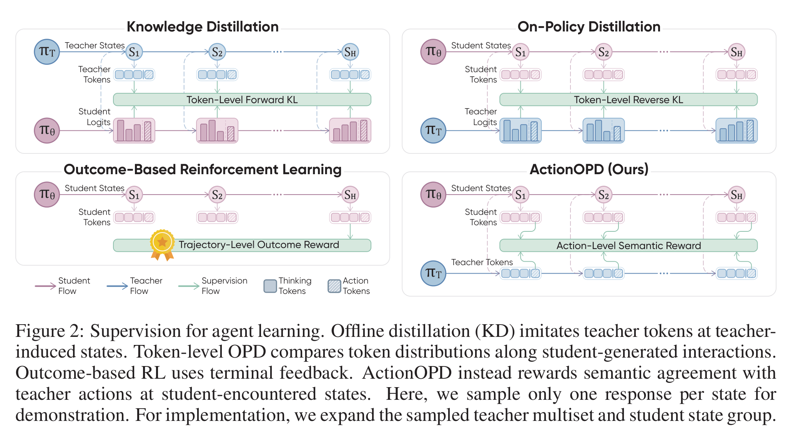
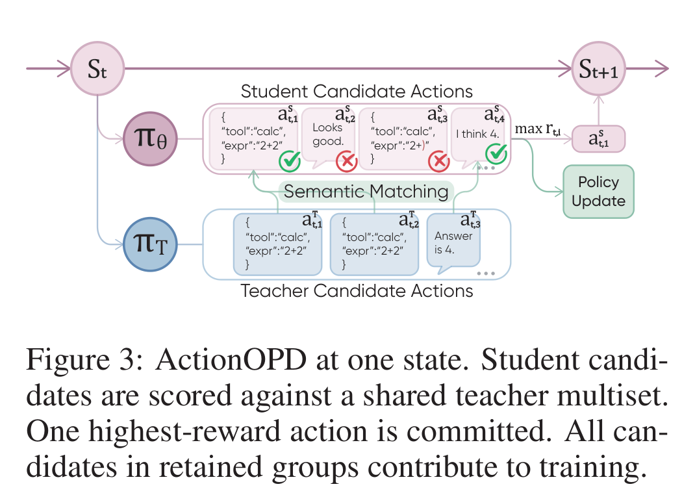

# ActionOPD 阅读笔记：Distilling Decisions, Not Tokens

## Summary

ActionOPD 把 agent 蒸馏的监督单位从 token 改为 semantic action。它在 student 访问的状态上，只调用黑箱 teacher 生成若干回复，再判断 student 与 teacher 是否表达同一个工具调用或沟通意图；因此不需要 teacher logits、相同 tokenizer 或相同模型家族。训练仍更新 student 自己的 reasoning/action token，但奖励来自整段 action 的语义一致性。



*图源：ActionOPD 原文 Figure 2。*

## 为什么 token 对齐不等于 action 对齐

Offline KD 和 token-level OPD 都可能学到正确 action，但 loss 本身不知道哪些字符串在环境中等价。例如两个 JSON tool call 只有参数顺序不同，或两句话措辞不同但都表示“基础经济舱不能改签”，token 分布可以相差很大，semantic action 却相同。

ActionOPD 用状态相关映射 `φ_s(y)` 把完整回复 `y` 转成 action，并优化 teacher action 在 student 下的总概率质量：

```math
\pi_\theta(a_T\mid s)
=\sum_y \pi_\theta(y\mid s)\mathbf{1}\{\phi_s(y)=a_T\}
```

这不是要求 student 复现某一条 teacher reasoning，而是允许任何语义等价的 student 表达获得奖励。

## 黑箱 Teacher 与语义匹配

主实验的 action teacher 是 Qwen3.7-Flash 和 DeepSeek-V4-Flash，student 是 Qwen3-4B/8B。Teacher 只需接受普通生成请求：输入任务、工具 schema、当前 observation 和保留的交互历史，输出即时 action；不需要返回 token probabilities。

工具调用先由程序比较 tool name 和规范化参数，无法确定的参数差异再交给冻结 LLM。自然语言先做 normalized exact match，否则由冻结 LLM 比较意图和事实。Matcher 不比较 reasoning，无效或无法解析的 action 永不匹配。

在同一状态，teacher 独立采样 `K=3` 个回复。对一个 student 回复 `y`，公式 (5) 统计语义匹配次数：

```math
c(s,y)=\sum_{k=1}^{K}m_s(y,y_k^T)
```

多样本用于粗略近似 teacher 的 action 分布。只采一个会把随机 action 当成唯一答案；`K=3` 是覆盖率与 API 成本的工程折中，并非理论最优。

奖励公式 (6) 为：无效 action 得 `-1`，合法但零匹配得 `0`；至少匹配一次先得 `1`，额外匹配只获得频率 bonus。

```math
r_\lambda(s,y)=
\begin{cases}
-1,& y\text{ 无效},\\
0,& y\text{ 合法且 }c=0,\\
1+\lambda\dfrac{c-1}{K-1},& c>0.
\end{cases}
```

论文取 `K=3, λ=0.5`，所以匹配 1/2/3 个 teacher sample 的奖励分别是 1/1.25/1.5。较小 bonus 可降低三个样本带来的频率估计噪声。

## State-group Rollout 与优化



*图源：ActionOPD 原文 Figure 3。*

每个 student 可见状态 `s_g` 同时采样 `N=4` 个 student candidates，并共享同一组 `K=3` teacher samples。四个候选都被评分，但只有最高奖励的 student action 被环境执行，产生下一 observation；所有保留 group 的候选都参与训练。

这里的 state 不是模型内部 hidden state，而是可序列化的公共上下文。系统把 task、tool schemas、历史消息、当前 observation 作为 teacher API 的 messages/tools 输入；主实验不提供 simulator hidden state、verifier 或私有任务答案。

优化本质上是 GRPO-style，而不是带 critic 的 PPO。组内平均奖励作为 baseline，不训练 value model；然后使用新旧 student token 概率比和 PPO clipped surrogate 更新所有 reasoning/action token。更准确的概括是：

> teacher-guided state-group rollout + semantic action reward + critic-free GRPO-style update。

由于每一步执行 group 中最高奖励 action，访问状态受到 teacher 引导，不再是普通 student policy 的纯 on-policy 分布，论文也承认存在一定 off-policy state visitation。

## 为什么叫 OPD，而不直接叫 RL

ActionOPD 没有使用经典 token-level OPD 的 reverse KL，但延续了 OPD 的核心数据逻辑：在 student 实际访问的环境状态上在线查询 teacher，让监督覆盖 student 会犯错的状态。更准确地说，teacher 不是接在 student 当前 token prefix 后续写，而是读取同一个公共环境状态，独立采样自己的 action。

“蒸馏”和“RL”描述的是不同维度。蒸馏描述监督来源：奖励由 teacher action 的语义一致性定义，目标是把 teacher decision transfer 给 student；RL 描述优化方式：该 action-level 目标经 REINFORCE 推导后，用无 critic 的 GRPO/PPO-style policy gradient 更新 student。它没有使用环境终局 reward，所以不同于论文 Figure 2 中的 outcome-based RL。

因此 ActionOPD 可以同时被称为 **teacher-supervised RL** 和 **action-level on-policy distillation**。如果删除 teacher、只用任务成功奖励，它才更接近普通 RL；如果只收集 teacher 轨迹再离线 SFT，则是 offline KD。这里的 “on-policy” 也不是严格纯净的：状态起于 student rollout，但每步执行 group 中 teacher-score 最高的候选，状态分布带有 teacher guidance。

## Baseline、实验与边界

黑箱主实验只能直接比较 Base、ActionOPD student 和 teacher 本身，不能运行需要 teacher logits 的传统 reverse-KL OPD。为了比较蒸馏方法，论文另用可访问 logits 的 Qwen3-32B teacher 和 Qwen3-4B student，在 τ²-bench 上比较 offline KD、OPD 与 ActionOPD。ActionOPD 的 test pass1 为 40.0，高于 OPD 39.6 和 KD 37.5；但 pass4 为 14.2，低于 OPD 17.5 和 KD 19.2，不能声称全面更优。

训练数据来自 AWM 与 EnvScaler，它们不计入最终四个 OOD benchmark。迁移评测具体包括：

- [BFCL Multi-turn](https://gorilla.cs.berkeley.edu/leaderboard.html)：多轮 function/tool calling，本文报告 accuracy。
- [ToolSandbox](https://github.com/apple-aiml-research/ToolSandbox)：带世界状态和工具依赖的对话式任务；本文使用 verified-local-only 子集并报告 trajectory similarity，不是二元成功率。
- [AppWorld](https://appworld.dev/)（[官方代码](https://github.com/StonyBrookNLP/appworld)）：在模拟日常应用中进行交互式 API 调用；本文评测 Normal/Challenge，报告 task goal completion 与 scenario goal completion。
- [τ²-bench](https://github.com/sierra-research/tau2-bench)：Airline、Retail、Telecom 三个客户服务域；本文报告 pass1 和 pass4，其中 pass4 表示四次 trial 全部成功，不是 best-of-four。

这些都不是 vision-language 或 GUI benchmark。BFCL 评测结构化 function call；ToolSandbox 是文本对话加状态化工具；AppWorld 虽然模拟日常 app，但 agent 操作的是 API/代码和数据库状态，不看截图、不点击 GUI；τ²-bench 是文本客服对话加工具调用。本文因此没有验证视觉理解、屏幕定位或 GUI 点击能力。

Table 1 的 Average 对四个 benchmark 等权：AppWorld 使用 Normal/Challenge TGC 的均值，τ²-bench 使用三个 domain 的 pass1 均值。四组黑箱师生配置相对 Base 的平均分提升 3.3–6.9 个百分点。

主要限制是 semantic agreement 不等于正确性：teacher 错误会成为监督，LLM matcher 也可能误判。固定的 teacher/student 样本数还可能找不到本来存在的语义匹配。

## 代码与原文

官方代码：https://github.com/thu-nics/ActionOPD 。`agent_system/` 实现环境适配与 state-group rollout，`gigpo/` 实现 group-relative advantage，`verl/` 负责策略训练。公开版本不包含论文 KD/OPD baseline 的本地实现，也未开放 Self-ActionOPD 和消融启动配置。

原文：[ActionOPD PDF](../Action-OPD.pdf)，重点参见 Figure 2–3、§2.1–2.3、§3.1–3.4 与 Appendix B.2。
