# Agentic On-Policy Distillation 发展脉络（2026.10）重制版

> 本文档根据所给长图的内容结构重新制作。方法图来自对应论文官方 arXiv source，公式依据论文原式重新排版；中文总结为结构化重写，不是原图影印。

## 01 · Agentic OPD：从三个失效假设出发

Single-turn token distillation 的默认前提，在 multi-turn environment interaction 中同时破裂

### 三个失效假设

**论文：** [Agentic On-Policy Distillation: A Comprehensive Survey](https://arxiv.org/abs/2604.00626)（2604.00626v5）

Single-turn OPD 通常把 Student rollout prefix 视为固定输入，在每个 token 上匹配 Teacher distribution。进入 Agent 场景后，action 会改变 observation、memory 和后续可达状态，因此局部 KL 不再自动等价于正确的长程 credit。

- 假设 1：监督单位与 credit 单位一致。Agent turn 同时包含 reasoning、tool arguments 和非决策 observation tokens。
- 假设 2：Teacher 在 Student 到达的状态上仍然可靠。错误 tool call 会把轨迹推入 Teacher 很少见的状态。
- 假设 3：Teacher–Student likelihood ratio 可以直接充当 value/advantage。它首先衡量 imitation gap，不保证与任务结果因果一致。

$$
\mathcal L_{\mathrm{OPD}}=\mathbb E_{y\sim\pi_\theta}\sum_t D_{\mathrm{KL}}\!\left(\pi_\theta(\cdot\mid y_{<t})\,\|\,\pi_T(\cdot\mid y_{<t},c)\right)
$$

### 四条研究主线

**论文：** [从 supervision granularity 到 temporal credit assignment](https://arxiv.org/abs/2604.00626)（2604.00626v5）

2026 年的 Agentic OPD 工作并不是沿一条线演进，而是在四个相互耦合的问题上同时推进。

- 监督与 credit 粒度：SOD、StepOPSD、TurnOPD。
- Covariate shift 与状态覆盖：Revisiting DAgger、Guided-OPD、SAGE-OPD、ReOPD。
- Privileged information asymmetry：Skill-SD、AR-OPD、HINT。
- Temporal credit assignment：OPPO、PBSD、AgentOPSD、CrEST、TASPO。

$$
\text{local matching}\;\neq\;\text{credit for reaching the matched state}
$$

> **本页结论：** 读图方式：后续方法分别回答“监督是否可信、状态如何覆盖、Teacher 知道什么、结果如何回传”。

---

## 02 · 为什么需要 Agentic OPD？

从整段 token matching，走向错误传播下的 step-wise reliability

### SOD

**论文：** [Step-wise On-policy Distillation for Small Language Model Agents](https://arxiv.org/abs/2605.07725)（2605.07725v3）

多轮工具交互中，一个错误 action 会注入大段异常 observation。后续状态逐步离开 Teacher support，统一累加 OPD loss 会把高方差监督当成同等可靠。

- 按模型生成步骤聚合 Student–Teacher log-prob gap，而不是把整条 trajectory 视作同质 token 流。
- 前一步分歧变大时降低当前 step 权重；策略恢复时允许权重回升，并限制最大放大幅度。
- I_k 是第 k 个生成步骤的 token 集合；论文使用 ε=10⁻⁶ 稳定比值，并以 δ 限制最大放大幅度。
- 核心贡献是 reliability weighting；它仍以 disagreement 作为 proxy，不等价于真实因果责任。

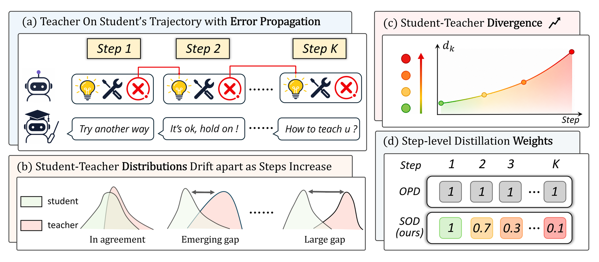

$$
\Delta_k=\frac1{|\mathcal I_k|}\sum_{t\in\mathcal I_k}D_{\mathrm{KL}}\!\left(\pi_\theta(\cdot\mid y_{<t})\,\|\,\pi_T(\cdot\mid y_{<t})\right)
$$

$$
d_k=\frac{1}{|\mathcal I_k|}\sum_{t\in\mathcal I_k}\left|\log\pi_\theta(y_t\mid y_{<t})-\log\pi_{\mathrm{teacher}}(y_t\mid y_{<t})\right|
$$

$$
w_k=\min\!\left(w_1\prod_{u=1}^{k-1}\frac{d_u+\epsilon}{d_{u+1}+\epsilon},\,1+\delta\right)
$$

> **本页结论：** Agentic OPD 的第一条主线：先判断当前 step 的 Teacher signal 是否还可信。

---

## 03 · 把 Hindsight 变成 Step-level Credit

StepOPSD：不改变在线 rollout，只在事后重塑 advantage

### StepOPSD

**论文：** [Step-Aware Online Preference Self-Distillation for Agent Reinforcement Learning](https://arxiv.org/abs/2605.27140)（2605.27140v2）

Student 仍按原策略与环境交互；rollout 完成后，将轨迹切成 causal action spans，并在加入 hindsight 的 Teacher context 下重评分同一 token。

- Teacher–Student likelihood gap 提供 dense token preference，但不替换环境给出的 outcome advantage。
- 用 advantage 符号决定 gap 的方向，再经过 sigmoid 与 clip 得到有界 credit weight。
- 每个 step 单独归一化到相同 contribution budget，避免长 action 因 token 更多而占据更大梯度。
- 最终只调节 GRPO advantage 的幅度，保留原始 outcome 的正负方向；GRPO update 本身不变。

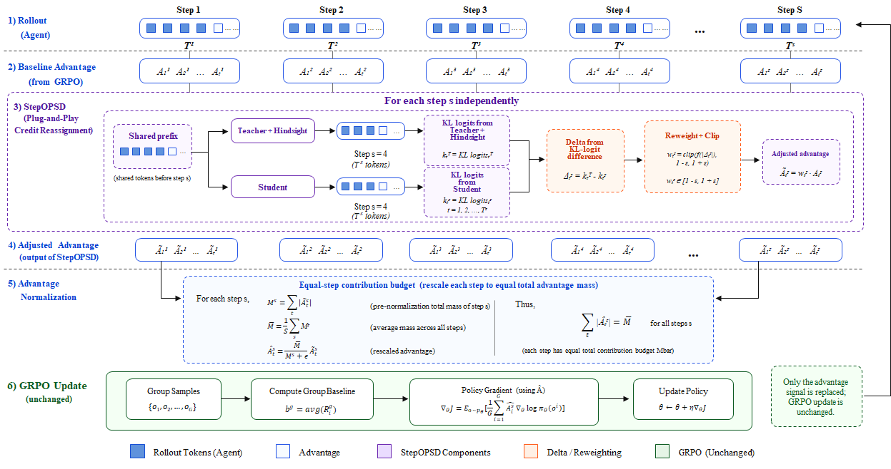

$$
\Delta_{k,j}=\log\pi_T(z_{k,j}\mid c_k^T,z_{k,<j})-\log\pi_S(z_{k,j}\mid c_k^S,z_{k,<j})
$$

$$
w_\ell=\Pi_{[1-\alpha_{\mathrm{clip}},\,1+\alpha_{\mathrm{clip}}]}\!\left(2\sigma(\operatorname{sign}(A_\ell)\Delta_\ell)\right)
$$

$$
\widetilde A_\ell=(1-\lambda_{\mathrm{mix}})A_\ell+\lambda_{\mathrm{mix}}(w_\ell A_\ell)
$$

> **本页结论：** 变化：Teacher 不再只提供 imitation target，而开始参与 outcome credit 的局部再分配。

---

## 04 · 让 OPD 感知 Turn 与 Horizon

TurnOPD：训练多深、每个 turn 占多大权重，都由在线统计控制

### TurnOPD

**论文：** [Making On-Policy Distillation Turn-Aware for Efficient Long-Horizon Agent Training](https://arxiv.org/abs/2607.05804)（2607.05804v2）

Vanilla OPD 在长 horizon 中出现外部错配与内部错配：Teacher uncertainty 和 reverse-KL 随 turn 加深，深层 token 又可能在 trajectory normalization 下占据过多 loss。

- 用每 turn KL 与 survivor ratio 估计有效 rollout 深度。
- 再用成功轨迹长度分位数给出 coverage lower bound，避免 horizon 过短。
- 从 token/trajectory-normalized loss 线性切换到 turn-normalized loss，减少长 turn 对梯度的垄断。
- 论文同时优化收集多少 rounds 与如何分配 loss，并报告最高约 2.29× 的训练加速。

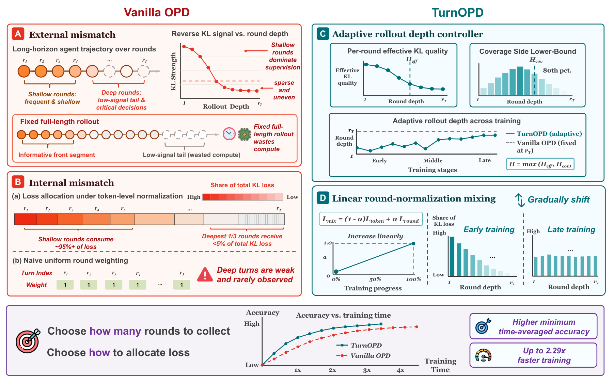

$$
H_{\mathrm{ctrl}}=\max(H_{\mathrm{eff}},H_{\mathrm{cov}})
$$

$$
\mathcal L_{\mathrm{mix}}=(1-\alpha)\mathcal L_{\mathrm{token}}+\alpha\mathcal L_{\mathrm{round}}
$$

$$
q_t^{\mathrm{blend}}=(1-\alpha)\frac{n_t}{\sum_jn_j}+\alpha\frac1T,\qquad H_{\mathrm{cov}}=Q^p(L_{\mathrm{succ}})
$$

> **本页结论：** Agentic OPD 的第二条主线：监督不仅要可信，还要控制暴露到多深的状态分布。

---

## 05 · 控制 Student 访问的状态分布

从 DAgger 的 Teacher mixing，到 Guided-OPD 的 curriculum turn guidance

### Revisiting DAgger

**论文：** [Revisiting DAgger in the Era of LLM-Agents](https://arxiv.org/abs/2605.12913)（2605.12913v1）

仅在 Teacher demonstrations 上 SFT 会遭遇 covariate shift；纯 Student rollout 又会在冷启动时迅速进入无效状态。DAgger 在每个 turn 随机选择 Teacher 或 Student，并收集 Teacher labels。

- 逐 turn mixture 扩大可恢复状态覆盖；β_i 随训练逐渐衰减到 0。
- 另一种 prefix mixing 在选定切点后由 Teacher 接管后续 turns。
- 聚合数据集上的训练目标仍是 Teacher action 的交叉熵。

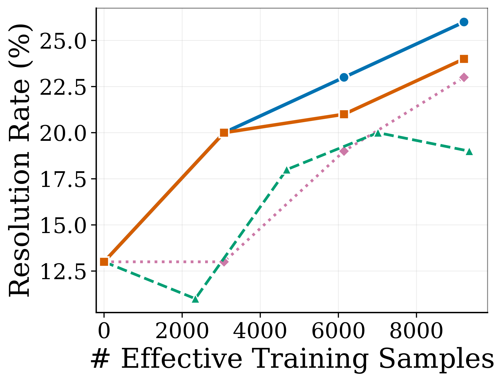

$$
\mu_i=\beta_i\pi_e+(1-\beta_i)\pi_{\theta_i}
$$

$$
p_i^{\mathrm{turn}}(b_{1:T})=\prod_{t=1}^{T}\beta_i^{b_t}(1-\beta_i)^{1-b_t}
$$

### Guided-OPD

**论文：** [On-Policy Distillation with Curriculum Turn-level Guidance for Multi-turn Agents](https://arxiv.org/abs/2606.15912)（2606.15912v3）

Guided-OPD 将 DAgger 式混合嵌入 OPD：训练早期 Teacher turns 较多，随后按 curriculum 衰减到纯 Student on-policy rollout。

- Teacher turn 使用 forward-KL；Student turn 使用 reverse-KL。
- Early guidance 把轨迹锚定在 Teacher 熟悉区域，随后逐步增加 Student turns。
- 最终阶段 β=0，与标准 OPD 一致。

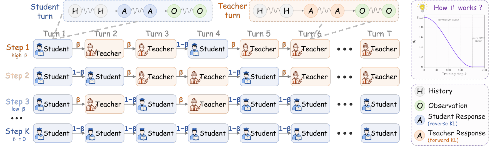

$$
a_t\sim\begin{cases}\pi_\theta(\cdot\mid h_t),&1-\beta_t\\\pi_\phi(\cdot\mid h_t),&\beta_t\end{cases}
$$

$$
\beta_t=\beta_{\mathrm{start}}+(\beta_{\mathrm{end}}-\beta_{\mathrm{start}})\frac{1-\cos(\pi\xi_t)}2
$$

$$
\mathcal L_t=(1-\beta_t)\mathcal J_{\mathrm{rKL}}^{\pi_\theta}+\beta_t\mathcal J_{\mathrm{fKL}}^{\pi_\phi}
$$

> **本页结论：** 关键取舍：Teacher intervention 改善状态覆盖，但 intervention 后的 history 不再是纯 Student on-policy。

---

## 06 · 选择性干预与 Offline Prefix Replay

不必在每个 turn 都调用 Teacher，也不必让环境在训练全程保持在线

### SAGE-OPD

**论文：** [Selective Agent-Guided Intervention for Multi-Turn On-Policy Distillation](https://arxiv.org/abs/2606.19659)（2606.19659v1）

Intervention Agent 依据 Student response、Teacher disagreement 与 confidence，在 Skip / Weak / Strong 三档之间选择。

- Intervention intensity 为 0 / α / 1，分别对应 Skip / Weak / Strong。
- Teacher confidence 沿 Student action prefix 聚合，抑制低置信 Teacher 的干预。
- 按实际被监督 token 数归一化，保持 loss scale 稳定。

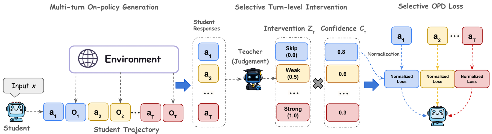

$$
c_t=\frac1{|a_t|}\sum_{i=1}^{|a_t|}\max_{v\in\mathcal V}\pi_\phi(v\mid h_t,a_{t,<i})
$$

$$
i_t\in\{0,\alpha,1\},\qquad s_t=i_tc_t
$$

$$
\mathcal L_{\mathrm{SAGE}}=Z\sum_t s_t\mathcal L_{\mathrm{OPD}}(h_t,a_t)
$$

### ReOPD

**论文：** [Multi-Turn On-Policy Distillation with Prefix Replay](https://arxiv.org/abs/2607.04763)（2607.04763v3）

Teacher trajectories 只需离线收集一次；Student training 通过 prefix replay 构造状态，环境无需始终在线，并让较早 step 获得更高权重。

- 用 Student / Teacher occupancy 的 geometric bridge 控制 replay distribution。
- γ_t 平衡 Student occupancy mismatch 与 Teacher prefix reliability，避免 prefix trap。
- Teacher-prefix 与 Student-prefix 样本分别用相反方向的 density ratio 校正；指数衰减近似长期 cost。

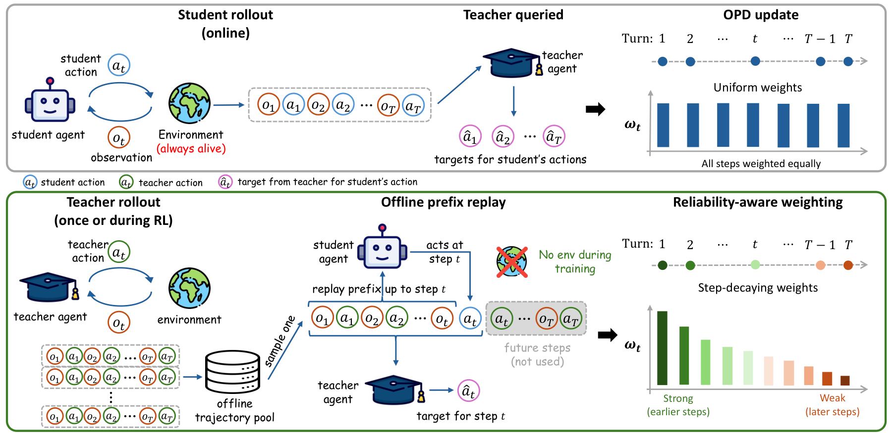

$$
\rho_t^*(h_t\mid x)\propto[d_t^{\theta_{\mathrm{old}}}(h_t\mid x)]^{\gamma_t}[d_t^T(h_t\mid x)]^{1-\gamma_t}
$$

$$
\gamma_t=\frac{\lambda_{\mathrm{stu},t}}{\lambda_{\mathrm{stu},t}+\lambda_{\mathrm{tea},t}},\quad w_t^T\propto\left(\frac{d_{\mathrm{old}}^t}{d_T^t}\right)^{\gamma_t}
$$

$$
\omega(t,\kappa)=\kappa^t
$$

> **本页结论：** 这一阶段开始同时优化监督质量、Teacher query 成本与 environment availability。

---

## 07 · 动态 Teacher 信息：从固定答案到 Skill

Skill-SD：Teacher privilege 来自 trajectory analysis，而不是唯一标准路径

### Skill-SD

**论文：** [Skill-Conditioned Self-Distillation for Multi-turn LLM Agents](https://arxiv.org/abs/2604.10674)（2604.10674v1）

Agent task 往往存在多条有效 action path。Skill-SD 将完成轨迹异步总结为 success analysis、mistake analysis 与 golden workflow，并存入 UCB-indexed skill buffer。

- Student 使用原始 prompt；Teacher 在同一 token prefix 上额外读取检索到的 skills。
- GRPO 提供 task-level credit；importance-weighted SDL 迁移 token-level Teacher distribution。
- Skill 由异步 summarizer 生成，并通过 UCB top-scoring buffer 在探索新技能与复用高价值技能之间平衡。
- 动态 Skill 解决 Teacher 应该知道什么，但不直接解决后续 outcome 对早期 action 的因果归因。

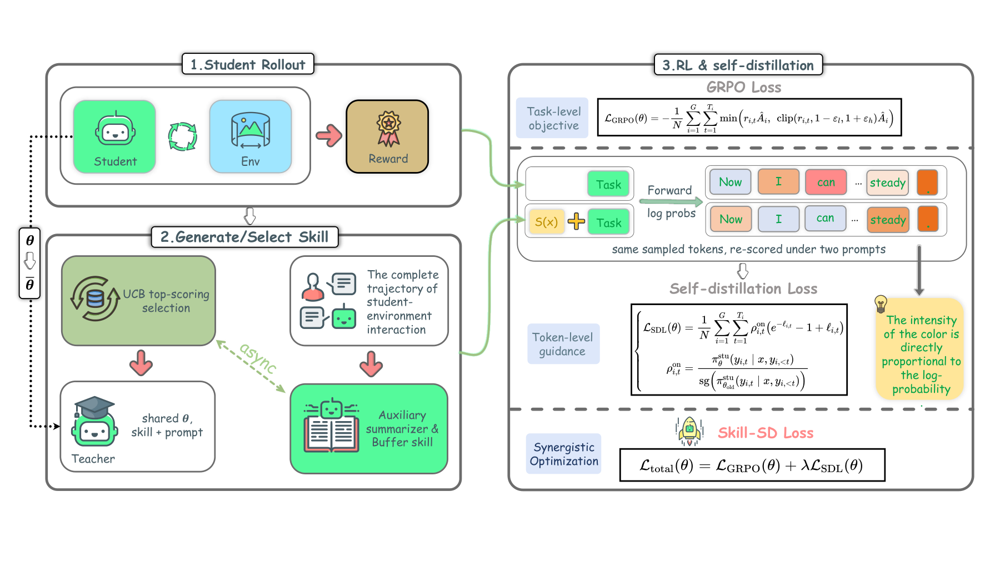

$$
e=\operatorname{Analyze}(\tau,x)=(e_{\mathrm{success}},e_{\mathrm{mistake}},e_{\mathrm{workflow}})
$$

$$
\ell_{i,t}=\log\pi_\theta^{\mathrm{stu}}(y_{i,t}\mid x,y_{i,<t})-\log\pi_{\bar\theta}^{\mathrm{tea}}(y_{i,t}\mid x,S(x),y_{i,<t})
$$

$$
\mathcal L_{\mathrm{SDL}}=\frac1N\sum_{i,t}\rho_{i,t}^{\mathrm{on}}\left(e^{-\ell_{i,t}}-1+\ell_{i,t}\right)
$$

$$
\mathcal L_{\mathrm{total}}=\mathcal L_{\mathrm{GRPO}}+\lambda\mathcal L_{\mathrm{SDL}}
$$

> **本页结论：** Agentic OPD 的第三条主线：privileged information 从静态 oracle 走向随经验演化的可检索技能。

---

## 08 · 信息不对称：Privileged Teacher 也可能误导

AR-OPD 校准 support mismatch；HINT 把 hindsight 压缩到真正的 decision fork

### AR-OPD

**论文：** [Beyond Absolute Imitation: Anchored Residual Guidance for Privileged On-Policy Distillation](https://arxiv.org/abs/2606.10385)（2606.10385v1）

Full privileged context 可能让 Teacher 依赖 Student 永远看不到的答案状态。AR-OPD 先构造 partial anchor，再只迁移 full view 相对 anchor 的 residual。

- Anchor 保留可由 Student 重建的支持。
- M_out 衡量 privileged Teacher 落到 Student 低支持 token 上的概率质量。
- λ 控制 privileged residual 强度，避免把 oracle shortcut 当作绝对模仿目标。

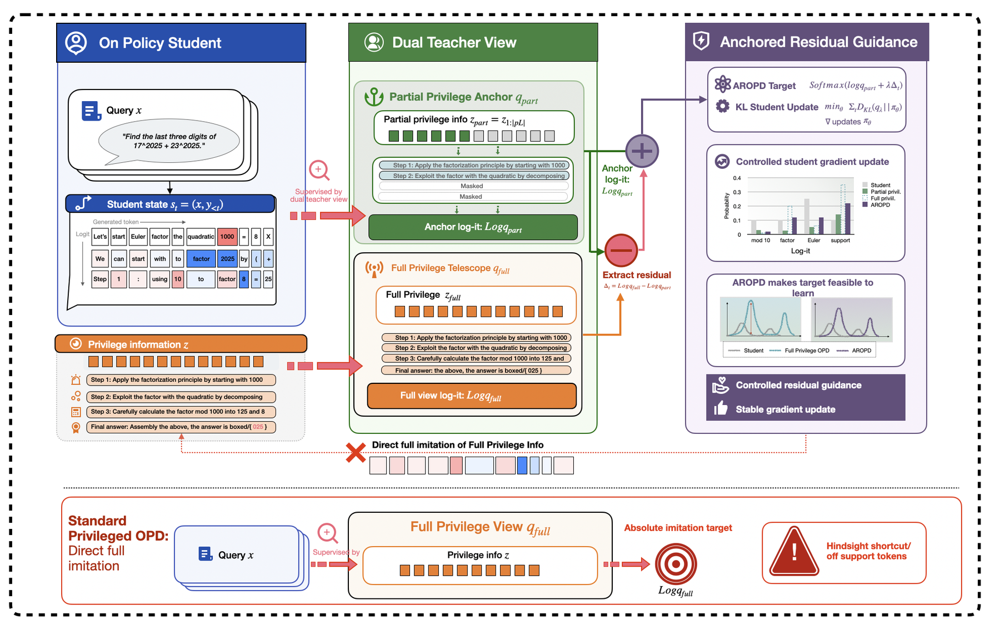

$$
M_\tau^{\mathrm{out}}=\sum_{v:\,\pi_{\mathrm{stu}}(v\mid s)<\tau}\pi_{\mathrm{priv}}(v\mid s)
$$

$$
\log q_\lambda=\log q_{\mathrm{part}}+\lambda(\log q_{\mathrm{full}}-\log q_{\mathrm{part}})-C_t
$$

### HINT

**论文：** [Multi-Turn Agent Self-Distillation with Compressed Hindsight](https://arxiv.org/abs/2606.11559)（2606.11559v2）

Reflector 将完整 trajectory outcome 压缩为 turn-level diagnosis 与可选纠正动作，只在识别出的错误 turns 蒸馏。原始长图写作 HERO，但对应论文和方法实际为 HINT。

- Teacher context 注入 diagnosis，而不是泄露完整参考答案。
- Reflector 将终局反馈拆成每个错误 turn 的 diagnosis 与可选纠正 action。
- 使用对称、有界的 JSD，并只在识别出的错误 turns 上聚合。

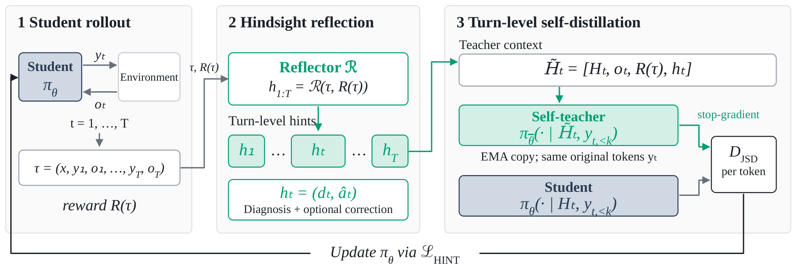

$$
h_t=(d_t,\hat a^t),\qquad q_t=\operatorname{sg}[\pi_{\bar\theta}(\cdot\mid x,y_{<t},h_t)]
$$

$$
D_{\mathrm{JSD}}(p_t,q_t)=\tfrac12D_{\mathrm{KL}}(p_t\|m_t)+\tfrac12D_{\mathrm{KL}}(q_t\|m_t)
$$

$$
\mathcal L_{\mathrm{HINT}}=\frac1{|I(\tau)|}\sum_{t\in I(\tau)}\ell_t
$$

> **本页结论：** 新问题：Teacher 拥有更多信息不代表它在 Student state 上一定校准良好。

---

## 09 · Bayesian Credit：从证据增量到 Turn Advantage

OPPO 给出 token-level value recursion；PBSD 将 privileged evidence 引入长程 Agent

### OPPO

**论文：** [Bayesian Value Recursion for Token-Level Credit Assignment in LLM Reasoning](https://arxiv.org/abs/2605.21851)（2605.21851v2）

把每个 token 的 likelihood ratio 视为 Bayesian evidence，递归更新成功概率；相邻 value 的变化就是局部 advantage。

- λ_t* 是成功条件与失败条件下当前 token likelihood 的 Bayes factor。
- Token advantages telescoping 到最终 reward 与初始 value 的差。
- 一阶近似把 credit 分解为 uncertainty × evidence，并用 sequence outcome 符号校准方向。

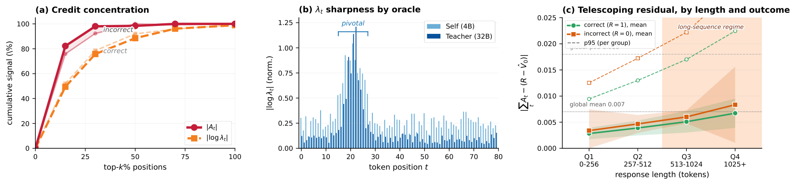

$$
V_t=P(R=1\mid x,y_{1:t-1}),\qquad \lambda_t^*=\frac{P(y_t\mid x,y_{<t},R=1)}{P(y_t\mid x,y_{<t},R=0)}
$$

$$
V_{t+1}=\frac{\lambda_t^*V_t}{\lambda_t^*V_t+(1-V_t)},\qquad A_t^{\mathrm{raw}}=V_{t+1}-V_t
$$

$$
\widehat A_{i,t}=\operatorname{sign}(A_i^{\mathrm{seq}})|A_{i,t}^{\mathrm{raw}}|,\qquad \sum_t A_t=R-V_0
$$

### PBSD

**论文：** [Privileged Bayesian Self-Distillation for Long-Horizon Credit Assignment](https://arxiv.org/abs/2606.09348)（2606.09348v2）

比较有/无 privileged outcome information 时当前 action 的 likelihood，得到 turn-level evidence score，再通过 decision gate 调整 sequence advantage。

- Bayes identity 将 outcome posterior 转换为 trajectory evidence ratio，并分解为 turn evidence。
- 成功轨迹可能含坏动作、失败轨迹也可能含好动作；binary reward 无法表达这种局部差异。
- 有界 tanh 权重保留 sequence reward 的方向，同时在 turn 内重新分配幅度。

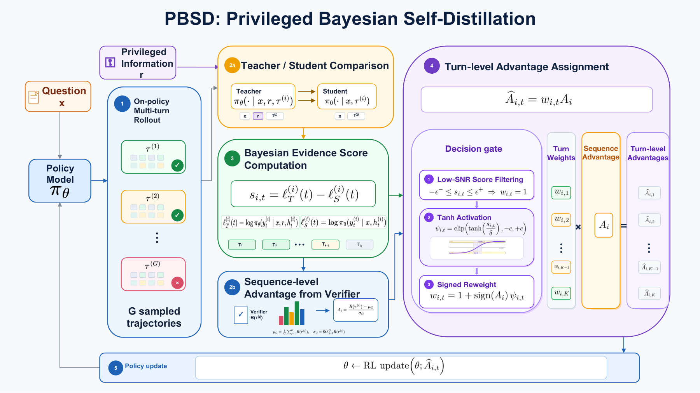

$$
S_i=\log\frac{p(y^*\mid x_i,\tau_i)}{p(y^*\mid x_i)}=\sum_t s_{i,t}
$$

$$
s_{i,t}=\log p(a_{i,t}\mid x_i,\tau_{i,<t},y^*)-\log p(a_{i,t}\mid x_i,\tau_{i,<t})
$$

$$
\widetilde A_{i,t}=w_{i,t}A_i,\quad w_{i,t}=1+\operatorname{sign}(A_i)\operatorname{clip}\!\left(\tanh\frac{s_{i,t}}\delta,-c,c\right)
$$

> **本页结论：** Bayesian 视角把 Teacher gap 从“模仿误差”改写成“当前动作对成功结论提供了多少证据”。

---

## 10 · 递归与层级 Credit Assignment

AgentOPSD 用 belief revision 分 turn；CrEST 让 verifier 决定方向、Teacher 只教幅度

### AgentOPSD

**论文：** [Recursive Self-Distillation for Agentic Reinforcement Learning](https://arxiv.org/abs/2608.05987)（2608.05987v1）

先将 token-level privileged gap 聚合为 turn evidence，再递归更新成功 belief。相邻 belief revision 作为每个 turn 的局部 credit。

- 初始 belief B₀ 来自 clipped group success rate。
- γ 对历史 evidence 做递归折扣，避免早期信号永久主导。
- belief sensitivity B(1−B) 在模型最不确定时放大证据，最终 credit 与 sequence outcome 符号对齐。

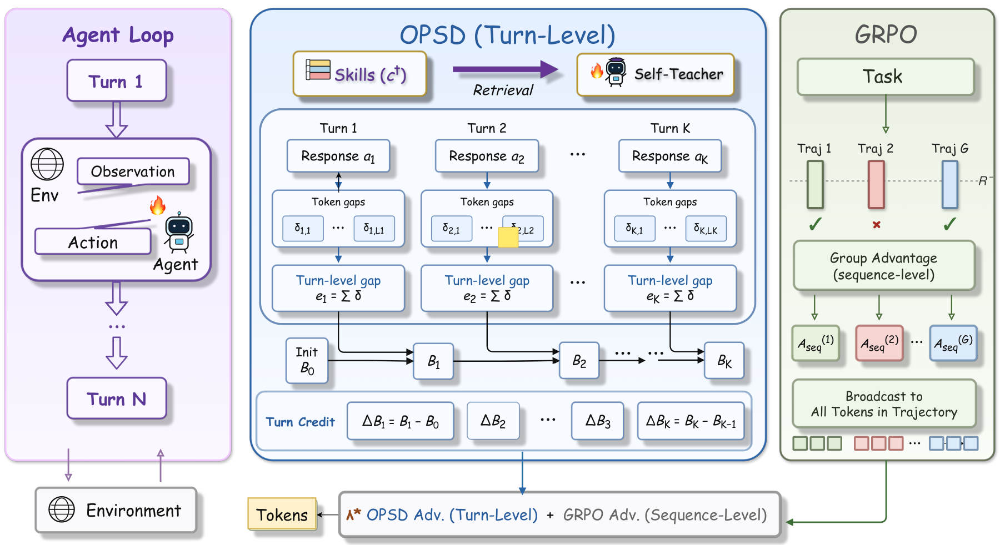

$$
e_k=\log\frac{\pi_\theta(a_k\mid s_k,c^+)}{\pi_\theta(a_k\mid s_k)},\qquad c_k=\gamma c_{k-1}+e_k
$$

$$
\ell_k=\operatorname{logit}(B_0)+c_k,\qquad B_k=\sigma(\ell_k)
$$

$$
\Delta B_k\approx B_{k-1}(1-B_{k-1})\left(e_k-(1-\gamma)c_{k-1}\right)
$$

### CrEST

**论文：** [Teach the Magnitude, Not the Direction](https://arxiv.org/abs/2608.13179)（2608.13179v2）

Teacher disagreement 不应决定更新方向。CrEST 让 environment verifier 提供 turn-level sign，self-teacher 只调节 token-level magnitude。

- Inter-turn credit 的方向来自 environment verifier。
- Intra-turn magnitude 由 entropy-gated Teacher gap 提供。
- 只有 Teacher preference 与 verifier direction 一致时才开启 modulation，并通过 clip 防止梯度集中。

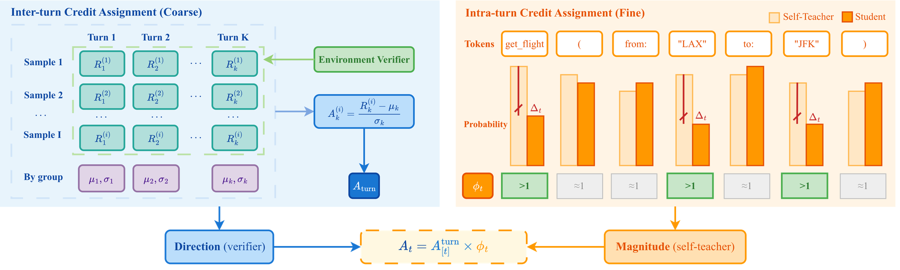

$$
\mathcal A_t=A_{[t]}^{\mathrm{turn}}\phi_t,\qquad \phi_t=1+\lambda_t^{\mathrm{eff}}(w_t-1)
$$

$$
w_t=\operatorname{clip}\!\left(\exp(\operatorname{sign}(A_{[t]}^{\mathrm{turn}})\Delta_t),1-\epsilon,1+\epsilon\right)
$$

$$
\lambda_t^{\mathrm{eff}}=\operatorname{clip}(\lambda g_t^{\mathrm{dir}}m_t^{\mathrm{ent}},0,\lambda)
$$

> **本页结论：** 方向与幅度解耦，是减少 privileged Teacher 误导风险的一条清晰设计原则。

---

## 11 · TASPO：Outcome-Constrained Process Supervision

用 verified successful siblings 构造 trajectory-aligned PI，同时守住 outcome advantage

### TASPO

**论文：** [Reconciling Process Supervision with Outcome-Based Credit in Agentic Policy Optimization](https://arxiv.org/abs/2608.31077)（2608.31077v2）

TASPO 从同任务的 verified successful siblings 提取与当前 trajectory 对齐的 privileged information，在 action level 计算 likelihood shift，并把它转换为有界、均值为 1 的 advantage weights。

- 权重始终为正，不翻转 outcome advantage 的符号。
- 每条 trajectory 上权重均值为 1，不改变总体 advantage budget。
- 局部 process supervision 只重新分配 credit，不覆盖 verifier 给出的成败结论。

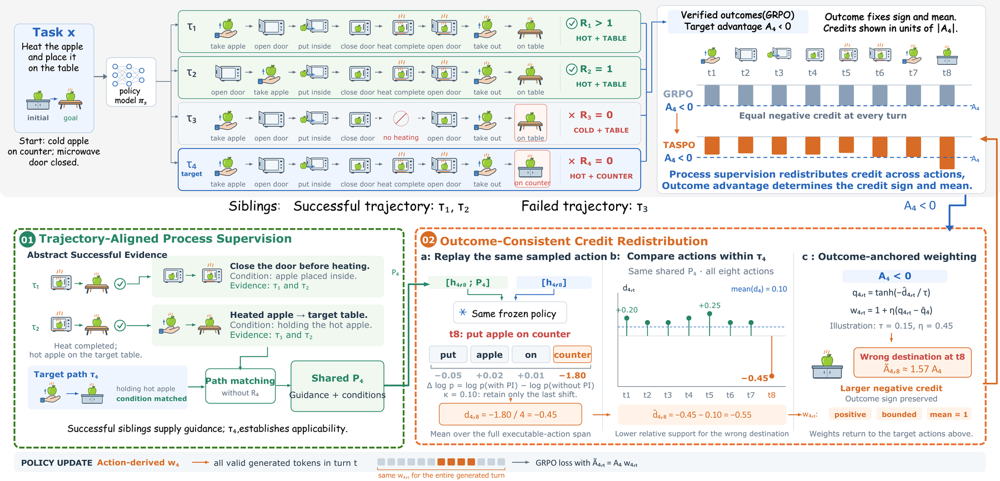

$$
\widetilde A_t^i=A_iw_t^i,\qquad 1-\epsilon_w\le w_t^i\le1+\epsilon_w,\qquad \frac1{T_i}\sum_t w_t^i=1
$$

$$
\Delta_{t,k}^i=\operatorname{sg}[\log\pi_{\theta_{\mathrm{old}}}(y_{t,k}^i\mid P_i,h_t^i,y_{t,<k}^i)-\log\pi_{\theta_{\mathrm{old}}}(y_{t,k}^i\mid h_t^i,y_{t,<k}^i)]
$$

$$
q_t^i=\tanh\!\left(\frac{\operatorname{sign}(A_i)\bar d_t^i}{\tau}\right)
$$

$$
w_t^i=1+\eta(q_t^i-\bar q_i)
$$

> **本页结论：** 发展脉络：局部 KL → step reliability → state coverage → dynamic PI → Bayesian/recursive credit → outcome-constrained redistribution。

---
