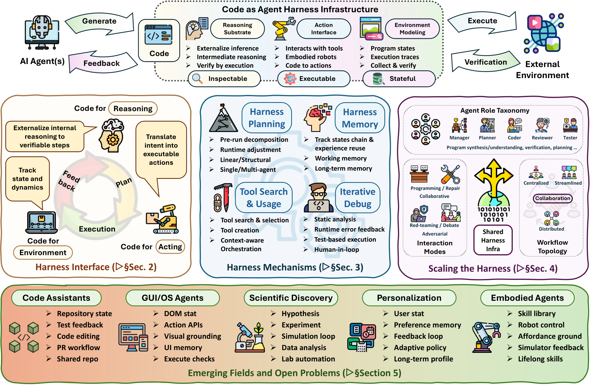
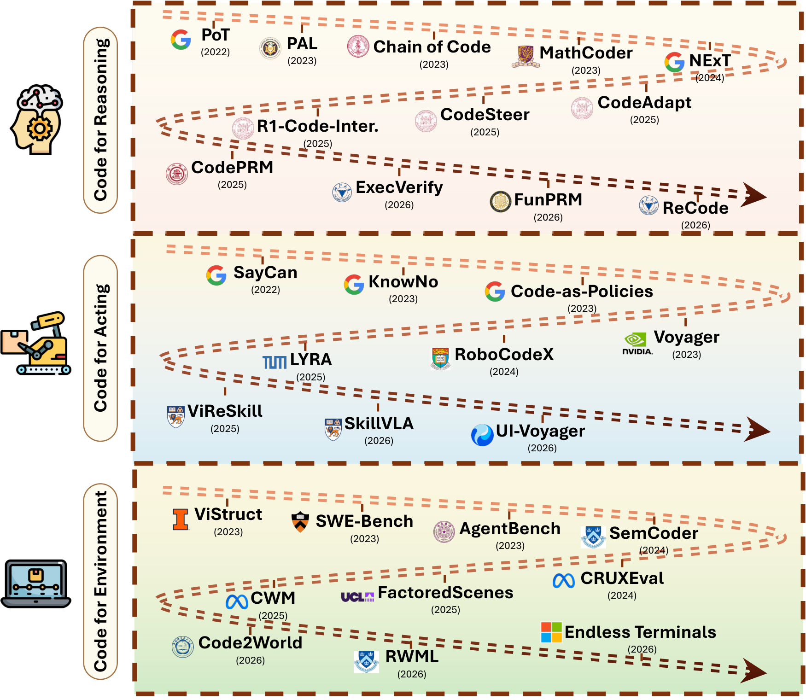
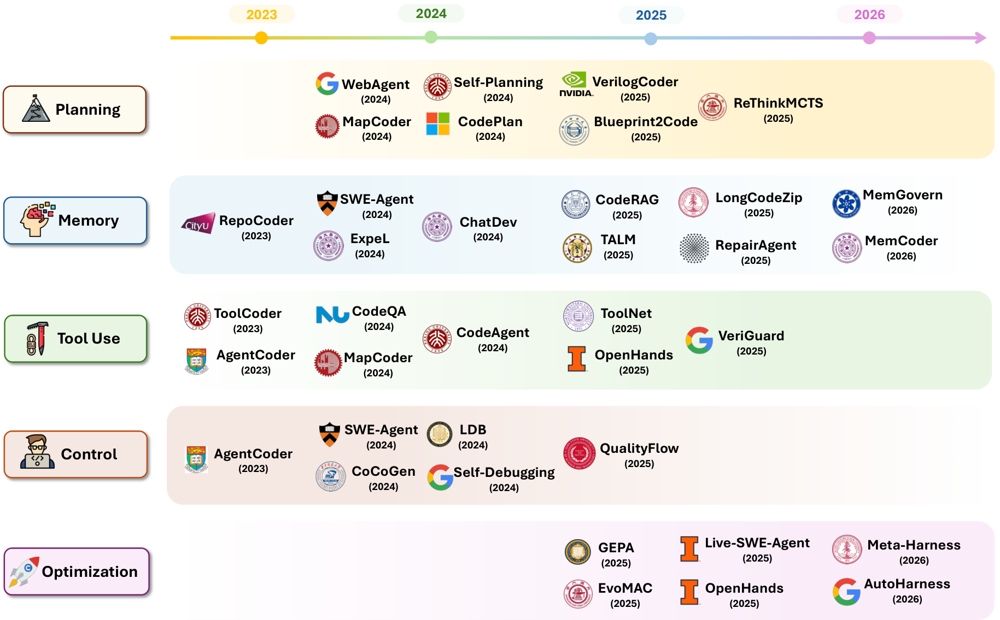

# Code as Agent Harness 阅读笔记：代码何时真正成为 Agent 的运行介质？

## Summary

*Code as Agent Harness: Toward Executable, Verifiable, and Stateful Agent Systems* 是一篇 survey/position paper，不是新算法论文。它提出的核心观察是：在 Agent 系统中，代码不再只是模型最后生成的目标产物，也逐渐成为模型进行推理、表达动作、表示环境、保存状态、接收执行反馈和协调多 Agent 的运行介质。

论文最有价值的贡献是概念统一和文献分类，而不是具体方法、实验或 reference implementation。其官方 GitHub 是 Awesome paper list，只有 README、figures 和维护文件，没有 `src/`、依赖、运行脚本或统一 Harness API。



*图源：原文 Figure 1。*

## 题目如何理解？

传统的 Code Generation 把代码视为最终答案：

```text
user request → model → generated program
```

Code as Agent Harness 则把代码放入持续闭环：

```text
model proposes code/action
→ runtime executes
→ verifier checks
→ state and traces persist
→ model revises or reuses artifacts
```

标题中的 `as` 表示一种观察视角：**Code 不只是输出，而是连接模型、工具、环境和反馈的 operational substrate。** 副标题中的三个词对应它希望从普通 token generation 获得的系统性质：

| 性质 | 含义 |
| --- | --- |
| Executable | 模型意图能成为真实操作，而非停留在描述 |
| Verifiable / Inspectable | 中间计算、动作效果和失败能被执行器或 verifier 检查 |
| Stateful | 计划、程序状态、repository、tests、logs 和 skills 能跨调用保存 |

但论文没有发明 Agent Harness。Software test harness、evaluation harness、agent scaffold/runtime、tool loop、sandbox 和 Agent-Computer Interface 都早已存在；本文是在既有工作上提出 code-centric taxonomy。

## 关键边界：不是“所有 Harness 底层都由 Python 实现”

所有数字 Agent 的 Harness 最终都由软件实现。如果这就是 “Code as Harness”，命题几乎没有区分度。更有意义的判别标准是：

> Code 或 machine-checkable artifact 是否进入 Agent 的闭环，成为它能生成、执行、观察、验证、持久化、复用或修改的一等对象？

需要区分：

```text
后台 implementation code
    Python 负责拼 prompt、请求模型、解析输出

model-facing executable artifact
    Agent 生成 tool call、程序、test、skill 或 workflow；
    runtime 执行并把结果作为下一步状态
```

论文对 `code` 的口径很宽，包括程序、scripts、API schemas、tool definitions、formal specifications、tests、repositories、simulators、config，以及被可执行系统消费的 traces/logs。原始视觉、人类意图、物理状态和模型内部 latent reasoning 不属于 code；它们只能通过代码被序列化、检查或操作。

## 第二章：Harness Interface

第二章回答：**Code 在模型与任务环境之间承担什么接口作用？** 作者分为 Code for Reasoning、Code for Acting 和 Code for Environment。

### Code for Reasoning

这里不是让代码替代全部思考，而是把可形式化、可计算、可搜索或可验证的推理外置为程序：

```text
natural-language problem
→ model chooses variables / algorithm / constraints
→ generated program executes
→ runtime returns value, trace or proof verdict
→ model interprets result
```

例如鸡兔同笼可以被形式化为约束枚举，组合题可以用程序穷举，定理可以交给 Lean kernel 检查。模型仍负责理解题意和正确形式化；程序负责精确执行。错误形式化会得到“执行完全正确但回答了错误问题”的结果。

### Code for Acting

Code for Acting 指模型通过 executable action interface 改变环境，例如：

```json
{
  "name": "click",
  "arguments": {"x": 521, "y": 384}
}
```

或者：

```text
click(x, y)
open_app(app_name)
input_text(text)
```

这里必须修正一个常见的错误对比：现代 Agent 的最终 action boundary 本来就不能只输出“点击右上角按钮”这种不可执行自然语言；它通常已经使用 JSON function call、XML tool call、API 或 DSL。因此普通 function call 在本文宽口径下本身就是最低层 Code for Acting。

更有区分度的层级是：

| 层级 | 例子 | Code-as-Harness 强度 |
| --- | --- | --- |
| Typed action | 单个 JSON/function call | 弱，现代 Agent 标配 |
| Programmatic policy | `if/loop/retry/assert` 控制多步动作 | 中，代码承担控制流与验证 |
| Persistent executable artifact | 可保存、组合、修改的 skill/workflow/test | 强，代码成为 Harness state |
| Agent-authored interface | Agent 创建新工具、verifier 或 Harness component | 最强，Harness 本身成为可修改对象 |

因此论文的 Code for Acting 主要是分类视角，不是新的 action mechanism。它没有实验证明 JSON、Python、DSL 或 behavior tree 哪种 representation 更优。

### UI-Voyager 为什么被放进 Code for Acting？

UI-Voyager 使用 AndroidWorld 预定义 Action DSL：`click(x,y)`、`swipe(...)`、`open_app(...)`、`input_text(...)`、`status(...)` 等。Runtime 解析并通过 Android/ADB 执行，所以它确实使用 code-defined action interface。

但 UI-Voyager 没有生成新程序、工具或 Harness。它的贡献是 RFT 和 GRSD：在固定 action space 上对齐成功/失败 GUI trajectories，并在 fork point 用成功 response 对失败 context 做 SFT。把它归入 Code for Acting 是宽口径 taxonomy，不代表其方法创新来自 code representation。

### Code for Environment

这一类把 environment state、transition 和 verifier 表示为 machine-checkable artifacts：

```text
repository + tests
DOM / accessibility tree
simulator state
program execution trace
renderable HTML world model
sandbox + executable checker
```

Code2World 把下一 GUI state 表示为可渲染 HTML；SWE-bench 用 repository、patch 和 tests 构造可执行环境；Endless Terminals 生成 terminal tasks 与 validators。它们中很多是 benchmark、world model 或环境基础设施，而不是完整 Agent Harness。



*图源：原文 Figure 3。图中混合了模型、训练方法、Agent、reward model、benchmark 和 environment，不能将每个条目都理解成独立 Harness。*

## Figure 3 应该怎样读？

Figure 3 不是作者提出的一组 Harness，而是三个接口角色的代表性文献：

| 分类 | 图中代表 | 实际对象类型 |
| --- | --- | --- |
| Reasoning | PAL、PoT、NExT、CodePRM、ExecVerify | program-aided reasoning、trace training、process reward/verifier |
| Acting | SayCan、Code-as-Policies、Voyager、UI-Voyager | skill selection、program policy、lifelong skill agent、GUI policy |
| Environment | SWE-bench、CRUXEval、CWM、Code2World | benchmark、execution task、world model、GUI state model |

这些工作只共享“Code 在闭环中承担某种 interface role”，其研究对象和因果贡献并不相同。把它们放在一张 timeline 上有助于检索文献，但容易制造一个并不存在的统一技术路线。

## 第三章：Harness Mechanisms

第二章只说明模型与世界通过什么形式连接；拥有 executable interface 仍不足以完成长程任务。第三章回答：**如何组织这些接口，使 Agent 能持续、可靠地运行？**

论文分为五类：

1. **Planning**：分解任务、维护计划、搜索候选 trajectories 和编排 roles；
2. **Memory**：保存 working state、repository evidence、经验和长期状态；
3. **Tool Use**：搜索/选择工具、创建工具、控制权限与参数；
4. **Control**：Plan–Execute–Verify、tests、runtime errors、重试、回滚和 human gate；
5. **Optimization**：根据 telemetry 修改 prompt、tool、workflow 或 Harness code。

可以把章节关系概括为：

```text
第二章：Code 能承载什么？
第三章：这些 artifacts 如何被组织和治理？
第四章：多个 Agent 如何在共享 artifacts 上协作？
```



*图源：原文 Figure 4。它仍是宽口径文献分类，不是统一实现。*

## 第四章：Scaling the Harness

多 Agent 场景中，代码被视为共享协作介质：planner、coder、reviewer、tester 和 executor 通过 repository、diff、tests、logs、schemas 与 blackboard 交换状态。论文讨论 role specialization、interaction mode、workflow topology、execution feedback、shared-state synchronization 与 convergence。

其核心判断是：多 Agent 的关键不只是“增加更多模型调用”，而是建立权威、持久、可执行的共享状态。否则不同 Agent 会基于过期 repository、不同 test result 或不一致计划行动。

## 与传统 Harness 的关系

传统 Agent Harness 本来就可能包含 reasoning、acting 和 environment：

```text
prompt/context
memory
function calls
execution environment
parser/verifier
retry/termination
```

本文的差异不是发明这些组件，而是强调它们可以围绕 executable artifacts 统一：reasoning 变成程序或 proof，action 变成 typed command/policy，environment 变成 repository/simulator/test，memory 变成 files/skills/traces，verification 变成执行结果。

与本仓库论文相比：

| 工作 | Harness 对象 | 与本文关系 |
| --- | --- | --- |
| HAD | tracker + rendered text | 底层由代码实现，但 model-facing artifact 主要是文本 |
| OPHSD | 多次 LLM call 与状态转移程序 | 属于 orchestration Harness，未必以 agent-authored code 为核心 |
| HERD | JSON skills + residual memory | skill/memory 是结构化 external state |
| HPD | serializer + transition kernel + control semantics | 最接近 runtime state-machine 形式化 |
| GUI-HARVEST | 可编辑 runtime source tree | 最强的 Code-as-Harness 实例：代码本身就是优化对象 |

## 官方是否提供 Implementation？

官方仓库 [Awesome-Code-as-Agent-Harness-Papers](https://github.com/YennNing/Awesome-Code-as-Agent-Harness-Papers) 是 MIT 许可的文献列表。仓库结构只有 `README.md`、`figs/`、`CONTRIBUTING.md`、`TODO.md`、`MISSING_URLS.md` 和 license；没有 `src/`、package、依赖、示例或运行命令。

因此作者开源了 taxonomy 与资源目录，没有把思想实现成统一 framework。OpenHands、SWE-agent、LangGraph、MCP、sandbox 和 verifier 等项目分别实现其中一部分，但不存在本文官方 reference implementation。

## 学术批判

### 1. “Code” 定义过宽

若 JSON tool call、API schema、log 和 config 都算 code，那么绝大多数现代 Agent 都能被归入框架，论点容易退化成“数字 Agent 最终由软件执行”。更严格的研究应区分：

- 后台 implementation code；
- model-facing typed actions；
- agent-authored executable programs；
- persistent/evolvable Harness artifacts。

### 2. Taxonomy 混合不同技术层级

Figure 3/4 同时列出模型、训练算法、Agent、benchmark、world model、reward model 和基础设施。它们不是同一比较单位，也不能从共同出现在 roadmap 推导出方法继承关系。

### 3. 缺少因果实验

论文没有对比：

```text
natural language vs JSON vs Python vs behavior tree
implicit state vs executable shared state
fixed Harness vs agent-authored Harness
```

因此没有证明 code representation 本身提升能力；它只能总结现有系统中出现的共同结构。

### 4. Executable 不等于正确

程序可以无错误地执行错误意图，tests 也可能漏掉需求，GUI checker 可能只验证最终状态而忽略危险中间动作。可靠性取决于 formalization、grounding、oracle adequacy、permissions 和 human oversight，而不只是 code execution。

### 5. Code-centric framing 可能低估非代码信号

GUI screenshots、物理感知、人类目标与 tacit conventions 不能自然化约为代码。Code 是连接和治理这些信号的介质，不是其完整替代物。

## 最终评价

这篇论文最适合作为**大范围 literature map 和系统设计语言**：它提醒我们不要只评价模型权重，而应评价整个 executable、stateful、verified loop。它最弱的地方是把范围扩得过宽，使 “Code as Harness” 有时接近对现代 Agent 工程的重新命名。

最有区分度的 Code-as-Harness 研究不应停留在普通 function call，而应研究：

- Agent 能否生成并复用带 pre/postcondition 的 programs；
- tests、traces、permissions 和 rollback 如何成为权威 runtime state；
- Harness code 能否根据 telemetry 安全演化；
- 多 Agent 如何在共享 executable substrate 上保持一致；
- Harness 改进如何在 held-out regression 与安全约束下验证。

## 原文定位

- [Code as Agent Harness（arXiv:2605.18747）](https://arxiv.org/abs/2605.18747)
- [官方 Awesome repository](https://github.com/YennNing/Awesome-Code-as-Agent-Harness-Papers)

主要依据：Abstract、§1–5、Figure 1、Figure 3–4。