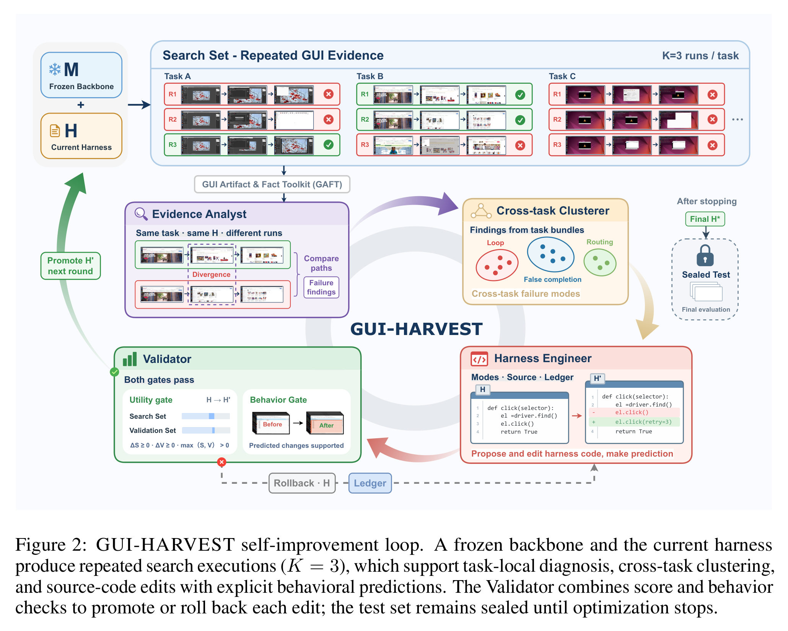

# GUI-HARVEST 阅读笔记：Evidence-Driven Harness Evolution

## Summary

GUI-HARVEST 不训练 GUI backbone 参数，而是自动修改模型外部的可执行 harness 源码。Harness 包括 prompt/context 构造、memory、action/tool interface、控制流、验证、错误恢复和终止逻辑。系统让冻结模型在 GUI 环境中重复执行任务，把多模态失败证据转成跨任务行为模式，再转成受限代码 patch；只有分数与预先声明的行为变化都通过验证，patch 才会成为下一轮 harness。

因此它本质上是面向 agent runtime 的自动软件工程系统，而不是参数学习算法。目标 backbones 全程冻结，四个 optimizer 角色由 Claude Sonnet 5 驱动。

*图源：GUI-HARVEST 原文 Figure 2。*

## Harness 如何在不训练模型时更新

当前 harness `H_t` 与冻结 backbone 运行 Search/Validation tasks。每个任务从干净快照重复执行 `K=3` 次，记录模型输出、计划与实际 action、前后截图、tool output、终止信息和 evaluator score。

Optimizer 根据这些轨迹直接检查、编辑并测试 harness 项目中的源码。例如发现点击无效果后仍继续时，可以把单次 click 改成带重试和屏幕变化验证的 click。修改对象是 runtime code，不是模型权重。

一个 harness 状态最多评测 5 个候选 patch；通过验证的候选被 promote 为 `H_(t+1)`，失败则 rollback。最多进行 10 个优化 round，最终 harness 冻结后才在 sealed Test 上评测。

## Evidence Analyst：单任务失败诊断

Evidence Analyst 以同一任务的三次运行作为一个 bundle。成功运行若存在，可作为失败运行的对照，帮助找到两条路径最早发生分叉的位置。

GAFT 工具先按 step 对齐文字、执行动作和前后截图，并计算重复 action、像素变化等机械事实。Analyst 再判断模型意图、实际 action 和机器结果是否一致，输出带 run/step 引用的 finding：决定性失败步骤、观察到的行为、机器结果、可能机制和反事实修复。

一个确定性 verifier 只检查引用的 harness 版本、run、step、原文位置和可机械验证事实是否一致；对失败机制的语义解释仍来自 Analyst。

## Cross-task Clusterer：发现可复用行为模式

Clusterer 不聚类任务主题，而是聚类**可能由同一个 harness 修改解决的失败机制**。每个 finding 先进入确定性的 outcome category；随后在类别内进行 open-vocabulary 归纳，只有至少两个独立任务支持的模式才保留。

例如“保存弹窗未关闭就宣布完成”“下载确认框未处理就终止”可以归为 `false completion with unresolved modal`。每个 behavior mode 记录机制、membership test、行为目标、成员 findings 和跨任务支持证据。

这一步防止 Engineer 针对单一任务写 hard-coded patch，并把 task-local evidence 提升为 runtime-level 问题。

## Harness Engineer：实际修改源码

Harness Engineer 是真正执行代码更新的角色。它读取 behavior modes、代表性证据、Harness Card、源码和 ledger 中被拒绝的旧尝试，在 capability manifest 允许的文件范围内定位并修改 runtime code。

在 GUI 评测前，Engineer 必须冻结一份 update plan，写明目标 mode、对应证据、修改位置、patch、预期可观察行为和必须保持的 invariant。它还要通过本地语法、接口、单元测试和 smoke test。

预注册预测使 patch 可证伪。例如完成检测 patch 可以预测：“Agent 会先解决 open save dialog，再宣布任务完成。”

## Validator：是否 Promote

Validator 先执行两层代码检查。L0 检查修改权限、diff 大小、语法和静态规则；L1 检查 import、接口兼容、单元测试和 smoke test。

通过后，candidate harness 在全部 Search/Validation tasks 上各运行三次。Utility hard gate 要求 Search 和 Validation 都不下降，并且至少一个严格提升：`ΔS >= 0`、`ΔV >= 0`、`max(ΔS, ΔV) > 0`。

Behavior gate 再检查 Engineer 预先声明的变化是否在 Search screenshots/trajectories 中得到支持，结果为 supported、contradicted 或 inconclusive。只有代码检查、utility gate 和 behavior gate 全通过才 promote，否则 rollback，并把 patch、预测、分数和 verdict 写入 ledger。

## 实验与边界

主 benchmark 是 [OSWorld-Verified](https://os-world.github.io/)，共 361 个任务，按领域分成 80 Search、80 Validation、201 sealed Test。Search 提供详细优化证据，Validation 只暴露 aggregate score，Test 在停止优化后才使用。优化后的 frozen harness 还迁移到 WindowsAgentArena，没有针对该环境继续优化。

论文评测 Qwen3-VL-8B/32B、OpenCUA-32B/72B、Gemini 3.1 Pro 和 GPT-5。15-step 设置下六个冻结 backbone 的 Test 都提升；Qwen3-VL-32B 的 Full score 从 38.61 提升到 50.94。

这种方法优化的是给定模型、GUI runtime 和任务分布之间的接口。Patch 仍可能过拟合 Search/Validation，行为解释也依赖 LLM Analyst；重复执行和 sealed Test 只能降低而不能消除这些风险。

## 原文定位

主要依据：[GUI-HARVEST 原文](../GUI-Agent-Harness-Evolution.pdf) Figure 2、§2、§3.1–3.5 和 §4.1。
