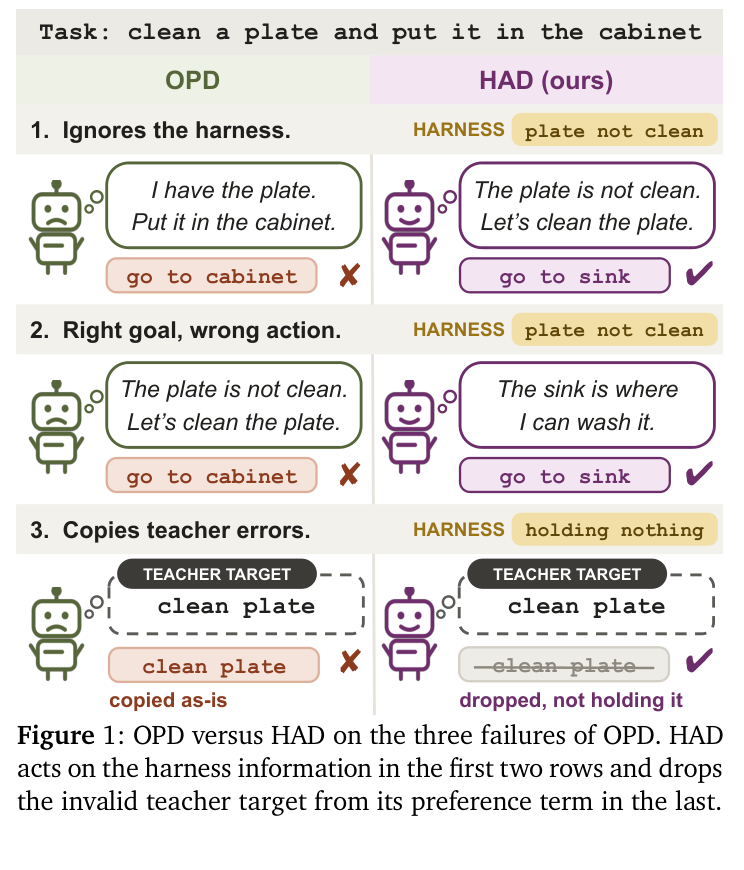

# HAD 阅读笔记：Harness-Aware Distillation

## Summary

HAD 的核心不是把 harness 蒸馏进模型，而是在部署时保留同一个 harness，并显式训练小模型“如何依据 harness 改变行动”。下文用 `θ` 表示学生参数、`φ` 表示固定教师参数，因而 `π_θ` 是学生策略、`π_φ` 是教师策略。HAD 先让学生 rollout，以学生造成的交互历史作为 on-policy 状态；再让教师在这个学生历史前缀上生成一轮完整 reasoning/action，用 teacher forcing 交叉熵蒸馏。随后，同一教师在有/无 harness 两种输入下各生成一个 action，HAD 在学生自己的 reasoning 后做 action-level 偏好学习。

## 从 OPD 到 HAD

Agent 的轨迹天然以环境 step 组织：学生生成 reasoning 与 action，环境执行完整 action 后才返回新状态。第 `t` 步带 harness 的学生历史记为 `x_t^h`，它包含任务、此前 observation、harness 文本，以及学生过去的 reasoning/action；移除 harness 文本后的同一历史记为 `x_t^0`。所谓 on-policy，首先指这些训练状态由当前学生访问，而不规定 step 内必须使用哪种 token loss。step-level 是环境数据的组织粒度；token-level 是一个 step 内计算监督的粒度，两者并不冲突。

论文的标准 OPD baseline 在学生当前回复的 token 前缀上比较师生 token 分布，最小化 student-to-teacher reverse KL。HAD 自身没有沿用这个 loss。教师策略 `π_φ` 在学生访问的历史 `x_t^h` 上独立生成完整回复：

```math
y_t^{\phi,h} = (z_t^{\phi,h},a_t^{\phi,h})
```

随后学生以 teacher forcing 拟合该回复：预测教师回复的第 `j` 个 token 时，输入教师目标的前 `j-1` 个 token，而不是学生自由生成的当前回复前缀。例如教师目标是 `go to sink`，训练 `sink` 时给学生的前缀是教师目标中的 `go to`。其 loss 为

```math
\mathcal{L}_{\mathrm{dist}}
= -\frac{1}{|y^{\phi,h}|}\sum_j
\log \pi_{\theta}(y_j^{\phi,h} \mid x_t^h,y_{1:j-1}^{\phi,h})
```

这在优化形式上是完整回复的 SFT/交叉熵；但训练历史持续由当前学生 rollout 产生，所以仍是 on-policy distillation，而非固定离线数据。若对教师所有回复样本取期望，该交叉熵等价于最小化 `KL(π_φ || π_θ)` 加一个与学生无关的教师熵，即 forward-KL-like 的 Monte Carlo 监督。本文实现中，这个基础项与 SOPD（Step-level On-Policy Distillation）的核心做法基本一致。

这里需要同时分清四个维度。第一，on-policy/offline 描述**状态来自谁**：HAD 与 OPD 都使用学生访问的状态。第二，reverse KL/交叉熵描述**怎样对齐 token 分布**：标准 OPD baseline 在学生当前 token 前缀上做 reverse KL；HAD response loss 在教师目标前缀上做交叉熵。第三，step/token 描述**数据与 loss 的粒度**：SOPD 每个环境 step 请教师写完整回复，但这段回复仍逐 token 训练。第四，teacher/student reasoning 描述**action 在什么上下文中评分**：response loss 的 action 接在教师 reasoning 后，preference loss 的两个 action 接在学生 reasoning 后。这四组概念可以自由组合，不能简单地把“on-policy”等同于“reverse KL”，也不能把“step-level”等同于“不训练 token”。

一次完整更新可以这样理解：学生先用当前策略跑若干任务，保存每个访问历史及其当前 reasoning；教师读取同一个学生历史，分别生成有/无 harness 的回复；response loss 用有 harness 的完整教师回复训练 reasoning 与 action，preference loss 用学生 reasoning 对两个教师 action 排序；最后把两项梯度合并更新学生，再由新学生重新 rollout。教师 action 从不进入环境，真正决定下一 observation 的始终是学生 action。

普通响应蒸馏只告诉学生“带 harness 的教师做了什么”，学习的是 `P+(a)`；它不能单独识别某个 action 本来就常见，还是因为 harness 才变得更可能。HAD 因此让教师 `π_φ` 再读取去掉 harness 的历史 `x_t^0`，得到行动 `a-`，并把带 harness 时的 `a+` 作为偏好项：

```math
\mathcal{L}_{\mathrm{pref}}
= -\log \sigma\left(\beta\left[
\log \pi_{\theta}(a^+ \mid x_t^h,z_t^{\theta})
- \log \pi_{\theta}(a^- \mid x_t^h,z_t^{\theta})
\right]\right)
```

它形式上类似 reference-free、action-level DPO，但偏好对来自同一教师的有/无 harness 条件，而非人类标签。两个 action 都接在学生当前采样的 reasoning `z_t^θ` 后评分；教师 action 不会被环境执行。这样，response loss 在教师 reasoning 前缀下教授完整理想回复，preference loss 则保证学生沿自己实际生成的 reasoning 走时仍偏向 harness 所引导的 action。若 `a+ = a-`，偏好项没有梯度。

“action-level”也不表示把整个 action 当成一个分类标签。若 action 是 `go to sink`，模型仍自回归地计算 `go`、`to`、`sink` 的 token log-probability，再取平均形成整段 action 的分数。它与标准 DPO 的相似处是 pairwise logistic loss；不同处是没有 reference model，正负样本也不是人类偏好，而是同一教师在两种上下文中的采样。



*图源：HAD 原文 Figure 1。*

图 1 的第二类错误中，学生可能在语言上认识到“盘子未清洗”，却仍给出 `go to cabinet`。带 harness 的教师此时可以完全正确；问题是学生自己的 reasoning 后仍把错误 action 赋予更高概率。Preference loss 正是在这个学生 reasoning 后提升 `go to sink` 相对 `go to cabinet` 的概率。这不是 OPD 理论上无法学会，而是普通模仿对少量 harness 关键决策只给出隐式信号；HAD 加入了更直接的归纳偏置。

## 有效性检查器 V

`V(a | x)` 不是模型、奖励函数或最优行动 ground truth，而是输出 0/1 的人工规则。它使用环境公开的 admissible commands、当前持有物和同状态失败历史，拒绝三类正行动：不在可用命令中、操作未持有物体、重复已经无效的动作。它不使用任务奖励、成功标签、未来状态，也不能识别“合法但策略错误”的行动。

论文只检查正行动 `a+`，因为 preference loss 会提高它的概率；若 `a+` 无效，强化它会伤害学生。负行动 `a-` 即使无效也无需过滤，因为 preference loss 正在降低其相对概率。这个 checker 更像高精度、低召回的安全筛网，而不是 correctness evaluator。

最终目标为

```math
\mathcal{L}_{\mathrm{HAD}}
= \mathcal{L}_{\mathrm{dist}}
+ \lambda V(a^+ \mid x_t^h)\mathcal{L}_{\mathrm{pref}}
```

过滤只关闭 preference loss；教师错误仍可能进入 response distillation。因此 `V` 的作用是避免额外强化明显矛盾，而非验证完整正确性。图 1 第三类错误才由 `V` 处理，第二类错误主要由学生 reasoning 上的 action preference 处理。

## 证据与边界

论文评测 ALFWorld、WebShop、ScienceWorld 三个 benchmark，并在 ALFWorld 上补充 Gemma 跨模型实验。ALFWorld 未见任务中，HAD 的成功率为 63.43%，最佳 OPD 基线为 47.01%；其停滞恢复率为 59.7%，其他模型最高为 50.0%。消融中，只有 response distillation 的成功率为 43.5%，去掉有效性过滤为 50.8%，完整 HAD 为 57.4%，说明行动对比贡献主要增益，`V` 负责抑制错误偏好。

局限同样明确：三个环境都具有结构化动作、显式 inventory 和可靠失败反馈，便于手写 `V`。论文只测试不超过约 2B 的学生及文本环境。真实软件 Agent 可以检查工具 schema、文件存在性、编译错误和重复失败，但难以仅靠规则判断修改是否真正满足用户目标。

## 原文定位

主要依据：[HAD 论文](../HAD-Harness-Aware%20Distillation%20for%20Small%20Language%20Model%20Agents.pdf) 的 §3.1–3.3（目标与设计）、§4.1–4.5（实验和消融）、Appendix A.1（loss 与 validity checker）、Appendix B.2–B.4（harness、规则和 baseline 实现）。SOPD 对照来源为 Sun et al., *Step-level On-Policy Distillation: Interpolating between On-Policy Distillation and Supervised Fine-Tuning*, arXiv:2608.16333。
