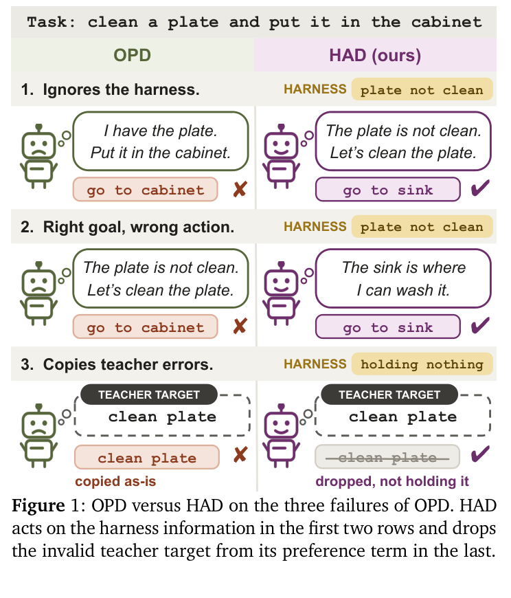

# HAD 针对性理解：从轨迹、前缀到两个 Loss

## Summary

理解 HAD 的关键是把三个维度分开：**状态从谁的轨迹来、当前回复使用谁的 token 前缀、loss 在模仿完整回复还是比较 action**。HAD 不是传统 reverse-KL OPD，而是“学生轨迹上的 SOPD 式完整回复蒸馏 + 学生 reasoning 上的 action preference”。第一项把教师在学生历史前缀上新生成的一轮内容做 teacher-forcing 交叉熵，是 forward-KL-like 的监督；第二项才使用学生当前 reasoning。有无 harness 的教师对比不是因为普通 OPD 原理上学不会，而是显式标出 harness 真正改变决策的位置；有效性检查器 `V` 只处理明显无效的教师正行动。

## 符号约定

`θ` 表示学生模型参数，学生策略写作 `π_θ`；`φ` 表示固定教师模型参数，教师策略写作 `π_φ`。`x_t^h` 表示学生走到第 `t` 步时包含 harness 的完整交互历史，`x_t^0` 表示保留同一轨迹但移除 harness 文本后的历史。上标 `h/0` 描述输入是否有 harness，上标 `θ/φ` 描述回复由学生还是教师生成。

## 一次训练记录究竟怎样产生

在第 `t` 个环境 step，历史 `x_t^h` 包含任务、此前所有 observation、harness 信息，以及学生过去生成的 reasoning/action。它是**学生行为造成的状态**，所以数据是 on-policy。注意这里的“student prefix”首先指整段交互历史，而不一定指学生当前回复已经生成的 token。学生在这里采样当前回复 `y_t^θ = (z_t^θ, a_t^θ)`，环境只执行学生的 `a_t^θ`，再进入下一状态。教师 action 只是监督标签，不会改写轨迹。

教师策略 `π_φ` 被查询两次：读取 `x_t^h` 时生成 `(z+, a+)`；读取 `x_t^0` 时生成 `(z-, a-)`。“去掉 harness”并不会重新跑一条环境轨迹，过去由学生造成的 observation 和 action 都保留。

以“洗盘子”为例，学生历史已经造成当前状态：盘子未洗，学生此前可能还走错过位置。学生当前 reasoning `z_t^θ` 是“盘子需要清洗”，却采样出 action `a_t^θ = go to cabinet`；这是实际执行并推进轨迹的 action。带 harness 教师生成 `a+ = go to sink`；去掉 harness 文本的教师可能生成 `a- = go to cabinet`。后两个 action 都只用于训练。

因此，**step-level 是环境数据的组织方式，token-level 是 step 内的训练方式**。环境只有执行完整 action 后才变化，但一个 step 的 Thought/Action 仍由多个 token 构成。Agent OPD 通常需要学生轨迹，却不代表所有方法必须使用相同 token loss，也不一定每一步都查询教师。

把实现压成伪代码，就是：

```text
for 学生访问的历史 x_t_h:
  (z_student, a_student) = pi_theta(x_t_h)  # 只有它推进环境
  (z_plus, a_plus) = pi_phi(x_t_h)
  (z_minus, a_minus) = pi_phi(x_t_0)
  L_response = CE(student, z_plus + a_plus)
  L_preference = rank(a_plus, a_minus | x_t, z_student)
  L = L_response + lambda * V(a_plus | x_t) * L_preference
```

式子中的先后是数据依赖，不要求工程实现严格串行；给定同一个历史，学生回复和两次教师回复可以独立采样。关键不变的是只有 `a_student` 被执行。

## 三种训练方式不要混在一起

论文的标准 OPD baseline 在学生当前回复的 token 前缀 `y_1:j-1^θ` 上计算：

```math
D_{\mathrm{KL}}\left(
\pi_{\theta}(\cdot \mid x_t^h,y_{1:j-1}^{\theta})
\parallel
\pi_{\phi}(\cdot \mid x_t^h,y_{1:j-1}^{\theta})
\right)
```

即 token-level reverse KL。

HAD 的 response loss 不用这个 KL。教师 `π_φ` 先在学生的**交互历史前缀** `x_t^h` 上采样完整回复 `y+ = (z+, a+)`，学生 `π_θ` 再以 teacher forcing 逐 token 拟合它。若教师目标是 `Thought: go to the sink; Action: clean plate`，训练 `sink` 时输入教师目标中的 `go to the`，而不是学生可能生成的 `go to cabinet`。因此 action `a+` 在 response loss 中条件于教师 reasoning `z+`：

```math
\mathcal{L}_{\mathrm{dist}}
= -\frac{1}{|y^+|}\sum_j
\log \pi_{\theta}(y_j^+ \mid x_t^h,y_{1:j-1}^+)
```

它在优化形式上是完整回复的交叉熵/SFT，但数据不是固定离线数据：每轮学生策略更新后都会访问新的历史，所以仍是 on-policy distillation。对教师生成分布取期望，交叉熵等于 `KL(π_φ || π_θ) + H(π_φ)`；教师熵与学生参数无关，因此可理解为 forward KL 的单样本 Monte Carlo 监督。本文实现中，这一项与 SOPD 基线的核心做法相同。SOPD 的“step-level”指每个学生访问的环境 step 让教师写一个完整 step，再做这种交叉熵，并不是说训练不再逐 token 计算。

因此，“先按照 student 前缀让 teacher 生成，再做交叉熵”需要说得更精确：这里的 student 前缀是学生造成的**跨 step 交互历史** `x_t^h`；教师从该历史开始生成自己的当前回复。做 teacher forcing 时，当前回复内部使用的是教师 token 前缀 `y_1:j-1+`，不是学生当前 token 前缀。它也不是精确计算教师全分布上的 forward KL，因为训练只拿到教师采样回复；只有对无限教师样本取期望时才恢复对应交叉熵。实际训练是单样本序列级 Monte Carlo 估计。

Preference loss 则把 `a+`、`a-` 都接到学生当前 reasoning `z_t^θ` 后评分：

```math
\mathcal{L}_{\mathrm{pref}}
= -\log \sigma\left(\beta\left[
\log \pi_{\theta}(a^+ \mid x_t^h,z_t^{\theta})
- \log \pi_{\theta}(a^- \mid x_t^h,z_t^{\theta})
\right]\right)
```

它像无 reference 的 action-level DPO：不模仿教师 reasoning，只要求学生沿自己的 reasoning 生成时更偏好 `a+`。action 若包含多个 token，分数仍是这些 token 的平均 log-probability。因此两个 loss 的区别不只是 reasoning 来自教师还是学生：response loss 学完整 `(z+, a+)`；preference loss 只学习 `a+ > a-`，专门提取 harness 引起的相对变化。

回到盘子例子，response loss 教学生复现教师的“去水槽”整段理想回复；preference loss 则不要求学生先写出同样的教师 reasoning，而是在学生自己的“盘子需要清洗”之后，直接要求 `go to sink` 的分数高于 `go to cabinet`。这就是论文所说的 action-only preference under student reasoning。它不是把 action 当作单个 token：多 token action 仍按自回归概率逐 token 评分，只是最后把整段 action 的平均 log-probability拿来比较。

Preference loss 本身不直接纠正学生已经采样出的 `z_t^θ`，因为离散 reasoning 被当作条件上下文；直接教授理想 reasoning 的工作仍由 response loss 完成。两项监督互补：一项回答“理想的完整 step 应该长什么样”，另一项回答“即使学生按自己的思路走到 action 位置，此时应该更偏向哪个动作”。

## 为什么学生和教师都有 harness 还需要对比

普通蒸馏只观察带 harness 的教师分布 `P+(a)`。它理论上可以学会利用 harness，但无法单独标出“这个 action 是本来就常见，还是因为 harness 才变得更可能”。HAD 的有/无 harness 对比强调 `log P+(a) - log P-(a)`；只有教师行动发生变化时才产生有效梯度。这是一种面向有限数据和小模型的归纳偏置，不是对 OPD 的不可能性证明。两者都有 harness 也不矛盾：harness 只提供信息，不替模型决定如何响应；对比监督专门标出教师因该信息而改变决策的位置。

还要保留一个实验解释边界：论文让教师在温度 1.0 下独立采样有/无 harness 回复，所以观察到 `a+ != a-` 同时包含 harness 条件差异和随机采样差异，并非严格的因果配对。方法依赖“harness 通常使教师行动更可靠”这一质量代理；`V` 只能删除与状态事实冲突的 `a+`，不能证明其一定优于 `a-`。



*图源：HAD 原文 Figure 1。*

图 1 第二行中，带 harness 的教师可以完全正确；学生甚至说出“盘子没洗”，却在自己的 reasoning 后选了 `go to cabinet`。Preference loss 直接在该学生 reasoning 后提升 `go to sink` 相对 `go to cabinet` 的概率。若教师有无 harness 都给出同一 action，HAD 在这里没有额外帮助。

第三行才是教师错误：harness 记录 `holding nothing`，教师却给出 `clean plate`。`V(a+ | x_t^h)` 不是模型、reward 或最优 action GT，而是手写布尔规则；它检查 action 是否在 admissible commands 中、是否操作未持有物体、是否重复同状态下已失败的动作。`V = 0` 只删除该 preference pair，错误回复仍进入 response loss，所以它避免“额外强化”明显矛盾，并不能保证正确性，也识别不了合法但策略错误的 action。

## 证据边界

HAD 只在 ALFWorld、WebShop、ScienceWorld 三个结构化文本 benchmark 上验证；Gemma 实验仍是 ALFWorld，不是第四个 benchmark。消融中，仅 response distillation 的成功率为 43.5%，去掉 `V` 为 50.8%，完整 HAD 为 57.4%。这些环境提供动作列表、inventory 和可靠失败反馈，适合规则型 `V`；论文尚未证明该设计能直接覆盖开放式软件 Agent 的语义正确性。

## 原文依据

以上对应 [HAD 原文](../HAD-Harness-Aware%20Distillation%20for%20Small%20Language%20Model%20Agents.pdf) §3.1（式 2–7）、§3.2–3.3、§4.1–4.5、Appendix A.1 与 B.2–B.4；SOPD 题名为 Sun et al., *Step-level On-Policy Distillation: Interpolating between On-Policy Distillation and Supervised Fine-Tuning*, arXiv:2608.16333。
