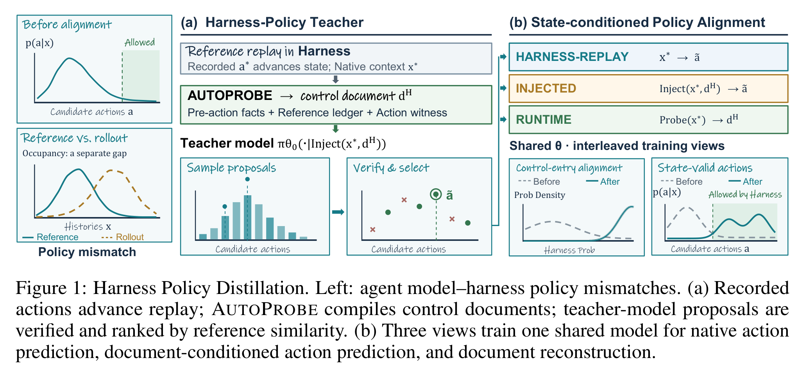
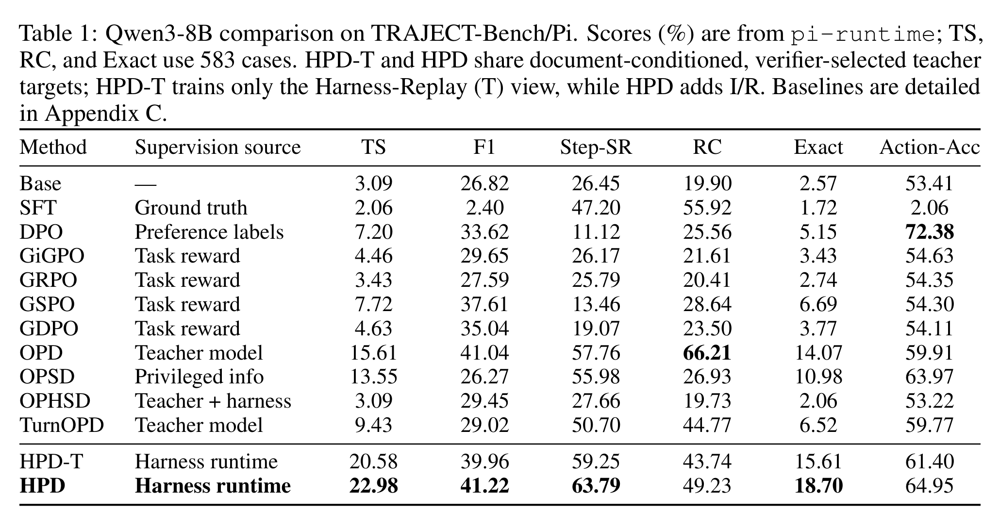
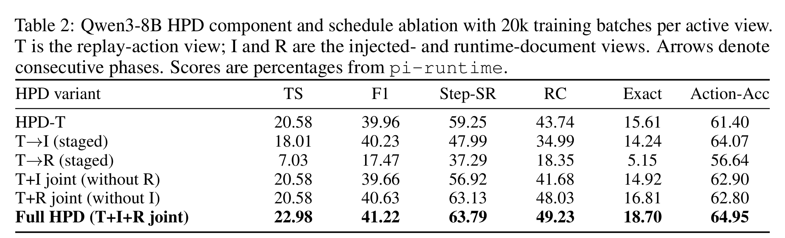

# Harness Policy Distillation 阅读笔记

## Summary

HPD 研究的不是如何把更多事实塞进 prompt，而是如何让模型遵守产品 runtime harness 的执行契约：哪些 action 当前可执行、工具调用后状态如何推进、尚有哪些 obligation、什么时候允许结束。通用模型即使会生成看似合理的 action，也可能与 Harness 的真实状态机不一致，例如查询尚未完成就回答、重复调用已经完成的工具，或在终止条件未满足时收尾。

方法先在 reference trajectories 上重放 Harness，在每个决策 boundary 生成 control document，并让 Teacher 提出候选 action；只有通过 Harness 验证且与参考行为一致的 action 才成为监督目标。随后用同一模型、同一组参数，在 Harness-Replay、Injected、Runtime 三种 prompt/target view 之间交替训练。部署时仍使用原生 Harness interface，不需要 control document。



*图源：原文 Figure 1。*

## 问题形式化：模型策略与 Runtime Semantics 不一致

设 Harness 在 decision boundary `b` 的完整状态为 `s_b`。Serializer `Ω_H` 把它转换为部署时模型实际看到的 native context：

```math
x_b=\Omega_H(s_b).
```

模型生成 action `a_b` 后，transition kernel `T_H` 负责解析、权限检查、工具执行、observation 插入、obligation 更新与终止判断：

```math
s_{b+1}\sim T_H(\cdot\mid s_b,a_b).
```

`x_b` 只包含普通交互历史，不一定显式说出 Harness 内部的控制状态。因此模型可能看见历史，却没有正确恢复“查询是否完成、最终回答是否已解锁、预算还剩多少”等 runtime facts。

HPD 在训练时额外构造 control document `d_b^H`。它包含三类信息：

- **Pre-action facts**：当前 action 前的 runtime state；
- **Reference ledger**：参考轨迹已经完成和仍未完成的 obligations；
- **Action witness**：为什么某个候选 action 在当前 boundary 合法并能推进状态。

这些文档只用于训练，不会在部署时注入模型上下文。

## Harness-Policy Teacher 如何产生监督

HPD 不是直接把 recorded reference action 当成唯一目标，也不是在 Student prefix 上做在线 logits KL。数据构造过程是：

1. 在真实 Harness 中重放 reference trajectory，用 recorded action 推进状态，得到每个 boundary 的 native context `x_b`。
2. AUTOPROBE 从 Harness state 编译 control document `d_b^H`。
3. Frozen Teacher 在 `Inject(x_b,d_b^H)` 下采样多个 candidate actions。
4. Harness verifier 检查 action 是否可执行、是否满足当前 runtime contract，并结合 reference similarity 选择目标 `\tilde a_b`。
5. 只保存 `(x_b,d_b^H,\tilde a_b)`；被拒绝和未选中的候选不会进入 Student targets。

因此 HPD 的“distillation”发生在**先用 privileged control document 改善并验证 Teacher action，再把选中的硬目标训练回 native policy**。Student 训练读取 stored targets，不需要再次运行 Teacher forward pass。

## 三个 View 到底是什么？

“View”指同一个模型、同一组参数使用三种不同的 prompt/target 格式训练，不是三个独立模型。

| View | 输入 | 预测目标 | 作用 |
| --- | --- | --- | --- |
| **T：Harness-Replay** | native context `x_b` | verified action `\tilde a_b` | 直接训练部署时真正使用的 `history → action` 映射 |
| **I：Injected** | `Inject(x_b,d_b^H)` | 同一个 verified action `\tilde a_b` | 学习控制状态明确时应选择什么合法 action |
| **R：Runtime** | `Probe(x_b)`，信息来源仍只有 native context | control document `d_b^H` | 学习从原生历史恢复当前 runtime control state |

可以把三者理解为：

```text
R：history → runtime state
I：history + runtime state → verified action
T：history → verified action
```

部署只走 T，但 I 和 R 更新同一组参数，使状态恢复与状态条件决策能力能够影响 native action policy。这里的共享来自参数更新，不是部署时先显式运行 R、再把生成文档传给 I。

三个 sequence-level NLL 可写成：

```math
\mathcal L_T=-\log \pi_\theta(\tilde a_b\mid x_b),
```

```math
\mathcal L_I=-\log \pi_\theta(\tilde a_b\mid \mathrm{Inject}(x_b,d_b^H)),
```

```math
\mathcal L_R=-\log \pi_\theta(d_b^H\mid \mathrm{Probe}(x_b)).
```

总目标为：

```math
\mathcal L_{\mathrm{HPD}}
=\alpha_T\mathcal L_T+\alpha_I\mathcal L_I+\alpha_R\mathcal L_R.
```

论文把 point-target NLL 解释为对经验条件 Teacher distribution 的 forward-KL 加一个与参数无关的 entropy 常数；实现层面仍是 stored completion 的 teacher-forcing NLL，而不是传统 OPD 的逐 token Teacher logits KL。

## 为什么必须交替训练，而不是分阶段？

默认训练令 `α_T=α_I=α_R=1/3`。实现不是把三个 loss 在同一个 batch 中相加后做一次 update，而是按 T、I、R 的 deterministic cycle 连续执行 AdamW updates；每个 view 使用自己的 seeded permutation 和每批 128 sequences。一个 T/I/R round 记作一个 training step，因此 20k steps 对应 60k optimizer updates。所有 update 都作用于同一参数 `θ`。

这里应区分：

- **Interleaved/joint**：在 mini-batch 粒度持续轮换 T、I、R，使三种能力共同约束参数；
- **Staged**：先把 T 完整训练完，再单独训练 I 或 R，后一个阶段可能覆盖 native action policy。

论文实验表明 staged training 会发生明显遗忘，所以不能把“三视图各训练一遍”理解为三个连续的大阶段。

## Lookup 示例

论文给出的合约要求模型先调用：

```text
lookup(item_id=42)
```

之后才能给 final response。初始 control state 是：

```text
lookup=pending; final=blocked
```

执行 recorded lookup、消费 observation 并完成 obligation 后，状态变为：

```text
lookup=complete; final=ready
```

R view 学习从 native history 重建这种状态描述；I view 学习在 `pending/blocked` 时调用 lookup、在 `complete/ready` 时回答；T view 则直接学习在没有 control document 的部署输入上作出相同选择。

## 实验设置与主结果

论文在 TRAJECT-Bench 的 Pi harness 上训练和评测 Qwen3-8B。TS、Runtime Compliance（RC）和 Exact 使用 583 个 cases；同时报告 F1、Step-SR 与 boundary-level Action-Acc。



*图源：原文 Table 1。*

主要结果：

- Base model 的 Task Success（TS）为 3.09，RC 为 19.90。
- 只训练 T view 的 HPD-T 达到 20.58 TS、43.74 RC。
- Full HPD 达到 22.98 TS、49.23 RC，并在 F1、Step-SR 和 Exact 上领先。
- DPO 的 Action-Acc 最高（72.38），但 TS 只有 7.20；这说明单个 boundary 的局部 action ranking 不等于完整 runtime 中的任务成功。
- OPD 达到 15.61 TS，仍低于 HPD-T；Harness-verified targets 本身已提供主要增益，I/R 再进一步改善状态理解和执行合规。

## 三视图消融与训练顺序



*图源：原文 Table 2。*

| Variant | TS | Step-SR | RC | 解读 |
| --- | ---: | ---: | ---: | --- |
| HPD-T | 20.58 | 59.25 | 43.74 | 只训练 native action mapping |
| `T→I` staged | 18.01 | 47.99 | 34.99 | 后续 I 阶段损害 native execution |
| `T→R` staged | 7.03 | 37.29 | 18.35 | 单独训练文档重建导致严重遗忘 |
| `T+I` joint | 20.58 | 56.92 | 41.68 | 未提高 TS，执行指标反而下降 |
| `T+R` joint | 20.58 | 63.13 | 48.03 | TS 不变，但状态执行指标改善 |
| Full `T+I+R` joint | 22.98 | 63.79 | 49.23 | 只有三者联合才提高任务成功 |

I 或 R 单独加入都没有超过 HPD-T 的 TS；R 更像在补 runtime-state representation，I 提供 state-conditioned action bridge，T 则把能力锚定在部署接口。三者互补时才出现额外的 end-to-end 增益。

## 与 HAD、OPHSD 和 LensVLM 的区别

- **HAD** 在部署时仍向模型注入固定状态追踪与行为监控文本；HPD 的 control document 只在训练中出现，部署回到 native Harness context。
- **OPHSD** 主要蒸馏 task-specific inference procedure；HPD 蒸馏的是 runtime contract、合法 action 与 termination semantics。
- **LensVLM** 可以借用 HPD 定义页面读取 runtime：已读页、剩余展开预算、pending evidence obligations、允许的 `read/zoom/answer` action 与停止条件。但 HPD 只能帮助模型理解控制语义，不能让压缩图像恢复根本不可见的原文事实。

对 LensVLM/PRISM，三视图可形成一个 runtime baseline：R 从压缩页交互历史重建阅读状态，I 在显式阅读状态下预测 verified page/action，T 从原生压缩历史直接预测同一 action。若 Teacher 还看到原文，仍需额外的 visibility/transferability gate；Harness 验证“action 合法”不等于其中引用的事实对 Student 可见。

## 批判性边界

1. **不是 student-on-policy distillation。** 训练 boundaries 来自 reference replay，论文也把 reference 与 rollout occupancy gap 视为独立问题。
2. **依赖 Harness adapter 和 AUTOPROBE。** 换 runtime 后，需要重新定义 state serialization、obligations、verifier 与 control document schema。
3. **主要监督是 hard target NLL。** 它不直接利用 Teacher 的完整 token distribution；收益可能来自 Harness filtering、privileged document conditioning和多任务表示学习的组合。
4. **Full HPD 的总更新量更大。** Table 2 对每个 active view 都给 20k batches，因此 Full T+I+R 有 60k optimizer updates，而 HPD-T 只有 20k。实验匹配了 per-view exposure，但没有匹配总训练计算；三视图增益仍应加入等总 updates 的对照。
5. **Runtime compliance 不等于事实正确。** 模型可以严格遵守调用顺序却仍给出错误答案，因此 TS、Exact、F1 与 RC 必须一起报告。

## 原文定位

主要依据：[Harness Policy Distillation 原文](../HARNESS%20POLICY%20DISTILLATION.pdf) Figure 1、§2–4、Table 1–2、Appendix B、C、F。