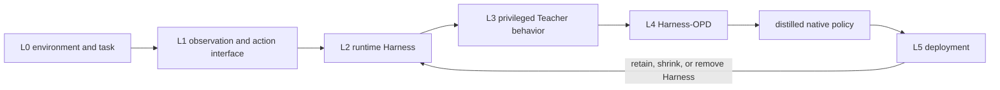
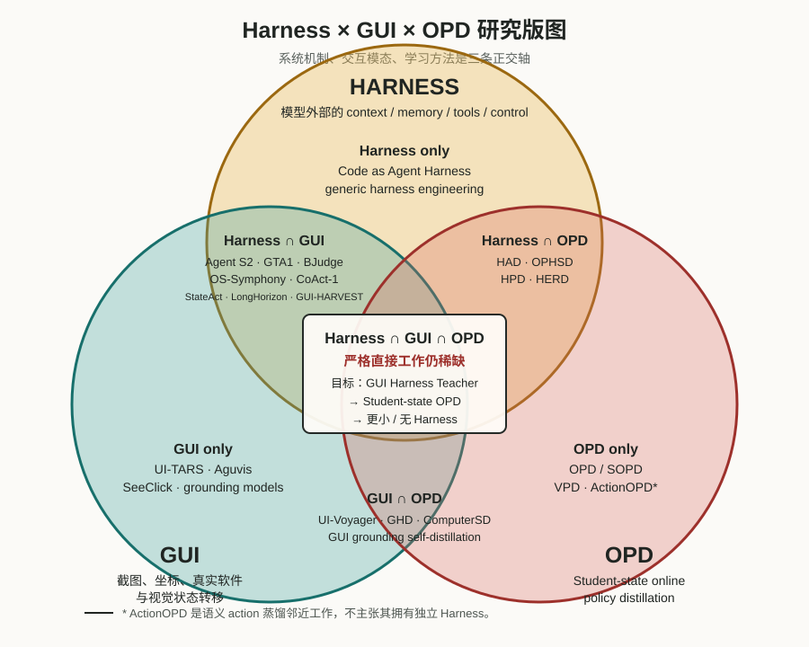
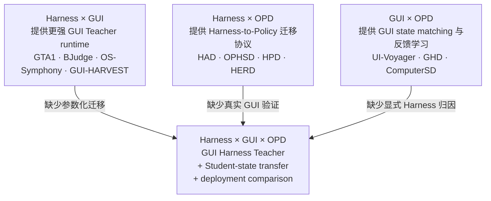
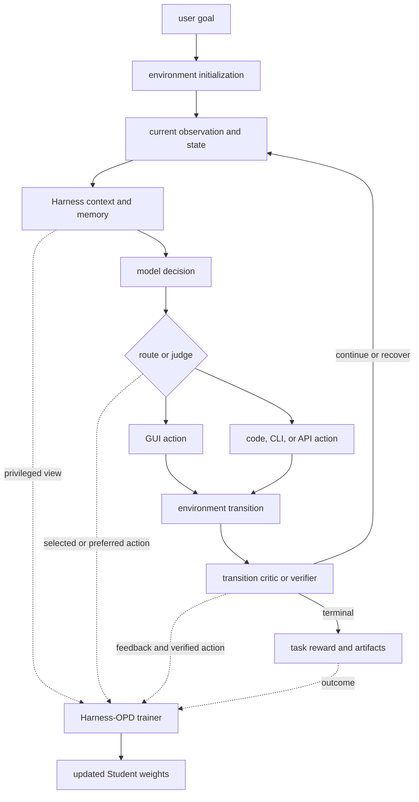

# Harness-OPD 在 GUI Agent Harness 生态中的位置与规模对标

系统生态位、任务闭环与 scale 分析 · 2026-11-08

## 1. 执行摘要

**核心判断：Harness-OPD 不是另一种 GUI Harness，而是连接“外部 Harness 能力”与“模型参数能力”的学习层。**

GUI Agent 生态通常从环境、接口、runtime、策略执行一直延伸到评测和部署。Agent S2、OS-Symphony、CoAct-1、StateAct 等工作直接改造运行时：它们决定模型看到什么、调用谁、如何执行、验证和恢复。OpenComputer、ClawGUI 还覆盖环境、训练或评测基础设施。相比之下，HAD、OPHSD、HPD、HERD 等 Harness-OPD 工作研究一个更窄但独立的问题：

> 当某个外部 Harness 已经能改善行为时，哪些优势可以通过监督迁移到模型权重，哪些必须继续留在 runtime？

因此 Harness-OPD 的生态位是一个 **Harness-to-Policy 能力迁移层**：

- 上游接收 GUI Harness 产生的 privileged context、verified action、行为偏好或 teacher distribution；
- 中间解决 state occupancy、动作语义、信息可见性和训练目标对齐；
- 下游输出更强的 native policy，部署时可以移除、缩小或保留原 Harness。

从研究数量看，当前仓库中的核心 Harness-OPD 范式约有 5 类，而本报告对标的 GUI Harness/基础设施系统有 10 余个。这个数量差反映出 GUI 领域目前更重视“搭出更强系统”，而不是“把系统优势系统性编译进权重”。但论文数不能直接代表成熟度：GUI 系统在任务、应用和 rollout 上规模更大；Harness-OPD 在训练视图、loss、state matching 和部署形态上控制更细。

最值得补的研究空白不是再发明一个 GUI Harness，而是：

1. 把 step-wise、transition-wise、trajectory-wise Harness 信号统一成可对齐的 OPD 数据协议；
2. 报告任务规模之外的 state coverage、teacher compute 与 Harness breadth；
3. 证明性能来自 Harness 蒸馏，而不是更强模型、更多环境步数或隐藏 API；
4. 在统一 benchmark 上同时报告 Base、Harness Teacher 与部署 Student 的任务指标和运行成本。

## 2. 先统一“生态位”的坐标系

### 2.1 GUI Agent 的六层系统栈

一个完整 GUI Agent 任务可拆成六层：

| 层级 | 负责什么 | 典型对象 | 代表工作 |
| --- | --- | --- | --- |
| L0 环境与任务 | 初始化、重置、应用状态、成功条件 | VM、emulator、task、verifier | OSWorld、OpenComputer、ClawGUI-RL |
| L1 观察与动作接口 | 截图、DOM、CLI/API、坐标、Action DSL | observation/action schema、grounder | GTA1、Agent S2、CLI-Anything |
| L2 运行时 Harness | 上下文、记忆、路由、规划、工具、验证、恢复、终止 | controller、state store、multi-agent loop | OS-Symphony、CoAct-1、StateAct、Syll |
| L3 Harness 增强策略 | 在同一状态上通过额外计算产生更优决策 | BoN、judge、critic、verified action | GTA1、BJudge、RMA、PRM |
| L4 Harness-to-Policy 学习 | 把 L2/L3 的行为优势迁入参数 | OPD、SFT、preference、RL | HAD、OPHSD、HPD、HERD、ActionOPD |
| L5 部署与治理 | 成本、权限、审批、持久记忆、用户入口 | chat channel、approval、monitoring | Syll、ClawGUI-Agent |

这六层不是互斥产品类别，而是系统责任。一个工作可以跨多层。例如 ClawGUI 同时覆盖 L0、L4 的 RL 基础设施、L5 部署；StateAct 同时改造 L1、L2 和验证；GUI-HARVEST 在 L2 外再套一层 Harness 优化循环。

### 2.2 Harness-OPD 的准确位置

Harness-OPD 主要位于 **L4**，依赖上游 L2/L3，但不等于上游本身：



它承担两种“编译”：

1. **Context compilation：** 把 Harness context 带来的分布变化变成裸输入下的 policy change；
2. **Control compilation：** 把 obligation、合法 action、停止条件等 runtime semantics 变成 native action policy；

这也是 Harness-OPD 与 GUI-HARVEST 的根本区别：GUI-HARVEST 固定权重、改 Harness；Harness-OPD 固定或先确定 Harness，再改权重。HERD 同时演化 Harness 和权重，是两条路线的交汇点。

### 2.3 Harness、GUI、OPD 的三集合研究版图



*图 1：三个 scope 是正交维度，不是从属层级。图中论文按主要贡献放置；同一工作可以跨越多个区域。中心三交集是本仓库希望推进的 GUI Harness-OPD。*

三者之所以可以两两组合，是因为它们描述的不是同一种东西：

| Scope | 它是什么维度 | 核心研究对象 | 单独成立时回答什么 |
| --- | --- | --- | --- |
| **Harness** | 系统/运行时维度 | 模型外部的 context、memory、tools、orchestration、verification、control | 不改或少改模型，怎样让 Agent 更可靠？ |
| **GUI** | 任务与交互模态维度 | screenshot、visual grounding、mouse/keyboard、真实软件状态转移 | Agent 怎样感知并操作视觉界面？ |
| **OPD** | 学习与优化维度 | Student 访问的 states、Teacher policy/action distribution、在线更新 | 怎样在 Student 自己会到达的状态上迁移更强策略？ |

因此三圆不是互斥论文分类。GTA1 同时属于 GUI 系统和 test-time Harness；ActionOPD 属于 OPD，并可作为三交集的方法组件；ClawGUI 同时覆盖 GUI Harness 与 RL infrastructure，但不因此自动成为 Harness-OPD。

#### 七个区域分别研究什么

| 区域 | 已有研究问题 | 代表工作 | 与中心三交集的距离 |
| --- | --- | --- | --- |
| Harness only | 外部 runtime 如何组织上下文、工具、记忆与长期控制 | Code as Agent Harness；通用 long-running harness engineering | 缺 GUI state/action，也不一定训练模型 |
| GUI only | 视觉理解、grounding 与 native GUI action policy | UI-TARS、Aguvis、SeeClick | 缺 Harness Teacher 与 on-policy transfer |
| OPD only | 如何在 Student occupancy 上迁移 token/action policy | OPD、SOPD、VPD；ActionOPD 是语义 action 邻近方法 | 缺真实 GUI transition 与显式 GUI Harness |
| Harness ∩ GUI | 如何用 planner、memory、judge、code、verifier 改善 GUI runtime | Agent S2、GTA1、BJudge、OS-Symphony、CoAct-1、StateAct、LongHorizon-Harness、GUI-HARVEST | 已有强 Teacher 系统，但通常不把增益蒸进权重 |
| Harness ∩ OPD | 如何内化或学习使用 Harness 产生的 context/control/skills | HAD、OPHSD、HPD、HERD | 已有迁移机制，但主要不是视觉 GUI 环境 |
| GUI ∩ OPD | 如何从 GUI 成功/失败轨迹、未来截图或 analyzer feedback 自蒸馏 | UI-Voyager、GHD、ComputerSD、On-Policy Self-Distillation for GUI Grounding | 已有 GUI state learning，但 Teacher 未必是完整 Harness-augmented policy |
| Harness ∩ GUI ∩ OPD | 用 GUI Harness 在 Student GUI states 上形成 privileged Teacher，再迁移为更小或无 Harness policy | **严格直接工作仍稀缺；当前更像待建立的研究 scope** | 中心目标 |

“严格直接工作稀缺”采用较强判据：必须同时有 GUI 环境、明确的外部 Harness 增益、Student-state 在线监督，以及蒸馏前后 Harness 部署形态对照。若把任意 verifier、未来截图或成功 peer 都宽泛称为 Harness，则 GHD、ComputerSD、UI-Voyager 会靠近中心；但这样会失去“蒸馏的是完整 Harness 增益还是一般 privileged feedback”的区分。

### 2.4 每两个 scope 组合都已有研究，但各自只提供中心问题的一部分



#### Harness × GUI：已有强系统，缺少参数化迁移

这条边研究“怎样搭一个更强的 GUI Agent runtime”。其规模和系统成熟度最高：

- Agent S2 用 Manager/Worker 与多 grounder 分工；
- GTA1 在每个 GUI state 做 Best-of-$K$ action selection；
- BJudge 在多个完整 rollout 之间做 behavior-level selection；
- OS-Symphony 引入 RMA、Searcher、Grounders 与 Coder；
- GUI-HARVEST 根据多次 GUI 证据自动 patch runtime 源码。

这些工作产生了更强 Teacher，但通常部署仍保留完整系统。中心问题需要再问：去掉 $K$ 次采样、judge、RMA 或多 agent 后，单策略是否仍能在相同 benchmark 和 step budget 下稳定提升？

#### Harness × OPD：已有迁移理论，缺少 GUI 复杂性

这条边研究“外部 Harness 的什么可以进入权重”：

- HAD 学习使用部署时保留的状态/失败提示；
- OPHSD 把固定多调用程序作为 privileged Teacher，部署移除 Harness；
- HPD 把 runtime state、control document 与 verified action 编译成 native policy；
- HERD 先演化 bounded skills/memory，再递归蒸馏并控制漂移。

这组工作已经提供 context matching、action contrast、multi-view control semantics 与 continual distillation，但尚未充分面对 GUI 的坐标动作、不可见后台状态、昂贵环境 reset 和多步状态分叉。

#### GUI × OPD：已有视觉轨迹学习，缺少 Harness 增益归因

这条边研究“怎样从 GUI 交互经验改进当前 policy”：

- UI-Voyager 用失败轨迹定位 fork point，再用成功 peer response 做 hard-target self-distillation；
- GHD 在 Student response/trajectory prefix 上利用 action 后 next screenshot 重打分，并按恢复条件 gate；
- ComputerSD 用前后截图 analyzer 的 guidance 与 step value，结合 value-gated token OPSD 和 GRPO；
- GUI grounding self-distillation 用视觉增强或后验反馈改善坐标预测。

它们最接近中心，但 privileged signal 常是未来截图、成功 peer 或 analyzer，而不是一个先被证明有独立增益的完整 GUI Harness。中心三交集要求增加 Harness ablation：同一 backbone 在有/无 Harness 时到底产生了什么 policy difference，Student 又回收了多少。

#### 中心三交集：三个条件必须同时成立

| 条件 | 为什么不可缺 | 推荐最小实现 |
| --- | --- | --- |
| GUI | 必须在真实 screenshot/action/transition 上验证，而非文本工具环境替代 | OSWorld-Verified 或可重置 GUI benchmark |
| Harness | Teacher 优势必须来自可关闭、可消融的外部机制 | GTA1 $K=8$ judge 对 $K=1$ |
| OPD | 监督必须覆盖 Student 实际访问的 GUI states | Student rollout 上 semantic-action matching/preference |
| 部署对照 | 必须证明 Harness 真的被移除或缩小 | Teacher $K=8$、Student $K=1$、base $K=1$ 三方对照 |
| 增益归因 | 必须区分更强模型、更多环境步和 Harness 本身 | same backbone、same grounder、same step budget |

最小中心实验因此不是把所有 GUI Harness 组件一次加入，而是：

```math
\underbrace{\text{GTA1-style GUI BoN}}_{\text{Harness × GUI Teacher}}
+
\underbrace{\text{Student-state semantic OPD}}_{\text{GUI × OPD protocol}}
\longrightarrow
\underbrace{\text{single-sample GUI policy}}_{\text{三交集产物}}.
```

它先把三者交集做“窄而真”，再逐步加入 RMA/PRM transition feedback、BJudge trajectory selection 和 OpenComputer verifier。

## 3. “Harness”在不同研究里不是同一大小

### 3.1 Harness-OPD 内部的对象光谱

| 工作 | 被称为 Harness 的对象 | 直接改变什么 | 部署时 |
| --- | --- | --- | --- |
| HAD | 状态跟踪、失败与停滞提示文本 | 模型当前 observation/context | Harness 保留 |
| OPHSD | draft-verify、plan-solve 等多调用程序及 terminal context | Teacher conditioning distribution | Harness 移除 |
| HPD | runtime state、serializer、transition、control document、verified action | runtime semantics 与 native action mapping | 原生 runtime 保留，privileged document 移除 |
| HERD | bounded skill registry + high-residual memory | task skill 与持续学习 Teacher | 每阶段蒸馏后移除当前 Harness |
| ActionOPD | 严格说不是新的 Harness；Teacher 在 Student state 上提供语义 action samples | action-level teacher reward | Teacher 移除 |

这组工作从 text augmentation 扩展到 runtime semantics，但大多把 Harness 当成**训练信号生成器**，而不是用户可部署的完整软件系统。

### 3.2 GUI Harness 的对象通常更宽

| GUI 工作 | Harness 覆盖范围 | 主要增益来源 |
| --- | --- | --- |
| Agent S2 | Manager/Worker、主动重规划、视觉/OCR/结构 grounding experts | 分工、重规划、专家接口 |
| GTA1 | per-step candidate sampling、judge、grounder | test-time compute 与 grounding |
| Agent S3 + BJudge | flat policy、Coder、多 rollout、behavior narrative、comparative judge | code action + wide scaling |
| OS-Symphony | Orchestrator、RMA、Searcher、Grounders、Coder | memory/reflection、外部教程、异构工具 |
| CoAct-1 | Orchestrator、Programmer、GUI Operator、summarizer | GUI/code 混合动作 |
| StateAct | state-first 主 Agent、GUI/web specialists、finish gate、context manager | program state、验证、上下文管理 |
| Syll | MCP/CLI/GUI routing、demo skill、evidence、approval、persistent artifacts | 可教、可审计、个人自动化 |
| CLI-Anything | app-specific typed CLI、JSON state、backend execution、preview、tests、registry | agent-native 软件接口 |
| OpenComputer | verifier、task/environment synthesis、evaluation harness | 可验证环境与 reward |
| ClawGUI | RL environments、PRM、evaluation、real-device deployment | 全生命周期基础设施 |

因此“把 GUI Harness 对标 Harness-OPD Harness”时不能只问二者是否都有 planner 或 verifier。应问：**GUI 系统的哪一部分正在充当 privileged Teacher，哪一部分只是不可移除的环境或接口？**

## 4. 在单个任务闭环中的生态位

### 4.1 完整任务的数据流



在这个闭环里，Harness-OPD 不负责替 Agent 点击，也不负责重置 VM。它抽取四类差异：

- **同 state 的 context 差异：** bare vs harness-conditioned；
- **同 state 的 compute 差异：** single sample vs Best-of-$K$/judge；
- **同 transition 的评价差异：** self-report vs independent critic/verifier；
- **同任务的 trajectory 差异：** single rollout vs selected successful rollout。

然后把差异转成 token KL、hard action target、semantic-action reward、preference 或 value-gated update。

### 4.2 它解决与不解决什么

| Harness-OPD 可以解决 | Harness-OPD 不能单独解决 |
| --- | --- |
| Student 不会利用已有状态提示 | Student 根本看不到目标信息 |
| 单次策略不稳定，但多采样能选对 | 环境不可重置、无法获得比较分支 |
| Student 在自己的错误 state 上缺少监督 | Teacher action 不在 Student action space |
| runtime control semantics 未被模型恢复 | 外部持久状态必须跨任务存在 |
| 多次 Teacher 计算部署太贵 | GUI grounder 本身定位不准且未训练 |

所以 Harness-OPD 的价值不是“消灭 Harness”，而是确定**最小必要 Harness**：能进权重的 amortize，不能进权重的信息、状态和权限继续外置。

## 5. Scale 不能只用任务数量衡量

本报告把 scale 分成四种。不同论文只覆盖其中一部分，不能把任一数字当总排名。

### 5.1 四类 scale

| Scale 轴 | 衡量问题 | 推荐指标 |
| --- | --- | --- |
| Task/environment scale | 覆盖多少任务、应用、OS、benchmark | tasks、apps、OS、benchmark families |
| Interaction scale | 一次学习信号跨多少 step/trajectory/stage | horizon、rollouts/state、continual stages |
| Compute scale | Teacher/Harness 多花多少推理与环境计算 | candidates、parallel workers、repeats、tokens、GPU/VM hours |
| Harness breadth | Harness 改变系统栈的多少部分 | context、memory、tools、control、verification、deployment |

任务指标仍使用各 benchmark 的原生口径，如 success rate、partial score 或 grounding accuracy。为避免把 Harness 上限、蒸馏效果和部署成本混在一起，应在同一设置下并列报告 Base、Harness Teacher 与部署 Student，并补充 calls、tokens、环境步数和墙钟时间。

## 6. 规模对标：Harness-OPD 研究

下表只记录原文已明确的、口径相对稳定的数字。任务类型不同，不做绝对性能横比。

| 工作 | 任务/环境规模 | Interaction/compute scale | 模型与部署规模 | 规模特征 |
| --- | --- | --- | --- | --- |
| HAD | 3 个文本交互环境：ALFWorld、WebShop、ScienceWorld | Student on-policy states；每 state 有 Harness/无 Harness Teacher action 对比 | 约 2B 及以下 Student，另有 Gemma 跨模型实验；部署保留 Harness | 环境少但 state matching 清楚，依赖手写 validity checker |
| OPHSD | 法律、化学反应分类与 4 个数学评测；Qwen3-8B | Student response prefix 上逐 token Teacher logits；Memory Bank 每轮 draft 取 5 条，再取 5 confirmers + 5 challengers | Teacher/Student 同源；部署去 Harness | task family 较少，teacher context 精细，动态环境未验证 |
| ActionOPD | 4 类 OOD benchmark：BFCL、ToolSandbox、AppWorld、$\tau^2$-bench；非视觉 GUI | 每 state $K=3$ Teacher samples、$N=4$ Student candidates，执行得分最高 candidate | Qwen3-4B/8B Student，黑箱强 Teacher | semantic-action scale 强，但未覆盖截图、坐标和 GUI transition |
| HPD | TRAJECT-Bench Pi Harness，583 cases | 3 views；每 view 20k batches，Full 为 60k optimizer updates；batch 128 | Qwen3-8B；部署保留 native runtime | runtime semantics 深，但基于 reference replay 而非 Student occupancy |
| HERD | TRACE+17 共 25-stage stream；每 stage 500/100/100 train/val/test；另有 5×200 general probes | 25 次 Harness evolution → distillation；bounded skill/memory 与双 drift anchors | Qwen3.5-4B；最终只留权重 | continual scale 最大，但不是 GUI environment rollout |

**结论：** Harness-OPD 当前的 scale 优势在训练结构，不在 GUI 世界覆盖。它已经探索 token、action、runtime view、continual stage 四种监督尺度，但几乎没有同时覆盖 screenshot、真实 GUI transition、长 horizon 和多 OS。

## 7. 规模对标：GUI Harness 与基础设施

| 工作 | Task/environment scale | Interaction/compute scale | Harness breadth | 对 Harness-OPD 的意义 |
| --- | --- | --- | --- | --- |
| Agent S2 | OSWorld 369、WindowsAgentArena 154、AndroidWorld 116；3 类 OS/device | Manager/Worker 多层 replanning；50-step OSWorld | planning + 3 grounding experts + knowledge | 提供规划/路由 Teacher，但结构动作需剥离 |
| GTA1 | 3 个 grounding benchmark + OSWorld/WAA；grounder 训练约 70k 样本 | 默认 $K=8$，测试至 $K=32$；7B 用 16×H100 约 2 天，32B 用 32×H200 约 1 天 | per-step planning judge + grounder | 最适合研究同状态 GUI Harness 蒸馏 |
| Agent S3 + BJudge | OSWorld 361；另测 WAA 154、AndroidWorld 116 | OSWorld 每 task 10 rollouts，共约 3610 trajectories；10 rollouts 完整实验约 17.5 小时并行执行 | flat policy + Coder + narrative generator + comparative judge | trajectory-scale Teacher 强，但 state 分叉和 code action 需处理 |
| OS-Symphony | OSWorld 361、WAA 154、MacOSArena 63，合计 578 个 benchmark instances | 最多 100 steps；Pass@5；RMA/Orchestrator 平均约 270k tokens/task | Orchestrator、RMA、Searcher、2 grounders、Coder | 可拆出 transition critic；整套太宽，不宜整体蒸馏 |
| CoAct-1 | OSWorld 与 WAA 154 | Orchestrator 最多 15 rounds、Programmer 每次 20 rounds、GUI subtask 25 steps | 3-agent GUI/code hybrid + summarizer | 展示 action mismatch 上界，适合 retained-tool distillation |
| StateAct | OSWorld 2.0 的 108 长任务；另横测 4 个 benchmark | 200 main turns；平均约 57 main + 98 subagent = 155 model turns/task | state-first action、GUI/web specialists、finish gate、context manager | 长 horizon 生态位明确，但核心收益依赖 program state |
| GUI-HARVEST | OSWorld-Verified 361：80 Search、80 Validation、201 sealed Test；迁移 WAA | 每 task $K=3$ repeats；每 Harness state ≤5 patches；≤10 rounds；6 backbones | 自动分析、源码 patch、双 gate、ledger | 可先优化 GUI Harness，再把稳定行为模式交给 OPD |
| OpenComputer | 33 apps、1000 tasks；平均 17.7 endpoints/app、6.9 checks/task | fresh sandbox rollout + criterion partial reward；支持并行云执行 | verifier、任务/环境生成、evaluation harness | 当前最适合规模化 verifier-grounded GUI OPD 的数据底座 |
| ClawGUI | 6 benchmarks、11+ models；MobileWorld GUI-only 117 tasks | 64 parallel envs、8×A6000、group size 8、3 epochs；PRM 为 Qwen3.5-72B | RL、eval、Android/HarmonyOS/iOS deployment | 提供 step reward 与并行训练基础设施，但不是纯 distillation |
| CLI-Anything | 65 generated/curated + 18 public CLI，共 83 interfaces、32 categories；61 skills、5 preview integrations | stateful REPL、backend E2E tests、artifact validation | interface、state、backend、preview、verification、distribution | 可作 privileged state/action source；GUI-only Student 存在跨动作翻译问题 |
| Syll | 3 个 mechanism studies；demo ablation 为单个配对案例 $n=1$ | MCP/CLI/GUI routing、demo phase replay、月尺度 artifact scenario | runtime + teaching + audit + approval + persistent memory | 产品生命周期宽，但 benchmark/statistical scale 尚小 |

### 7.1 GUI 研究的 scale 结构

GUI Harness 的扩展主要沿四个方向发生：

1. **横向扩环境：** Linux → Windows → Android/macOS/iOS；
2. **纵向扩 horizon：** 单步 grounding → 50/100 steps → OSWorld 2.0 约百级 model turns；
3. **横向扩工具：** GUI → OCR/UNO → code/CLI/API → unified routing；
4. **外层扩计算：** per-step BoN → multi-rollout judge → Harness evolution → online RL。

Harness-OPD 当前只充分覆盖了第 4 条的一部分，而且主要发生在文本或结构化 action 环境。因此它的机会不是复制 GUI 系统的 breadth，而是为这些已有 scale 增加一个**参数化压缩轴**。

## 8. 研究数量与成熟度判断

### 8.1 按本仓库样本统计，而非声称穷尽文献

本报告中的研究版图可粗分为：

- **核心 Harness-to-Policy 学习范式：5 类**，即 HAD、OPHSD、ActionOPD、HPD、HERD；
- **Harness 自身演化：1 个直接 GUI 代表**，即 GUI-HARVEST；
- **GUI runtime / scaling / infrastructure 对标：10 余个系统**，包括 Agent S2、GTA1、Agent S3/BJudge、OS-Symphony、CoAct-1、StateAct、OpenComputer、ClawGUI、CLI-Anything、Syll。

这不是系统综述的穷尽计数，只是当前仓库与本轮核对的 corpus。它仍足以显示结构性不平衡：

| 研究问题 | 文献密度判断 | 现状 |
| --- | --- | --- |
| 如何让 GUI Agent 更强 | 高 | planner、grounder、memory、code、search、judge、RL 均有多条路线 |
| 如何规模化环境和 verifier | 中高且快速增长 | OpenComputer、ClawGUI、GUI environment synthesis 等开始形成基础设施 |
| 如何自动优化 GUI Harness | 低到中 | GUI-HARVEST 是直接代表，其他工作多为人工设计 Harness |
| 如何把 GUI Harness 优势蒸进权重 | **低** | 有 GUI self-distillation/trajectory learning，但严格 Harness-OPD 交叉仍稀缺 |
| 如何判断哪些 Harness 信号可迁移 | **极低** | 现有工作通常假设 Teacher signal 有用，缺少 visibility/action mismatch 的统一测量 |

### 8.2 成熟度不是“系统越大越成熟”

可以用三级成熟度评价一个 Harness-OPD 方向：

| 等级 | 最低证据 |
| --- | --- |
| M1 机制成立 | 单 benchmark 上 Teacher Harness 与部署 Student 都优于对应 Base |
| M2 归因成立 | same backbone、same action space、等计算对照、组件消融 |
| M3 规模成立 | 多应用/多 OS、Student-state coverage、长 horizon、稳定 verifier |

现有 Harness-OPD 多在 M1-M2，GUI Harness 系统多在 task/environment 的 M3，但二者的交叉验证仍少。这正是可形成独立研究议程的位置。

## 9. 最有价值的交叉研究矩阵

不要把每个 GUI 系统整体蒸馏。应按 Harness 信号粒度配对：

| GUI Harness 信号 | 最合适的学习框架 | 首要实验 |
| --- | --- | --- |
| GTA1 同 state 的 Best-of-$K$ action | ActionOPD / OPHSD-style on-policy matching | $K=8$ Teacher → $K=1$ Student，固定 backbone/grounder |
| RMA/PRM 的 transition label | HAD-style contrast + value-gated OPD | 成功/无效 transition 上的 recovery action preference |
| BJudge 的 trajectory selection | fork-point branch preference | 共同 prefix 快照下生成短分支，避免比较不同 state action |
| HPD/OpenComputer 的 verified action/state | T/I/R multi-view + verifier-gated training | native history → control state → verified GUI action |
| GUI-HARVEST 的跨任务 behavior modes | HERD-style skill → recursive distillation | 先形成稳定 skill，再测移除 skill 后的任务表现 |
| StateAct/CLI-Anything 的 program state | retained-harness HAD/HPD | 蒸馏 routing 和验证习惯，不强行移除 state interface |

这个矩阵把“GUI Harness 相关工作”从竞争 baseline 变成上游信号来源。

## 10. 推荐的规模化研究路线

### 阶段 1：窄 Harness、强归因

选择 GTA1 式 per-step BoN。只扩一个 scale 轴：$K\in\{1,4,8,16\}$。固定 base model、grounder、task set 和环境步数，比较 Base、Harness Teacher 与部署 Student 的任务表现和运行成本。目标是达到 M2，不追求最大系统成绩。

### 阶段 2：扩 state coverage

加入 Student on-policy rollout 与 transition critic。按 app、错误类型、horizon 对 state 分层采样，报告：

- 训练访问的独立 GUI states 数；
- Teacher 查询数与有效 preference 比例；
- 错误 state、恢复 state、成功 state 的覆盖；
- seen app 与 unseen app 的任务表现和泛化差距。

### 阶段 3：扩 trajectory 与 verifier

在 OpenComputer 或同类可重置环境上做 common-prefix branch rollout。将 BJudge narrative、visual critic 和 programmatic verifier 分工：前者给 dense transition signal，后者给终局真值。

### 阶段 4：扩 Harness breadth

再逐步加入 memory、search、code/state tools。每加入一种 privileged channel，都测：

```math
\text{可见性差距} \rightarrow
\text{动作空间差距} \rightarrow
	ext{Student 任务表现变化}.
```

最终得到的不是一个“最大 Harness”，而是一条经验蒸馏边界曲线。

### 阶段 5：补充部署成本对照

在固定成功率下比较：

- Teacher Harness 的 calls、tokens、VM steps、wall time；
- Student 的单 rollout 成本与重试次数；
- 保留最小 verifier/memory 后的混合部署 Pareto frontier。

## 11. 对论文定位的建议

### 11.1 不建议的定位

- “我们提出了一个新的 GUI Harness，然后做蒸馏”：容易同时与大量系统工作和大量蒸馏工作竞争，贡献边界不清。
- “工具调用可以蒸进模型”：若工具提供动态信息或不同动作空间，这个命题通常不成立。
- “任务更多所以 scale 更大”：任务数、rollout 数、应用数和 optimizer updates 不是可互换单位。

### 11.2 更清楚的定位

> 我们研究 GUI Harness-enhanced policy 的 on-policy distillation：在 Student 实际访问的 GUI states 上，将同骨干、同动作空间的 Harness-augmented policy 蒸馏为 single-sample policy，并系统分析信息可见性、动作空间和状态覆盖对任务表现的影响。

这一定义有三个优势：

1. **生态位清楚：** 位于 GUI Harness 与 native GUI policy 之间；
2. **scale 清楚：** 从 candidate $K$、state coverage、branch rollouts 到 app/OS 逐轴扩展；
3. **可证伪：** 若 Student 在移除 Harness 后无法改善任务表现，仍能明确揭示信息或动作空间边界。

## 12. 最终判断

Harness-OPD 在整体 GUI Agent 生态中是一个目前较稀缺的**能力迁移层**。它不负责替代环境、接口或 verifier，也不应默认移除所有外部机制。它的科学问题是：

```math
\text{GUI Harness 产生的总增益}
=\text{可参数化过程增益}
+\text{不可内化信息增益}
+\text{必须外置的状态/权限增益}.
```

GUI Harness 研究已经在任务覆盖、系统 breadth、test-time compute 和环境基础设施上快速 scale；Harness-OPD 的研究数量和 GUI 验证规模明显更小，但恰好缺少一个把这些系统增益分解并编译进 policy 的统一层。最合理的路线是从 GTA1 的同 state、同 action、额外 compute 开始，再扩展到 RMA/PRM transition feedback、BJudge trajectory selection，最后才触碰 code/state tools。

如果这条路线成立，最终产品不应是“无 Harness Agent”，而应是：**更强的 native policy + 只保留不可蒸馏部分的最小 Harness。**

## 13. 来源与口径限制

### Harness-OPD 与 Harness evolution

- [HAD 阅读笔记](HAD-reading-notes.md)
- [OPHSD 阅读笔记](OPHSD-reading-notes.md)
- [ActionOPD 阅读笔记](ActionOPD-reading-notes.md)
- [HPD 阅读笔记](HPD-reading-notes.md)
- [HERD 阅读笔记](HERD-reading-notes.md)
- [GUI-HARVEST 阅读笔记](GUI-HARVEST-reading-notes.md)
- [Harness formulation 对照](harness-formulation-comparison.md)

### GUI Harness 对标

- [GUI Agent Harness OPD 候选图谱](GUI-Agent-Harness-OPD-candidate-map-zh.md)
- [Agent S2](https://arxiv.org/abs/2504.00906)
- [GTA1](https://arxiv.org/abs/2507.05791)
- [Scaling Agents for Computer Use / BJudge / Agent S3](https://arxiv.org/abs/2510.02250)
- [CoAct-1](https://arxiv.org/abs/2508.03923)
- [OS-Symphony](https://arxiv.org/abs/2601.07779)
- [StateAct](https://arxiv.org/abs/2607.22798)
- [OpenComputer](https://arxiv.org/abs/2605.19769)
- [ClawGUI](https://arxiv.org/abs/2604.11784)
- [CLI-Anything](https://arxiv.org/abs/2606.03854)
- [Syll](https://arxiv.org/abs/2606.07594)

本文的论文数量是当前仓库与本轮核对 corpus 的描述，不是系统性文献计量。任务规模采用各论文自己的 benchmark 口径；不同 task、case、app、rollout、boundary 和 optimizer update 不做相加或绝对排名。未来若做正式 survey，应固定检索数据库、关键词、时间范围、纳入标准与去重规则，再报告论文数量趋势。