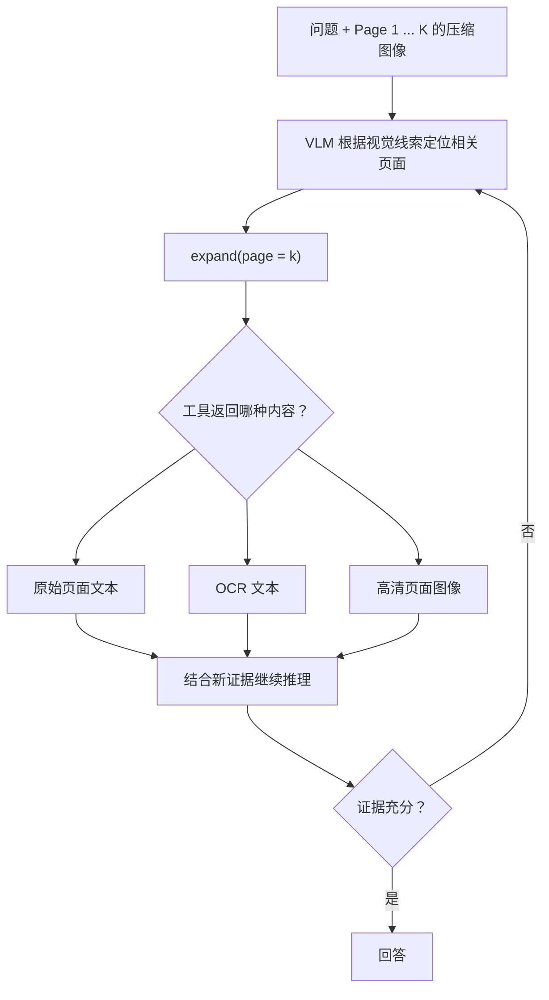
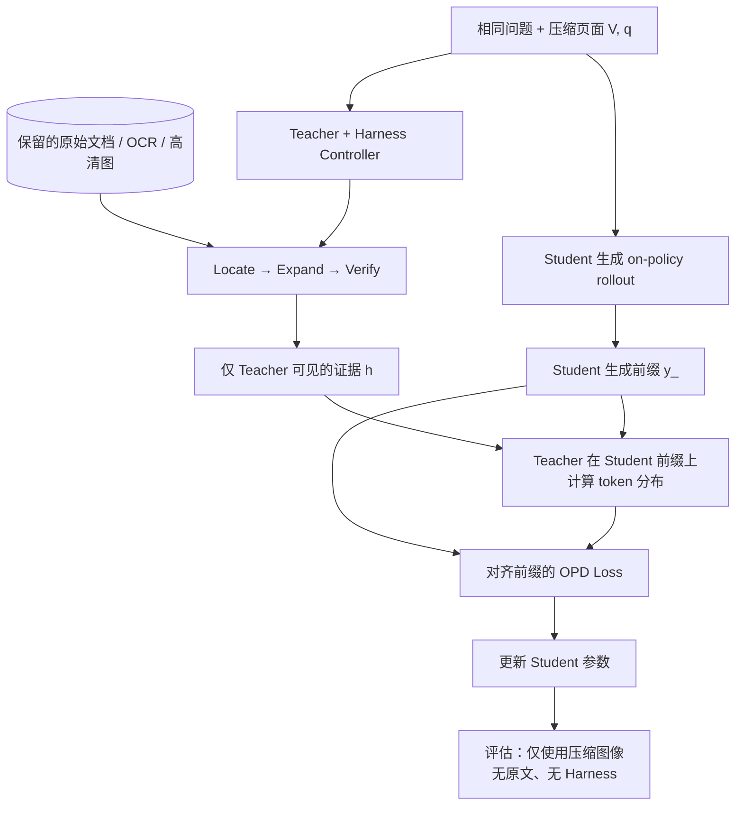

# 研究计划：面向压缩视觉长上下文的 Harness-Augmented OPD

> 研究构想，尚未进行实验验证 · 2026-11-05  
> 灵感来源：[LensVLM: Selective Context Expansion for Compressed Visual Representation of Text](https://arxiv.org/abs/2605.07019)（[官方代码](https://github.com/apple-aiml-research/ml-lensvlm)）  
> [English version](LensVLM-Harness-OPD-proposal.md) · 关联方向：OPHSD、HAD、ActionOPD、异构教师 OPD

## 0. 核心问题与结论

**研究问题：** Teacher 在推理中能够使用外部 Harness 按需访问原始文本或高清页面，能否将其能力通过 Online Policy Distillation（OPD）迁移给一个**只能访问固定预算压缩图像、推理时没有工具**的 Student？

**待检验假设：** 相比直接给 Teacher 完整原文，经过「定位 → 展开 → 验证」的 Harness 所生成的证据条件监督，可能与 Student 剩余的视觉线索更一致，从而形成更有效的蒸馏信号。这是研究假设，不是已验证的结论。

**根本限制：** 如果压缩图像彻底丢失某个任意事实或字符，且没有可以推断它的线索，无工具 Student 不能凭蒸馏可靠恢复。我们要验证的应是对残留线索的使用、页面定位、推理与可学习先验，而非「恢复全部不可见文本」。

## 1. LensVLM 的工作机制

LensVLM 先把长文档渲染为多页压缩图像。VLM 同时看到问题与全部页面的压缩概览，预测相关证据可能在第几页，然后调用展开工具读取对应页面的高保真内容，继续推理、再次展开或直接回答。

### 图 1：压缩页面选择与按需展开

**关键澄清：** 页面定位通常先利用压缩图像上的粗粒度信息，不等于提前全文检索；但如果使用 **Original Text Expansion**，工具会通过页码真正访问**外部保留的原始文本**。模型并非从模糊图像中无损恢复原文。OCR 和高清页面属于其他可选展开模式。

### LensVLM 的训练与我们的设想有何不同？

- **Hard-sample filtering：** 让 Base VLM 先只看压缩图像回答问题，把回答错误的样本筛为 Hard Samples。这是**相对于该 Base VLM 和压缩输入的困难样本**，不能等同于「所有无工具模型都无法解决」。
- **SFT 轨迹合成：** 强 Teacher（论文使用 Qwen3.5-397B）获知正确证据和参考答案，生成调用页面工具与推理的示范轨迹；这里主要**不是更新 Teacher 权重**，而是让 Student 学会工具调用形式。
- **后续 RL：** 被训练的 VLM 自主从压缩页面定位、调用工具并回答，优化真实决策行为。
- **部署差异：** LensVLM 的目标模型在推理时**仍可 Expand**；本提案的 Student 在推理时**完全不允许访问 Harness**。

## 2. Harness 如何抽象？

一个最小可用的外部 Harness 包含：

| 部件 | 主要作用 |
| --- | --- |
| State | 压缩页面、页码与文档索引、展开历史、预算 |
| Controller | 判断何时展开、展开哪页、选择哪种返回模态、是否再次检索 |
| Actions | `select_page`、`read_original_text`、`ocr_page`、`zoom_page`、`verify`、`stop` |
| Observations | 从工具返回的文本、OCR、高清图及其来源 |
| Guardrails | 工具预算、页码合法性、权限、Student 输入隔离 |

**方向 A：Inference-time Harness。** 在部署时把选择、展开、验证作为显式外部工作流。比较视觉选页、全文检索、Oracle 选页以及有无验证等控制器，联合衡量答案准确率、工具调用量与延迟。这属于有工具推理，独立于 OPD。

**方向 B：Harness-Augmented OPD（主要研究方向）。** Teacher 训练期拥有 Harness，Student 训练与评估的模型输入仅包含压缩图像和问题。Harness 不出现在 Student 的测试时上下文。

### 图 2：Teacher-only Harness → Tool-free Student

> 注意信息边界：Teacher-only 的原文、OCR 或展开后的证据**不会被拼到 Student 输入里**；工具调用 token 也不能直接当作没有工具接口的 Student 的生成目标。

## 3. 训练目标与技术细节

记 $V$ 为多页压缩图像，$q$ 为问题，$h$ 为仅 Teacher 可访问的 Harness 观察信息，$y_{<t}$ 为 Student 自己 rollout 中的第 $t$ 步前缀。一个示意性的 **forward-KL** 目标为：

$$
\mathcal{L}_{\mathrm{OPD}} = \mathbb{E}_{(V,q)\sim\mathcal{D},\; y\sim\pi_S(\cdot\mid V,q)}\left[\sum_{t=1}^{|y|}\mathrm{KL}\!\left(\pi_T(\cdot\mid V,q,h,y_{<t})\;\|\;\pi_S(\cdot\mid V,q,y_{<t})\right)\right]
$$

这不是说所有 OPD 都使用 forward KL；KL 方向、mask 和数据选择都需要通过实验确定。这个公式要表达的是：**rollout 与输出前缀来自 Student；Teacher 在匹配前缀上额外利用私有证据进行打分。**

基础工作流：

1. **准备输入：** 文档分页、统一压缩预算，并保留页面索引及原始文档用于 Teacher 的 Harness。
2. **构建任务：** 组织 QA、参考答案与证据页面标注；Oracle 标注仅用于合法的训练对照和评估分析。
3. **Student rollout：** Student 仅凭 $(V,q)$ 自主生成答案或推理文本，记录 prefix $y_{<t}$。
4. **Teacher Harness：** Teacher 使用压缩概览，控制器进行页面定位、展开与证据验证，收集 $h$。
5. **对齐蒸馏：** 对 Student 已生成的相同 token prefix，计算 Teacher 与 Student 的分布，在可学习 token 上计算蒸馏损失。
6. **更新和测试：** 更新 Student；测试时关闭所有 Harness / 原始文本访问，单独报告 Teacher+Harness 的工具上界。

**实现注意事项：** 若模型词表或 tokenizer 不一致，直接 full-vocab token KL 不成立；可改做 action/sequence 级别监督。即便词表相同，也要处理 Teacher 证据与 Student 前缀可能不一致时的监督噪声。Teacher 的工具响应、内部执行轨迹不应被当作 Student 必须生成的文本。

## 4. 最小实验分组

建议保持 Student 架构、训练数据、视觉 token 预算、Student rollout 机制、Teacher 容量与训练计算量尽量一致。

| 实验 | Teacher 信息条件 | Student 测试时输入 | 主要回答的问题 |
| --- | --- | --- | --- |
| Baseline | 无蒸馏 | 压缩图像 + 问题 | 基础能力 |
| **OPD-Visual** | 仅压缩图像 | 同上 | 没有额外文本特权时能蒸馏多少 |
| **OPD-Text** | 完整原始文本 | 同上 | 直接文本 Teacher 是否更强 |
| **OPD-Oracle** | 压缩图像 + GT 证据页面原文 | 同上 | 正确证据带来的理想监督上限 |
| **OPD-Harness** | 压缩图像 + 自主选页、展开、验证结果 | 同上 | 真实 Harness 工作流是否有额外价值 |
| Teacher+Harness | 在线调用原文/高清展开 | **有工具** | 带工具的推理上界，不能与无工具 Student 混为一谈 |

**归因要求：** OPD-Harness 胜过 OPD-Text 是值得研究的结果，但必须排除 Teacher 额外用了更多 token、提示词差异或更长思考预算等混淆因素。OPD-Oracle 可能比自主 Harness 更强，不应把 Harness 超过 Oracle 当成必要条件。

### 必做 Ablation

- 压缩强度、页数、固定视觉预算与多跳证据分布。
- 页面选择：随机、视觉选页、文本检索、Oracle；选错后的恢复。
- 展开内容：原始文本 / OCR / 高清图。
- 选页轮数、每轮证据 token 上限、是否进行 Verify/Replan。
- Teacher 输入：完整原文 vs 证据片段 vs 带推理过程的展开结果。
- 训练：Token KL vs answer-token-only KL vs 额外页面定位辅助任务。
- 计算：统一 Student 训练预算，并单独记录 Teacher/Harness 工具与推理成本。

## 5. 评测与信息不可恢复性

**主要指标：** Student 在**无工具、相同视觉 token 预算**下的 QA 正确率 / EM / 适用的多跳指标。

**诊断指标：** Evidence page Hit@1、Recall@k、多跳全证据召回；Student 独立定位 probe；Teacher 工具调用数、延迟、token 消耗、证据归因正确率、幻觉率；不同压缩率和不同信息可恢复程度下的表现。

尤其要区分：
1. **可从压缩图像识别**：答案或线索仍然可见。
2. **部分可推断**：字符不清楚，但上下文、语义和先验仍有帮助。
3. **不可恢复**：任意名称、数字或细节完全丢失，也没有可推断依据。

第 3 类不应被当作「Student 通过蒸馏恢复了隐藏信息」的证据。建议加入新的实体、随机编号、事实替换与跨文档切分，排除记忆和数据泄漏。

**Leakage 审查：** 按文档源而不是仅按 QA 对划分数据；训练时 Teacher 可以使用额外证据，但测试时 Student 不允许访问；Oracle 证据选择不能冒充自主 Harness 行为；Teacher 合成轨迹若已知答案，必须明确标注这是 answer-conditioned synthesis。

## 6. MVP：分阶段验证

**Stage 0｜无需训练的可行性检查。** 搭建图 1 的简单 `read_page` 工具、页面定位评测和压缩页面 QA，分别测无工具与有工具的能力上限；记录失败样本。

**Stage 1｜小规模 OPD。** 从同族/同 tokenizer 模型入手（例如约 2B Student 与对应较强 Teacher），实现 OPD-Visual、OPD-Text、OPD-Oracle、OPD-Harness。固定 rollout 方案、输入预算和评测集。

**Stage 2｜定位能力诊断。** 用独立 page-selection probe 测试 Student 是否真的更会定位相关内容，而不只是生成更流畅、依赖记忆的答案。辅助定位任务单独列为 ablation。

**Stage 3｜复杂 Harness。** 只有在 Stage 1 显示无工具 Student 确实受益之后，才增加多轮搜索、验证、OCR/高清切换与 controller evolution，避免一开始过度工程化。

### Go / No-go

- **Go：** 在严格控制信息、预算和评测划分下，OPD-Harness 对无工具 Student 的提升相对 OPD-Visual、OPD-Text 稳定成立，并且定位/鲁棒性诊断支持这一解释。
- **模糊：** Teacher+Harness 显著提高，但 Student 没有提高；或改进只来自 Teacher 的额外计算。
- **调整方向：** 难例中的关键事实不可恢复，蒸馏几乎无法提升；转向部署时保留小型 Harness 的工具增强 Student，而不是宣称可蒸馏不可见信息。

## 7. 创新性边界与开放问题

**LensVLM：** 训练一个推理时有 Expand 工具的 VLM。  
**一般 Harness：** 将状态、证据存储、工具和控制策略外置。  
**本 Proposal：** 只在**训练 Teacher** 阶段使用外部证据访问，试图通过 OPD 把与视觉线索有关的推理策略迁移给**无工具 Student**。

这也延续了 OPHSD 关于「程序性能力 vs 动态/不可观察事实」的蒸馏边界讨论。HAD、ActionOPD 可用于比较 harness-aware 或 action-level 监督，但不可直接视为相同方法。

值得验证的问题是：

1. 学生学到的是页面定位能力，还是仅学到答案先验？
2. Oracle 正确证据与自主 Harness 的差异来自哪里？
3. 哪些压缩条件下监督是可迁移的，哪些属于信息理论上的不可恢复？
4. 多轮验证是否比一次性展开更有利于 Student 的在线蒸馏？
5. 对无工具 Student，蒸馏答案 token、页面定位 token，还是两者结合更有效？
6. 统一推理成本后，小模型+轻量 Harness 是否比完全无工具 Student 更实用？

## 参考

- [LensVLM 论文](https://arxiv.org/abs/2605.07019) / [代码](https://github.com/apple-aiml-research/ml-lensvlm)
- 本仓库：[OPHSD 笔记](OPHSD-reading-notes.md) · [HAD 笔记](HAD-reading-notes.md) · [ActionOPD 笔记](ActionOPD-reading-notes.md)
- [英文 Proposal](LensVLM-Harness-OPD-proposal.md)

> 注：本文为待验证的研究计划，所有 OPD-Harness 效果均不是已有实验结果。
