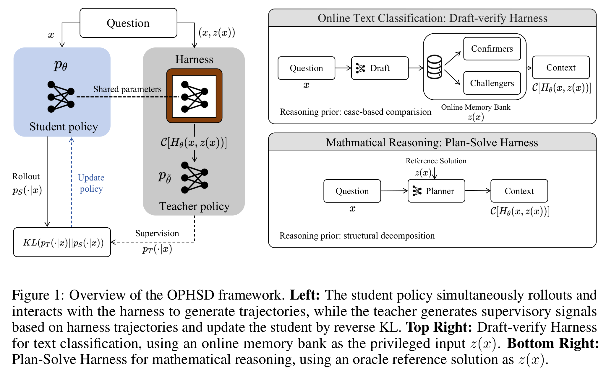

# OPHSD 阅读笔记：On-Policy Harness Self-Distillation

## Summary

OPHSD 把 inference harness 当作训练期 privileged teacher：当前 student 裸跑产生 on-policy response；同一模型在 draft–verify 或 plan–solve harness 中生成结构化 terminal context；冻结的初始模型读取该 context，在同一段 student response prefix 上提供 token distribution。Student 通过 reverse KL 学习 harness 诱导出的决策和推理倾向，部署时移除 harness。

它能够较好迁移 plan、decompose、verify 等由输入本身可推导的程序性模式；Memory Bank 场景只能部分迁移“draft–compare–challenge–revise”的流程，不能把具体动态案例或实时外部信息塞进权重。无检索 student 可能生成参数记忆中的类比，也可能产生无法验证的 pseudo-case。



*图源：OPHSD 原文 Figure 1。*

## 训练数据流：不是模仿 Harness Trace

每个问题 `x` 上，当前 student 先从 bare prompt 采样 response `ŷ`。与此同时，harness 用当前模型构造 terminal context `C[H_θ(x,z)]`；其中 `z` 是 Memory Bank 或参考解。该 context 被 stop-gradient，不反向传播到检索器或 harness 程序。

冻结的初始模型 `θ̃` 作为 teacher，在 harness context 加同一段 student prefix `ŷ_<n` 上计算分布；student 则在 bare prompt 加 `ŷ_<n` 上计算分布。官方代码实际使用：

```math
\mathcal{L}_{\mathrm{OPHSD}}
=\mathbb{E}_{x,\hat y}\frac{1}{|\hat y|}\sum_n
D_{\mathrm{KL}}\left(p_S(\cdot\mid x,\hat y_{<n})
\parallel
p_T(\cdot\mid C[H_\theta(x,z)],\hat y_{<n})\right)
```

论文图示和式 (3) 的排版容易让方向显得含混；代码 [`losses.py`](https://github.com/zzy1127/OPHSD-On-Policy-Harness-Self-Distillation/blob/main/ophsd_train/src/ophsd/losses.py) 明确定义 `reverse_kl = KL(p_S || p_T)`。

代码在 [`batch_builder.py`](https://github.com/zzy1127/OPHSD-On-Policy-Harness-Self-Distillation/blob/main/ophsd_train/src/ophsd/batch_builder.py) 中构造：

```text
student sequence = bare prompt + student rollout response
teacher sequence = harness prompt + 同一 student rollout response
loss mask        = 0 for prompt, 1 for response
```

因此检索案例、draft、confirmers、challengers 都是 teacher-only conditioning，不是 student target token。与 agent SFT 类似，它们不计 loss；但 OPHSD 更准确地说是在两种 prompt 下比较同一 response 位置的 logits，而不是把 tool observation 放入同一条 trajectory 后再模仿。

## Draft–Verify Harness

Memory Bank 保存此前流入的带标签样本，用 BGE embedding 和 cosine similarity 检索。少于 10 条记录时直接 zero-shot；正常流程先取 5 个相似案例生成 draft，再按 draft 标签检索两组案例：

- **Confirmers**：与当前问题相似、标签与 draft 相同，用来支持初判。
- **Challengers**：与当前问题相似、标签与 draft 不同，用来暴露类别边界和反例。

Verify prompt 包含原问题、draft label 和两组案例，让模型维持或修正结论。检索由 Python 的 `MemoryBank.retrieve()` 完成，不存在模型生成的 `<tool_call>`；相关实现位于 [`draft_verify.py`](https://github.com/zzy1127/OPHSD-On-Policy-Harness-Self-Distillation/blob/main/ophsd_train/harnesses/lawbench/draft_verify.py)。

## “流程可蒸馏”与信息边界

Teacher 看到 `p_T(y|x,z)`，裸 student 只能表示 `p_S(y|x)`。当不同动态 `z` 无法由 `x` 推导时，student 不可能恢复本次真实内容；它最多吸收训练分布中稳定、可预测的共同模式。

Reverse KL 会反复提升多个 harness context 下都得到 teacher 支持的 token，例如“考虑另一个标签”“寻找反例”“修正初判”。具体案例事实在不同样本间变化，可能被削弱、记忆化或转化为幻觉。因此所谓 internal retrieval 更准确地说是参数化类比，不是隐藏检索器。

论文 Appendix C 将 harness 分为三类：

1. **完全可蒸馏**：plan-and-solve、自验证、分解等只改变处理 `x` 的程序。
2. **部分可蒸馏**：Memory Bank。比较流程可迁移，具体案例取决于参数中是否已有足够知识。
3. **不可蒸馏**：实时网页、代码执行结果、状态环境反馈等无法从 `x` 和权重推出的信息。

Mask 只能阻止 student 复制外部结果 token，不能消除信息缺失。如果任务要求实时事实、准确引用或可验证来源，推理时仍必须保留外部工具。

## 实验与证据边界

所有实验从 Qwen3-8B 开始。文本分类包括 CAIL-2018 训练、LawBench accusation evaluation，以及 USPTO-50k reaction classification；数学使用 DeepMath 训练，评测 AIME24、AIME25、OlympiadBench、HMMT25。Baselines 包括 GRPO、OPSD，数学任务另有 CRISP。

OPHSD 在 LawBench/USPTO 达到 69.51 F1 / 90.81 accuracy，并在四个数学 benchmark 上取得最高平均 pass@8。重新挂载 harness 没有进一步提升，文本分类中还可能因偏置检索而下降。

但论文用 GPT-4o 判断无 harness reasoning 是否“引用类似案例”，90% 以上 cite rate 只能证明案例式表达增加，不能证明引用真实或等价于 Memory Bank 检索。附录案例也显示：当 challengers 语义不相关时，外部 harness 会强化错误 draft，而裸 student 的内部双向比较反而更好。

## 原文与代码

- [OPHSD PDF](../OPHSD.pdf)
- [官方代码](https://github.com/zzy1127/OPHSD-On-Policy-Harness-Self-Distillation)
- 重点章节：§3.2–3.3、Figure 1、Appendix B.1、Appendix C。
