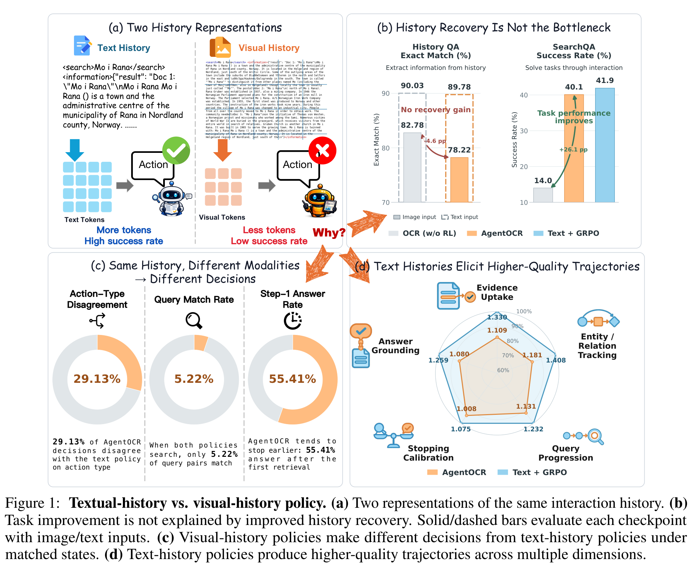
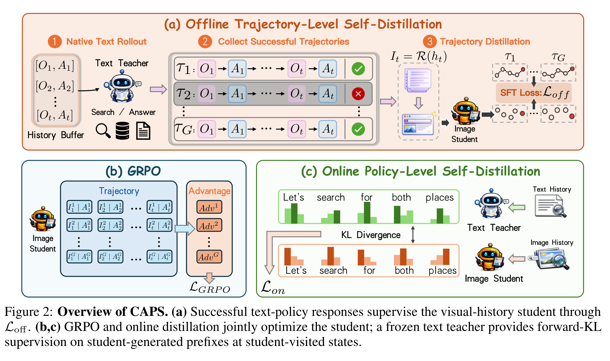

# Reading Is Not Reasoning 阅读笔记：CAPS

## Summary

论文研究 vision–text compression（VTC）在多步 agent 中造成的能力损失。VTC 把不断增长的文本交互历史渲染成图像，用更少的 visual tokens 表示相同内容；但 visual-history agent 明显弱于 text-history agent。作者发现差距并非主要来自 OCR：模型可能能够读出历史事实，却仍在搜索、停止、证据使用和 action 选择上系统性偏移。这被称为 **agentic policy gap**。

CAPS（Cross-modal Agentic Policy Self-distillation）用同一模型的 text-history policy 教 visual-history policy。第一阶段把成功 text trajectories 转成 visual-history SFT 数据；第二阶段联合 visual-history GRPO 与 student-visited states 上的 online forward-KL distillation。目标不是恢复更多文字，而是让压缩界面下的模型学会像 text policy 一样推理和行动。



*图源：原文 Figure 1。*

## Motivation：能读，不等于会用

同一个 interaction history 可以表示为文本 token，也可以通过确定性 renderer 变成页面图像。两种输入包含相同 observation/action 内容，模型架构和 action space 也相同；唯一变化是历史模态。

论文没有明确提出名为“三层诊断”的框架，但第 3 节 *Diagnosing the Visual-History Policy Gap* 按“历史恢复 → 单步决策 → 完整轨迹”从局部到整体推进，可以理解为三层诊断。它要区分两种解释：一是图片中的文字难以恢复，即感知/OCR 问题；二是文字虽然可读，模型却不能像处理 text history 那样利用它做决策，即策略问题。

### 第一层：History Recovery——历史读得准不准

**做法。** 作者基于 SearchQA 的真实 AgentOCR trajectories 构造 4,000 道平衡的 visual History QA。问题只要求定位和提取历史中明确出现的信息，例如最近一次 query、retrieved document title、keyword 是否出现或某个 year，不要求多步规划和 action selection。因此这层主要测 visual localization 与 text extraction。

**关键结果（7B）。** GRPO 将 SearchQA EM 从 14.0% 提升到 40.1%，增加 26.1 个百分点；同期 image-input History QA 却从 82.78% 降至 78.22%。同一历史以纯文本输入时约为 90%（90.03% → 89.78%），训练前后基本不变。

**解读。** Agent 的任务能力大幅提升时，visual history 的文字恢复能力没有同步提高，甚至略有下降。因此 GRPO 的主要收益不能解释为 OCR 变强，history recovery 也不是唯一或主要瓶颈。这里证明的是“任务增益与通用读取分数脱钩”，而不是证明视觉读取已经完美。

### 第二层：Matched-State Decision——相同信息会不会产生相同动作

**做法。** 作者从 text-history policy 的真实 SearchQA trajectories 中抽取 10,000 个 decision prefixes。两种 policy 接收相同 question、actions、observations 和语义历史，只改变历史表示：一边输入 text history，另一边输入其 rendered image，然后比较下一步决策。这一控制变量设计避免把“先前走了不同轨迹”误当成当前模态造成的差异。

**关键结果（AgentOCR vs. text policy）。** 29.13% 的状态上，两者下一步 action type（Search 或 Answer）不一致。在 initial retrieval 后的第一次决策中，AgentOCR 有 55.41% 直接 Answer，text policy 只有 29.80%。当两边都选择 Search 时，query token Jaccard similarity 不低于 0.8 的比例仅为 5.22%。

**解读。** 即使可用信息完全相同，仅改变呈现形式也会改变“是否继续搜索、何时停止、接下来搜什么”。Visual policy 更容易过早作答，query progression 也与 text policy 显著不同。这比 History QA 更接近 agent 的核心能力：问题不只是能否复述历史，而是能否把历史转化为下一步 action。

### 第三层：Full-Trajectory Quality——单步偏差是否形成系统性质量差距

**做法。** 作者从 SearchQA validation trajectories 中分层抽样 2,800 个实例，获得 2,795 个有效的 DeepSeek-V4-Flash 盲评结果。完整轨迹被匿名化，评审看不到 policy 名称、history modality 和最终答案是否正确，并按 0–2 分评价五个维度。作者使用 inverse-probability weighting 校正分层抽样带来的分布偏差。

| 轨迹维度 | Text policy | Visual policy |
| --- | ---: | ---: |
| Evidence uptake | 1.330 | 1.109 |
| Entity/relation tracking | 1.408 | 1.181 |
| Query progression | 1.232 | 1.131 |
| Stopping calibration | 1.075 | 1.008 |
| Answer grounding | 1.259 | 1.080 |

**解读。** Text-history policy 在五个维度上全部领先，差距方向一致；evidence uptake、entity/relation tracking 和 answer grounding 的差距最大，query progression 与 stopping calibration 的差距较小。第二层发现的局部决策偏移会改变后续 observation，并在完整 rollout 中累积为证据使用、实体追踪和最终答案落地的系统性劣化。

### 三层证据如何合起来

1. History QA 表明任务提升并不依赖更强的通用文字恢复能力。
2. Matched states 表明在相同语义信息下，history modality 本身会改变下一步 policy。
3. Full trajectories 表明这种行为差异并非任意风格差异，而是稳定地对应较低的轨迹质量。

因此论文把问题归纳为 **agentic policy gap**，而不只是 OCR/perception gap。这也直接引出 CAPS：既然同一模型体系的 text-history policy 更强，就用它作为 Teacher，将搜索、证据使用与停止行为蒸馏给 visual-history policy。

### 批判性边界

- **第一层是间接论证。** 通用 History QA 没有提高，不等于所有 task-relevant reading 都没有改善。论文 §5.4 还报告 CAPS 的 History QA 为 73.70，低于 AgentOCR 的 78.22，并将其解释为模型向策略任务特化；这是合理解释，但不是直接证明。
- **Matched prefixes 来自 text policy。** 这些状态对 visual policy 可能部分属于分布外输入，因此 29.13% 的不一致不一定全部由模态表示本身造成。
- **动作不一致不等于动作更差。** 不同的 Search query 或停止时机可能同样有效；第二层只能证明 policy 不同，第三层的轨迹评分和最终任务结果才支撑“visual policy 更差”。
- **轨迹质量依赖 LLM judge。** 论文使用盲评和 inverse-probability weighting 降低偏差，但没有人工评估；五个维度的均值差约为 0.07–0.23，仍应结合不确定性与最终成功率理解。

## 问题形式化

第 `t` 步的 canonical text history 为 `h_t`，确定性 renderer `R` 把它转换为 visual history `I_t`。于是同一个语义状态有两个 paired contexts：

```math
x_t^T=(I,h_t),
\qquad
x_t^I=(I,I_t)
```

其中 `I` 是任务 instruction。Frozen text policy `π_φ^T` 是 source，trainable visual policy `π_θ^I` 是 target。CAPS 希望在对应状态上缩小两者 response distribution 的差距。

这和 Teacher-only external-evidence distillation 不同：text teacher 没有额外答案、原文或 oracle，它只看到与 student 相同的 interaction content，只是表示形式更容易被模型利用。

## CAPS 两阶段方法



*图源：原文 Figure 2。*

### Stage 1：Offline Trajectory Self-Distillation

作者先训练一个 text-history GRPO policy，并收集其交互 trajectories。只保留完成任务、action 可解析、response 未截断的成功轨迹；同一任务有多个轨迹时，依次优先选择交互步数更少、重复搜索更少、response tokens 更少、prompt tokens 更少的轨迹，最后优先较晚的 Teacher training step。

对每个决策 step，instruction、interaction content 和完整 teacher response 都不变，只把 history 从 text `h_t` 替换成其 rendered image `I_t`：

```text
(text instruction, text history, teacher reasoning + action)
                         ↓ replace history representation only
(text instruction, image history, same teacher reasoning + action)
```

Visual student 对完整 response 做 next-token SFT，因此同时学习 reasoning 与 action。这个阶段提供稳定初始化，但只覆盖 text teacher 访问过的成功状态。

#### NLL 是什么？这一阶段为何叫 Self-Distillation？

Next-token NLL 是 negative log-likelihood，即对 Teacher response 做标准 teacher-forcing cross-entropy：

```math
\mathcal L_{\mathrm{off}}
=-\frac{1}{|y^T|}\sum_k
\log \pi_\theta^I(y_k^T\mid I,I_t,y_{1:k-1}^T)
```

Student 给目标 token 的概率越高，NLL 越小。因此这一阶段的**优化形式就是 SFT**：不读取 Teacher logits，也不计算师生 KL，而是把成功 Teacher sequence 当 hard label。

这里有一个重要术语边界。Text Teacher 已经经过 text-history GRPO，Visual Student 则是随后训练的 target checkpoint；二者当前权重不同，输入模态也不同。因此如果把 self-distillation 严格限定为“同一时刻、同一组权重的两个 context view”，CAPS offline 阶段并不完全符合。

论文采用的是更宽泛的 self-distillation：Teacher 与 Student 来自同一个 Qwen2.5-VL base，架构、规模、tokenizer 和 action space 相同，没有额外更大的外部 Teacher；更强监督来自模型自身在 text interface 下训练出的 policy。更精确的表述应是：

```text
GRPO-trained text checkpoint
→ visual checkpoint 的 cross-modal sequence-level distillation
→ 优化上表现为 Teacher-generated synthetic trajectory SFT
```

所以“self”强调同源模型体系，“distillation”强调把 text policy 的能力迁移到 visual policy，“SFT/NLL”描述实际 loss；三者不是同一维度。

#### 两个阶段使用的是同一个 Teacher 吗？

在论文的方法定义层面，答案是**同一个 source-policy 训练线**。§4.1 只定义一个 frozen text-history source policy `π_φ^T`；§4.2 先用 GRPO 训练 text-history agent，并把这条训练线产生的成功 trajectories 用于 offline distillation；§5.1 也只列出一个 size-matched `Text + GRPO (Qwen2.5-VL)` Teacher，表 1–2 将其标为 CAPS source policy。论文没有为两个阶段另外训练两名不同 Teacher。

但两阶段使用 Teacher 的接口不同：

| 阶段 | Teacher 提供什么 | Student 如何学习 |
| --- | --- | --- |
| Offline trajectory self-distillation | Teacher 已采样出的成功完整 response（reasoning + action） | 把 history 渲染成图像，对具体 token sequence 做 next-token SFT/NLL；不读取 Teacher logits |
| Online policy self-distillation | 在 student-visited state 和 student-generated prefix 上的全词表 next-token distribution | 用 teacher-to-student forward KL 对齐软分布；Teacher 不独立 rollout 或执行 action |

还有一个 checkpoint-level 边界。附录 A.1 明确说 offline SFT 使用的是 **text-history policy 训练过程中保存的实际 rollouts**；SearchQA 读取 training step 50 及之后的数据，再按成功、action 合法、连续 step、最多四步、单次 response 不超过 511 tokens 等条件过滤，每道题只保留一条。它没有说这些轨迹由最终 frozen Teacher checkpoint 重新 rollout 得到。

因此最严谨的说法是：两个阶段共享同一个 Text + GRPO source-policy lineage；offline 阶段消费这次 Teacher 训练过程中采样并保存的 hard-label trajectories，online 阶段则调用 frozen source checkpoint 产生 soft logits。论文没有报告中间 rollout checkpoint 与最终 frozen checkpoint 的行为差异，所以不能进一步断言每条 offline trajectory 都来自 online 阶段那个精确参数快照。

### Stage 2：Visual-History GRPO + Online Distillation

Visual student 随后在图像历史界面中自主 rollout，使用环境 return 做 GRPO。这样优化真实部署分布，但 sparse reward 不能为每个 token 提供明确的策略修正。

因此每当 visual student 到达状态，系统同时保留由**同一批 student actions 与 environment observations**组成的 canonical text history。Student 先采样 response；frozen text teacher 与 visual student 再在同一 student prefix 上计算全词表分布：

```math
p_k^S=\pi_\theta^I(\cdot\mid x_t^I,y_{1:k-1}),
\qquad
p_k^T=\pi_\phi^T(\cdot\mid x_t^T,y_{1:k-1})
```

Online loss 使用 teacher-to-student forward KL，并逐 position clip，避免极大 KL 主导梯度。Student 与 teacher response mask 的交集决定哪些 token 参与；若完整 response 没有合法环境 action，则整段 mask 为 0。

#### Online Teacher 是否独立 rollout？

不会。当前环境状态由 visual student 之前执行的 actions 与 observations 形成；到第 `t` 步后，visual student 先采样完整 response `y_t`，其中可以同时包含 reasoning 与 action。Frozen text teacher 不生成另一条 reasoning/action，也不向环境提交自己的 action，而是作为 sidecar scorer，在每个 **student-generated prefix** `y_{1:k-1}` 上输出全词表 next-token distribution。只有 student response 中解析出的 action 会推进环境。

因此“Teacher 没有继续生成 argument”并不是这里的问题。即使 student 已经生成到 function call 或 JSON argument 中间，Teacher 仍会对该 prefix 下的所有候选 token 给出概率；实际下一个 token 仍由 student policy 采样，KL 只提供分布级训练信号。

真正的失败模式是 student 最终得到截断或不可解析的 tool call。CAPS 在完整 response 层面检查 action：若没有合法可执行 action，就将整段 online-distillation mask 置零。这能避免用 malformed response 计算 KL，却不会直接教会模型如何补全括号或修复 argument；Teacher 在异常 student prefix 上的分布也可能是噪声。工程实现若要求严格结构合法，可额外使用 grammar/JSON-schema constrained decoding，再保留 action validation 与 invalid-response mask。论文方法本身依赖后两者，而不是让 Teacher 接管半截 tool call。

最终目标为：

```math
\mathcal L=\mathcal L_{\mathrm{GRPO}}+\lambda\mathcal L_{\mathrm{online}}
```

GRPO 保留环境 reward 作为主信号；online distillation 在 visual student 自己访问的状态上提供 dense policy guidance。论文将 online distillation 明确描述为 “an auxiliary objective during GRPO”。其权重较小：SearchQA 使用 `λ=0.05`，ALFWorld 使用 `λ=0.01`；两者的 per-token KL clip `τ` 都是 `0.05`。

#### 为什么 GRPO 不是第三个阶段？

这里必须区分 **training stage** 与 **loss term**。CAPS 的阶段一是独立的 offline trajectory self-distillation：用 text policy 的成功轨迹做 SFT（原文 Eq. 8），得到 visual policy 的初始化 checkpoint。阶段二才是 online training，其中 GRPO 与 online policy self-distillation 同时优化（原文 Eq. 14），并非先完成一次 GRPO、再启动一次 OPD。

第二阶段共享同一批 student rollout：visual student 在 image history 下采样 trajectories；环境结果用于计算 GRPO reward/advantages；系统同时保留由这些 student actions 与 observations 形成的 canonical text history，再让 frozen text teacher 对同一 student response prefix 计算 full-vocabulary logits，得到 forward-KL loss。因此数据流是：

```text
Offline visual-history SFT checkpoint
                    ↓
Visual student rollout ──→ environment reward ──→ GRPO loss
                    └────→ paired text history ─→ Teacher logits ─→ online KL
                                                        ↓
                                             joint update of Student
```

如果把前置的 source-policy preparation 也算进去，完整工程流水线可以写成 “text-history GRPO Teacher → offline visual SFT → online GRPO + KL”。但论文所说的“两阶段 CAPS”是在数两个 student distillation/training stages，不是在枚举整个项目里出现过多少次优化。

## 为什么必须两阶段

只做 offline distillation 会遇到 state-distribution mismatch：visual student 一旦执行不同 action，就进入 text teacher 成功轨迹没有覆盖的状态。

只做 online distillation 则缺少稳定的视觉策略初始化，student rollout 质量较低。SearchQA Table 3 的拆分正好验证这一结构：

| Variant | 3B Avg. EM | 7B Avg. EM | 含义 |
| --- | ---: | ---: | --- |
| `Off-SD → GRPO` | 37.4 | 42.9 | 阶段一完成后，阶段二只做普通 GRPO |
| `GRPO + On-SD` | 37.1 | 41.4 | 没有 offline 初始化，直接联合 GRPO 与 online distillation |
| Full CAPS | 39.2 | 43.5 | offline SFT 初始化后，再联合优化 GRPO 与 online distillation |

两种单独组件都有效，完整 CAPS 最好，说明 offline successful behavior 与 online student-state correction 互补。

#### OPD、On-SD 与 self-distillation 的术语边界

本文相关工作把 OPD 用作 on-policy distillation 的一般类别；方法部分更具体地称自己的在线目标为 **online policy self-distillation（On-SD）**，并引用 Zhao et al. (2026) 的 OPSD。这里的 “online/on-policy” 指 Teacher 在 visual student 自己访问的 states 和 student-generated prefixes 上提供分布监督。

“Self” 则表示 Teacher 与 Student 来自同一个底座模型体系，使用相同规模、架构、tokenizer 与 action space，没有引入更大的外部 Teacher；主要能力差来自 text-history 与 image-history interface。它不应被理解为二者在训练时共享同一组可变参数：online 阶段的 text Teacher 是 frozen source checkpoint，visual Student 是被更新的 target checkpoint。

## Benchmark 与结果

**SearchQA** 包含 NQ、TriviaQA、PopQA、HotpotQA、2Wiki、MuSiQue、Bamboogle；NQ 和 HotpotQA 用于训练，其余用于 OOD generalization。Agent 最多交互四步，每次搜索返回 top-3 passages。

**ALFWorld** 包含六类长程家庭任务。主实验保留完整历史 `H=50`，同时报告短窗口 `H=2`。

模型为 Qwen2.5-VL-3B/7B-Instruct，使用 size-matched text-history policy 作为 teacher。SearchQA 上 CAPS 相比 AgentOCR 提升 5.0 / 3.4 个百分点；full-history ALFWorld 提升 15.6 / 14.5 个百分点。

7B CAPS 在 SearchQA 达到 43.5 average EM，略高于 text teacher 的 43.0；ALFWorld 达到 95.7%，高于 text teacher 的 92.6%。同时相对 matched text-history policy，平均/峰值 memory-context cost 最多降低 63.3% / 83.4%。

## 与 Harness-OPD / PRISM Proposal 的关系

CAPS 可以看作最干净的 **representation-level OPD**：Teacher 与 Student 看到同一语义历史，没有 privileged external facts；差别只来自 text renderer 与 image renderer。它证明即使信息理论上相同，interface change 仍会造成 action policy mismatch。

因此它应成为 LensVLM/PRISM 的核心 baseline：

- **CAPS / OPD-Visual**：Teacher 只有 canonical text history，没有额外原文工具优势；测纯跨模态 policy transfer。
- **Harness-OPD**：Teacher 还能展开原始文本/OCR/高清页；测 privileged evidence 是否提供额外可迁移收益。
- **PRISM**：进一步判断这部分额外 Teacher advantage 是否受 Student 压缩图像中的可见线索支持。

CAPS 没有回答不可见事实能否蒸馏，因为它没有给 Teacher 注入 Student 永远看不到的新信息。它主要消除的是 **policy gap**，不是 **information gap**。

## 局限

CAPS 要求 text teacher 与 visual student 使用相同模型家族、action space 和 compatible vocabulary，才能在 matched prefix 上做 full-vocabulary KL。方法也依赖 deterministic renderer，使 text/image state 能严格配对。

Offline 阶段只学习筛选后的成功轨迹，可能丢失有价值的恢复行为；online 阶段把 text policy 当成固定上界，但 text policy 本身也可能决策错误。视觉压缩方案没有被联合优化，因此论文回答的是“如何对齐 policy”，不是“什么视觉 renderer 最优”。

## 原文定位

主要依据：[Reading Is Not Reasoning 原文](../READING%20IS%20NOT%20REASONING-BRIDGING%20THE%20AGEN-TIC%20POLICY%20GAP%20IN%20VISION%E2%80%93TEXT%20COMPRESSION.pdf) Figure 1–2、§3、§4.1–4.4、§5.1–5.3。
