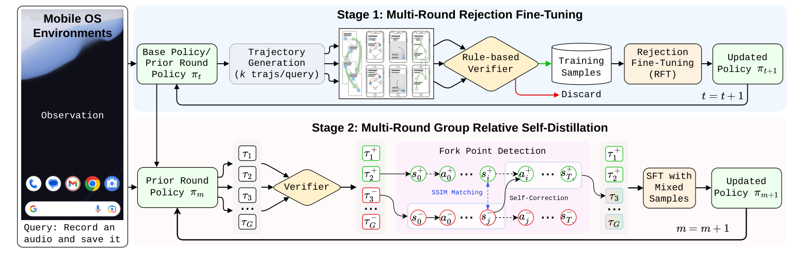
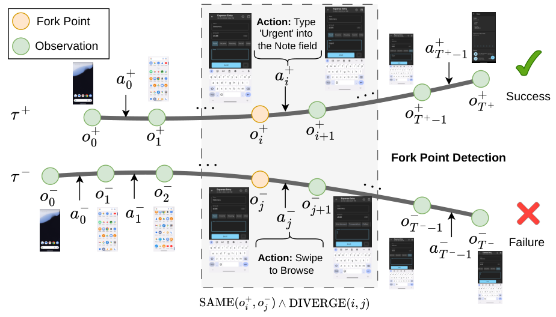

# UI-Voyager 阅读笔记：从失败 GUI 轨迹中做局部自纠错

## Summary

UI-Voyager 面向 Android 长程 GUI 操作中的两个问题：成功轨迹稀缺，以及只有最终成功/失败奖励时无法判断具体哪一步导致失败。它使用两阶段训练：先通过多轮 Rejection Fine-Tuning（RFT）反复收集并模仿模型自己的成功轨迹，再通过 Group Relative Self-Distillation（GRSD）把同一任务的成功与失败 rollouts 对齐，在共享屏幕状态的分叉点，用成功轨迹的 reasoning + action 监督失败轨迹的 context。

最重要的边界是：UI-Voyager 没有生成或演化新的 Harness，也不是在 Student prefix 上读取 Teacher logits。AndroidWorld 的 action interface、ADB executor 和 rule-based verifier 都是固定的；GRSD 的实际优化是标准 response-token SFT。所谓 “failed experience” 的准确含义是：**失败轨迹提供在哪里纠错，成功轨迹提供纠错目标。**



*图源：原文 Figure 2。*

## 固定的 Action DSL

AndroidWorld 将 GUI interaction 定义为一个有限的 Domain-Specific Language（DSL）：

| Code action | 含义 |
| --- | --- |
| `click(x,y)` | 点击屏幕坐标 |
| `long_press(x,y)` | 长按坐标 |
| `swipe(x1,y1,x2,y2)` | 从起点滑到终点 |
| `open_app(app_name)` | 打开指定 App |
| `input_text(text)` | 输入文本 |
| `keyboard_enter()` | 按 Enter |
| `navigate_back()` / `navigate_home()` | 系统返回/主页 |
| `wait()` | 等待或 no-op |
| `status(goal_status)` | 终止并报告状态 |
| `answer(text)` | 返回最终文本答案 |

它也可以被序列化成 JSON/tool call；关键不是表面语法，而是 action name 与 arguments 能被 parser 校验，并由 Android/ADB runtime 执行。UI-Voyager 学习的是在当前 screenshot 和 history 下选择哪种 action 及其参数，不会发明新 action、修改 schema 或生成带分支的 GUI 控制程序。

因此在 *Code as Agent Harness* 的宽口径下，它使用了 **code-defined action interface**；但 UI-Voyager 本身是 policy 与训练方法，AndroidWorld runtime 才是执行 Harness。

## Stage 1：Multi-Round Rejection Fine-Tuning

第 `t` 轮 policy 对新生成的训练任务采样多条 trajectories。Rule-based verifier 只保留成功样本，失败样本直接丢弃；保留的完整 responses 被用于 SFT，得到下一轮 policy：

```text
policy π_t
→ generate k trajectories per task
→ verifier keeps successes
→ response SFT
→ policy π_{t+1}
```

初始轮使用多种规模的 Qwen3-VL 产生轨迹，训练目标模型为 Qwen3-VL-4B-Instruct；之后由上一轮 checkpoint 继续生成新数据。论文报告多轮 RFT 将 Pass@1 从约 37% 提升到 73.2%，并使用第三轮 checkpoint 初始化后续 GRSD/GRPO/PPO 比较。

RFT 只从成功经验学习，并不诊断失败原因。它的作用是先得到一个能够偶尔完成复杂任务的 warm start，否则后续同组 rollouts 很难找到成功 peer。

## Stage 2：Group Relative Self-Distillation

对同一个任务采样一组 trajectories，使用 verifier 将其分为成功组与失败组，并选最短成功轨迹作为 self-teacher。GRSD 不把最终成功 reward 均匀分给整条 trajectory，而是寻找成功/失败轨迹真正发生行为分叉的位置。

### Fork Point Detection

设成功轨迹为 `τ+`，失败轨迹为 `τ-`。对失败步骤 `j`，寻找成功步骤 `i`，要求：

1. 两个 action 之前的 screenshots 近似相同；
2. 两个 action 之后的 screenshots 明显不同；
3. 匹配索引单调前进，避免把失败轨迹后面的状态映射回成功轨迹更早的状态。

截图先移除固定高度的 status bar、缩小并转成灰度；mean-hash 低于 0.80 的 pair 直接过滤，其余用 SSIM 判断状态等价：

```math
\mathrm{Same}(o_a,o_b)
=
\mathbf{1}\bigl[\mathrm{SSIM}(\phi(o_a),\phi(o_b))\geq\theta\bigr].
```

如果前状态相同，但 next observations 不相同，就把该 pair 视为有信息的 fork point；若前后 screenshots 都近似相同，说明两个 action 可能效果等价，该 pair 被跳过。



*图源：原文 Figure 3。*

### 如何把失败轨迹变成训练样本

对匹配 pair `(j,i*)`，GRSD 保留失败轨迹在步骤 `j` 的完整 prompt/context，但把 response 替换为成功轨迹步骤 `i*` 的 response：

```text
input  = failed trajectory context at step j
 target = successful trajectory response at matched step i*
```

即：

```math
x_j^{\mathrm{train}}
=
\bigl[
\mathrm{prompt}_j^{-}
\mid
\mathrm{response}_{i^*(j)}^{+}
\bigr].
```

目标 response 同时包含成功 peer 的 thinking、executed action 和 tool-call format。训练只在 response tokens 上计算标准 next-token NLL：

```math
\mathcal L_{\mathrm{GRSD}}
=
-\frac{1}{|\mathcal D|}
\sum_{x\in\mathcal D}
\frac{1}{T_x}
\sum_{t=1}^{T_x}
\log \pi_\theta(y_t\mid s_{1:P_x},y_{1:t-1}).
```

论文实验中 GRSD 是单独的训练目标，并非 `GRPO + distillation loss` 的联合优化。

## 为什么叫 Self-Distillation？

这里没有外部大 Teacher：

```text
Teacher signal = 当前模型同组 rollout 中的成功 trajectory
Student context = 当前模型同组 rollout 中的失败 trajectory
```

“Self”来自同一 policy 产生成功/失败 peers；“distillation”是把成功轨迹的局部决策迁移到失败 trajectory context。它属于 sequence-level hard-label self-distillation，实际形式是 SFT，不是 OPHSD/CAPS 那种 matched Student prefix 上的 Teacher full-vocabulary KL。

也不能把它简化成“选择模型做错的题，再给最终正确答案”。它是在长程 GUI 任务中找到相同中间屏幕状态下的具体分叉步骤，只纠正该步骤的完整 response。

## 实验结果

模型为 Qwen3-VL-4B-Instruct，环境为 AndroidWorld，训练任务超过 7,000 个，评测覆盖 116 类任务。主要结果为：

- Base Qwen3-VL-4B：45.3% Pass@1；
- 多轮 RFT checkpoint：73.2%；
- 从相同 RFT checkpoint 开始，GRPO/PPO 最终约 76%；
- UI-Voyager 的 GRSD：81.0%。

论文将 81.0% 与 AndroidWorld 报告的 80.0% human performance 比较。不过多数 baseline 数字来自既有论文而非统一重跑；“超过人类”也取决于 AndroidWorld 的特定任务分布、action abstraction 和 verifier，并不表示一般手机操作能力超过人类。

## “Via Failed Experience” 的准确解读

两阶段对失败数据的使用不对称：

| 阶段 | 失败轨迹的作用 |
| --- | --- |
| RFT | 被 verifier 丢弃，不直接进入 loss |
| GRSD | 提供 Student 实际访问的 context、错误 action 与 fork-point 位置 |

因此更准确的概括是：

> RFT 从成功经验建立能力；GRSD 用失败经验定位需要纠正的状态，再借成功 peer 提供 hard target。

失败本身并不告诉模型正确 action。如果同组没有任何成功 rollout，或成功/失败轨迹没有可匹配的屏幕状态，GRSD 就无法构造监督。

## 与 OPD、OPHSD、GHD 和 ComputerSD 的区别

| 方法 | 状态来源 | Privileged signal | 训练信号 |
| --- | --- | --- | --- |
| OPHSD | Student rollout | fixed task-specific Harness terminal context | matched-prefix Teacher logits/KL |
| GHD | Student response/trajectory prefix | action 后的 next screenshot | 参数共享 Teacher 重打分，并按恢复条件 gate |
| ComputerSD | online Student GUI trajectory | 前后截图 analyzer 的 guidance + step value | value-gated token OPSD + GRPO |
| UI-Voyager | 同组成功/失败 self-rollouts | 成功 peer 的完整 response | failed context + successful response 的 SFT |

UI-Voyager 的优势是实现简单，不需要外部 Teacher logits，也不需要额外 GUI analyzer；代价是必须先采到成功轨迹，并依赖跨轨迹状态匹配。

## 方法边界与批判

1. **截图相似不等于状态相同。** 相同页面可能具有不同焦点、后台变量、已完成 obligation 或未显示设置；SSIM 也容易受动画、键盘、toast 和时钟影响。
2. **成功 response 未必适配失败 history。** 即使当前 screenshot 相同，两条轨迹的记忆和先前 reasoning 可能不同，把成功 response 接到失败 prompt 后可能产生语义不连续。
3. **没有执行纠正 action。** GRSD 离线拼接训练 pair，不从 fork point 真正执行成功 action 并验证该失败状态能否恢复，因此不是 counterfactual repair rollout。
4. **只利用有成功 peer 的失败。** 最难、所有 rollouts 都失败的任务仍缺少监督。
5. **Action DSL 是环境给定的。** UI-Voyager 没有提出新的 Code for Acting interface，也不优化 Harness；主要贡献是 credit assignment 与 self-training data construction。
6. **成功轨迹不等于每一步最优。** Terminal verifier 只能保证整条任务成功，不能证明被迁移的 reasoning 最简、动作最安全或路径最优。

## 原文与代码

- [UI-Voyager 原文（arXiv:2603.24533）](https://arxiv.org/abs/2603.24533)
- [官方代码与模型](https://github.com/ui-voyager/UI-Voyager)

主要依据：Figure 2–3、Table 1–2、§3.1–3.3、§4.1–4.3、§5。