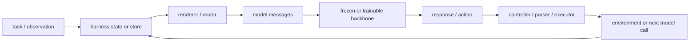
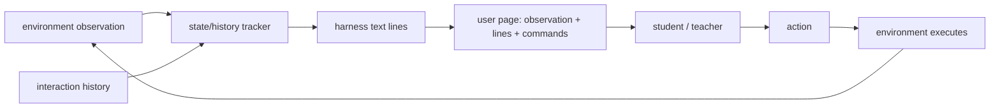
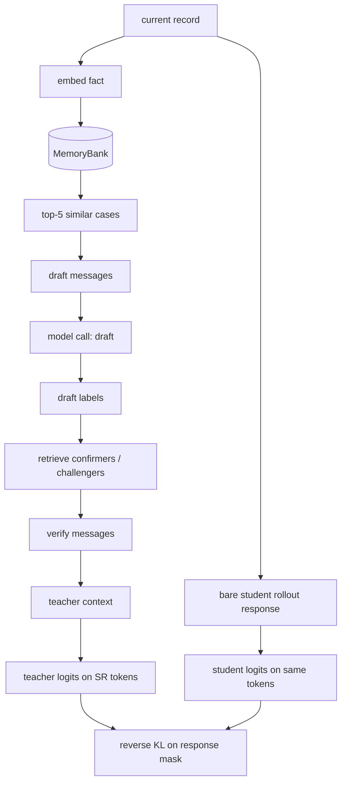
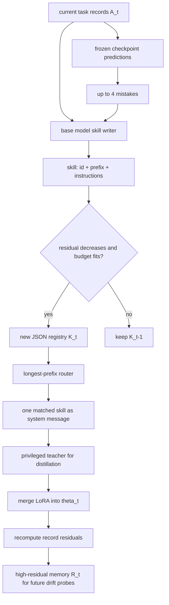
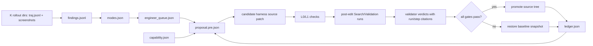
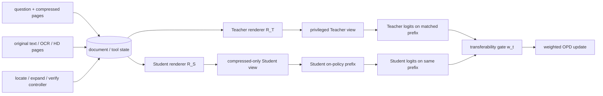

# Harness 定义与 Formulation 对照

## 一句话结论

这几篇论文中的 **harness 不是同一个严格定义的数学对象**，而是同一类模型外部机制的不同实例：它在不直接改变 backbone 参数的前提下，读取任务、交互历史、外部信息或执行证据，并通过附加上下文、组织多次模型调用、维护记忆或控制 agent runtime 来改变模型的行为。

HAD、OPHSD、HERD 和 GUI-HARVEST 分别强调 harness 的四个层次：**文本状态提示、推理编排程序、有限容量外部记忆、完整可执行 agent runtime**。新加入的 HPD 进一步把 runtime state、serializer、transition 与 termination semantics 显式化。讨论“蒸馏 harness”时必须说明被迁移的是哪一层，以及部署时 harness 是否仍然存在。

## 跨论文统一抽象

下面不是任何一篇论文原封不动给出的定义，而是便于比较的统一 formulation。设：

- `x` 是任务输入；
- `τ_(1:t-1)` 是第 `t` 步之前的 observation、reasoning、action 和 tool result 历史；
- `e_t` 是可选的外部信息，如 memory、检索结果、verified answer 或 GUI 执行证据；
- `θ` 是 backbone 参数；
- `H` 是不属于 `θ` 的外部机制。

最小的 context-level harness 可以写成：

```math
c_t^H = H(x, \tau_{1:t-1}, e_t),
\qquad
(z_t,a_t) \sim \pi_\theta(\cdot \mid x,\tau_{1:t-1},c_t^H).
```

这里 `H` 产生额外上下文 `c_t^H`，模型仍负责生成 reasoning `z_t` 和 action `a_t`。更一般地，harness 可以维护内部状态并组织多次模型调用：

```math
q_t = T_H(q_{t-1}, o_t, u_t),
\qquad
u_t \sim \pi_\theta(\cdot \mid P_H(q_{t-1},o_t)),
\qquad
y = R_H(q_T).
```

其中 `P_H` 构造每次调用的 prompt/context，`T_H` 更新 harness 状态并执行工具或控制流，`R_H` 从终态读出答案。按这个抽象，harness 可以包含：

1. **Context**：prompt、状态摘要、规则、retrieved memory；
2. **Orchestration**：plan–solve、draft–verify、多轮调用和路由；
3. **Interface**：action schema、tool wrapper、环境 observation；
4. **Control**：验证、重试、错误恢复和终止；
5. **Persistent state**：skill、案例、residual memory 或优化 ledger。

并非每篇论文都包含以上全部组成。把所有 harness 都简称为“prompt”会低估 OPHSD 和 GUI-HARVEST；把它都称为“完整 agent runtime”又会夸大 HAD 中 harness 的权限。

## 先看代码：Harness 在运行时由什么构成

从实现而不是论文术语看，一个 harness 通常至少有四个可分离部分：

```text
state/store   保存环境记录、memory、skill 或优化 ledger
renderer      把 state 和当前输入渲染成 chat messages / observation page
controller    决定调用次数、路由、重试、验证和终止
interfaces    解析 action，调用工具或环境，再把结果写回 state
```

它不一定是一个名为 `Harness` 的类。HAD 主要体现为 deterministic tracker + text renderer；OPHSD 是 retrieval store + 多次 LLM call controller；HERD 的可部署部分主要是 JSON skill registry + system-message router；GUI-HARVEST 的 harness 则是一个可编辑源码目录，另有一套 JSON artifacts 管理优化流程。



因此比较 harness 时，最有用的问题不是“它有没有 prompt”，而是：**state 存在哪里、renderer 输出什么格式、controller 控制哪些调用、哪些内容会进入模型上下文、部署时哪些部分仍存在。**

## 逐篇定义

### HAD：固定的文本状态跟踪与行为监控

HAD 没有把 harness 定义成一个独立的通用程序 `H`，而是把它实现为一组**任务无关、跨环境共享的代码与文本模板**。它在每一步向 observation 增加两类信息：

- state tracking：当前位置、持有物、已访问位置等状态记录；
- behavior monitoring：重复动作、停滞、近期失败等条件触发提示。

可将其写为：

```math
h_t = H_{\mathrm{track}}(\tau_{1:t})
\oplus H_{\mathrm{monitor}}(\tau_{1:t}),
\qquad
x_t^h = x_t^0 \oplus h_t.
```

这里 `x_t^0` 是移除 harness 文本但保留同一学生交互历史后的输入，`x_t^h` 是带 harness 的输入。重要边界是：HAD 的 harness **只添加文本，不替模型选择或屏蔽 action**。训练和部署使用同一个固定 harness；HAD 的目标是让小模型学会正确利用它，而不是要求最终移除它。

HAD 用同一教师在 `x_t^h` 与 `x_t^0` 下的行动差异识别 harness 改变决策的位置：

```math
a_t^+ \sim \pi_\phi(\cdot \mid x_t^h),
\qquad
a_t^- \sim \pi_\phi(\cdot \mid x_t^0).
```

因此 HAD 中的核心问题是 **harness-conditioned action use**，而不是 harness 本身如何生成或演化。

#### HAD 在页面上实际长什么样

HAD 的公开仓库目前仍写着 “code, harness, and training scripts will be released”，没有可核对的源码 schema。下面只能依据论文 Appendix B.2 的模板和触发规则还原运行时格式，不能把它冒充官方 JSON 类型。

每一步传给模型的 user page 大致是：

```text
Observation: Nothing happens.

You are at sofa 1. You are holding remotecontrol 1.
12 of 14 places visited; 2 unvisited (garbagecan 1, ottoman 1).
This visit to sofa 1: arrived turn 18, 2 commands executed since.
Here, 'take remotecontrol 2 from sofa 1' does nothing (attempt 2).
This state will not accept it; choose another action.
Step 21 of 30. Only 9 steps remain.

Admissible commands:
examine remotecontrol 1 / go to armchair 1 / ...
```

对应的内部记录可以用以下**示意结构**理解：

```json
{
  "situation": {"location": "sofa 1", "holdings": ["remotecontrol 1"]},
  "visit": {"visited": 12, "unvisited": ["garbagecan 1", "ottoman 1"]},
  "budget": {"step": 21, "cap": 30},
  "failure": {"action": "take remotecontrol 2 from sofa 1", "attempts": 2},
  "stall": {"steps_without_new_state": 0}
}
```

这里真正的 harness 本质是：从环境状态和历史计算这些字段，按固定模板转成文本，再插到 observation 与 admissible commands 之间。论文明确说明，同一套代码和模板跨三个环境共享，只有读取环境状态的 adapter 不同；它不会替模型选 action，也不会拦截 action。



源码状态：[`moon4sake/harness-aware-distillation`](https://github.com/moon4sake/harness-aware-distillation) 目前只有项目页文件，尚未公开训练与 harness 实现。

### OPHSD：任务特定的多调用推理程序

OPHSD 把 inference harness 形式化为一个由模型调用和确定性状态转移组成的动态程序。它维护状态 `s_t`，第 `t` 次调用基于当前状态产生内容 `c_t`，确定性转移函数 `τ_H` 更新状态，最终 readout `ρ_H` 从终态抽取答案：

```math
c_t \sim p_\theta(\cdot \mid s_{t-1},x),
\qquad
s_t = \tau_H(s_{t-1},c_t),
\qquad
y = \rho_H(s_T).
```

若 harness 还读取 privileged input `z(x)`，例如 Memory Bank 或参考答案，则得到 `H_θ(y | x,z(x))`。论文的两个具体实例是：

- draft–verify：检索相似案例，先 draft，再用 confirmers/challengers verify；
- plan–solve：先构造计划，再按计划求解。

训练时用 `C[H_θ(x,z)]` 表示 harness 运行后的 terminal context。它只作为 teacher conditioning；裸 student 只看 `x`。所以 OPHSD 要内化的是 harness 诱导的**程序性推理分布**，不是复制整个 harness trace：

```math
D_{\mathrm{KL}}\bigl(
p_S(\cdot \mid x,y_{1:n-1})
\,\Vert\,
p_T(\cdot \mid C_H(x,z),y_{1:n-1})
\bigr).
```

部署时移除 harness。只有能由 `x` 和参数知识重建的 procedure 可以完整蒸馏；实时网页、代码执行结果和动态环境反馈等新信息不能由无 harness student 凭空恢复。

#### OPHSD 的真实数据结构与消息

OPHSD 的 Memory Bank 不是抽象“知识库”，而是 Python 中三部分并行存储：`examples`、embedding matrix、按标签建立的 `_label_idx`。以 LawBench 为例，一条输入/Bank record 的核心字段是：

```json
{
  "fact": "案件事实文本",
  "accusations": ["盗窃", "诈骗"],
  "label_str": "盗窃;诈骗"
}
```

`fact` 被 BGE encoder 转成向量用于 cosine retrieval。Draft 阶段取 5 个相似记录；模型输出 draft labels 后，再按标签过滤同一个 Bank，分别取 5 个 confirmers 和 5 个 challengers。Harness 返回的 trace 接近：

```json
{
  "mode": "full",
  "draft_response": "...",
  "final_response": "...",
  "draft_labels": ["故意伤害"],
  "trace": {
    "draft": {
      "retrieved": [{"fact": "...", "label_str": "故意伤害"}],
      "messages": [{"role": "system", "content": "..."}, {"role": "user", "content": "..."}],
      "response": "...",
      "extracted_labels": ["故意伤害"]
    },
    "verify": {
      "confirmers": [{"fact": "...", "label_str": "故意伤害"}],
      "challengers": [{"fact": "...", "label_str": "过失致人死亡"}],
      "messages": [{"role": "system", "content": "..."}, {"role": "user", "content": "..."}],
      "response": "..."
    }
  }
}
```

Verify user message不是 tool-call transcript，而是直接拼好的文本：先写原问题和 draft label，再列“支持该罪名的类似判例”与“情况相似但罪名不同的判例”，最后要求维持或修正。

训练 batch 又把 trace 变成两条共享 response token 的序列：

```text
student sequence = bare prompt            + student rollout response
teacher sequence = verify/draft messages  + same student rollout response
loss mask        = 0 for either prompt, 1 for the shared response
```



关键源码：[`_memory_bank.py`](https://github.com/zzy1127/OPHSD-On-Policy-Harness-Self-Distillation/blob/main/ophsd_train/harnesses/_memory_bank.py)、[`draft_verify.py`](https://github.com/zzy1127/OPHSD-On-Policy-Harness-Self-Distillation/blob/main/ophsd_train/harnesses/lawbench/draft_verify.py)、[`batch_builder.py`](https://github.com/zzy1127/OPHSD-On-Policy-Harness-Self-Distillation/blob/main/ophsd_train/src/ophsd/batch_builder.py)。

### HERD：skill registry 与 high-residual memory

HERD 给出了最明确的集合式定义：

```math
H_t = (K_t,R_t).
```

其中 `K_t` 是有容量预算的 skill registry；每个 skill 包含 routing prefix 和 instructions，输入 `x` 被路由到匹配的 `K_t(x)`，后者成为 system message。`R_t` 是同样有容量上限的 residual memory，逐字保存完整的 `(prompt, verified answer)` 记录。

执行 harness 被写成：

```math
f(x;\theta,K_t),
```

即模型 `θ` 在 routed skill `K_t(x)` 作为 system message 时回答 `x`。`K_t` 保存可复用规律，`R_t` 保存 skill 与当前权重仍解释不好的高 residual 例外。需要注意，`R_t` 主要用于后续阶段的 drift probes，并不是直接 replay target。

HERD 中 harness 是 continual learning 的**快速、选择性、容量有限的外部层**，模型权重是缓慢、持久的内部层。每个 stage 先演化 `H_t`，再把 skill 提供的分布优势蒸馏进新权重 `θ_t`。最终部署只保留权重，不携带 `H_t`。

#### HERD 的正式 JSON schema 与路由

HERD 的 skill registry 有公开、严格校验的 schema：

```json
{
  "schemaVersion": "hero-harness-spec-v1",
  "skills": [
    {
      "id": "trace:C-STANCE",
      "promptPrefix": "Classify the stance:",
      "instructions": "Format: one letter.\nRules:\n- choose A, B, or C\nAvoid:\n- explanations\nExamples:\n- ..."
    }
  ]
}
```

Router 对 prompt 做 NFKC、空白折叠和 lowercase normalization，然后选**最长匹配 prefix**。命中 skill 后，它不把整个 registry 都塞进 prompt，而只渲染一个 system message：

```text
Apply this task skill.
<skill>
{matched_skill.instructions}
</skill>
```

Skill writer 的输入窗口最多包含 16 个 verified records 和 4 个 checkpoint mistakes，要求按 `Format / Rules / Avoid / Examples` 四个标题输出。候选 skill 只有在降低该窗口 verified-answer mean NLL 且 registry 不超过 token budget 时才 commit。

Residual memory 中保留的是完整训练记录，运行代码中的核心字段为：

```json
{
  "id": "sample-id",
  "prompt": "完整输入",
  "answer": "verified answer",
  "taskId": "trace:C-STANCE",
  "tokens": 213
}
```

Residual score 不必永久写进 record，而是在 refresh 时重新计算；`TopBudget` 按 residual 从高到低扫描，整条 record 能放入预算才保留。尤其要注意：`R_t` 不是在线 inference retrieval，也不是 replay target。下一 stage 只拿其中的 bare prompts 生成 checkpoint-anchor probes，约束新 student 不要偏离旧 checkpoint。



关键源码：[`hero-harness-evolving/src/index.ts`](https://github.com/a1exsun/HERD/blob/main/packages/hero-harness-evolving/src/index.ts)、[`stream/hero.py`](https://github.com/a1exsun/HERD/blob/main/packages/hero-drift-constrained-opd/stream/hero.py)、[`stream/run.py`](https://github.com/a1exsun/HERD/blob/main/packages/hero-drift-constrained-opd/stream/run.py)。

### GUI-HARVEST：可编辑的完整 agent runtime

GUI-HARVEST 使用最宽的工程定义。Harness 是冻结视觉语言 backbone 外部的**可执行源码系统**，包括 prompt/context construction、memory、action/tool interface、control flow、verification、error recovery 和 termination logic。它不是单个 prompt，也不是只有 memory。

若冻结 backbone 为 `π_θ`，当前 runtime 为 `H_i`，其 GUI 轨迹可抽象为：

```math
\tau \sim \mathrm{Run}(\pi_\theta,H_i,x,E),
```

其中环境 `E` 返回截图、tool output 和 action effect。GUI-HARVEST 根据多次运行证据提出受限源码 patch：

```math
H_{i+1} = \mathrm{Promote}(H_i + \Delta_i)
```

仅当代码检查、Search/Validation utility gate 和预注册 behavior gate 全部通过时才 promote，否则 rollback。这里学习发生在 `H` 的源码，而不是 `θ`；优化结束后部署的是冻结 backbone 加优化后的 harness `H_*`。

#### GUI-HARVEST 不是一个 JSON Harness，而是一棵源码树

GUI-HARVEST 中被优化的 harness 是 adapter 指向的 runtime repository。`capability.json` 规定 editable/create/read-only 路径，`HARNESS_CARD.md` 描述这些文件产生的可观察行为；两者和源码文件一起计算 behavior hash。Engineer 必须同时修改源码与 Harness Card，不能只改说明。

每次 GUI rollout 的目录格式是：

```text
run_manifest.json
.../<domain>/<task_id>/
    result.txt
    traj.jsonl
    step_0.png
    step_1.png
    ...
```

`traj.jsonl` 每行是一个 step，常见字段包括 `step_num`、`plan`、`action`、`plan_code`、`exec_code`、`reflection`、`screenshot_file`、`reward`，以及 harness 新增的 telemetry。Analyst 把多次运行转成 finding：

```json
{
  "finding_id": "f1a2b3c4d5",
  "task_id": "...",
  "run": "C",
  "decisive_step": 7,
  "signature": {"action": "click", "outcome": "no_effect", "noticed": "no"},
  "did": "clicked once and continued",
  "machine": "screen remained unchanged",
  "mechanism": "agent advances after an ineffective action",
  "counterfactual": "verify screen change and switch approach",
  "quotes": ["verbatim trajectory quote"]
}
```

Clusterer 看不到原始 trajectory/screenshots，只接收精简 finding 字段，并输出：

```json
{
  "label": "NO_PROGRESS_AFTER_ACTION",
  "mechanism": "action has no observable effect but control advances",
  "membership_test": "finding reports unchanged state after action",
  "behavioral_target": "verify effect before continuing",
  "members": ["f1", "f2"]
}
```

模式必须横跨至少两个 task，否则进入 `residue`。Engineer 接收 `SESSION.json`、`engineer_queue.json`、`findings.jsonl`、`modes.json`、`capability.json` 和 `ledger.json`，先写 `proposal.pre.json` 冻结 target、源码位置、intervention、预测、invariants 和风险，再修改 candidate source。正式 proposal 使用 `gui-harvest-intervention-v1`，其 patch manifest 记录 action、path、before/after SHA-256。

Validator 为每个预注册 prediction 和 target task 输出：

```json
{
  "prediction_id": "p1",
  "task_id": "...",
  "verdict": "supported",
  "summary": "predicted recovery occurred",
  "citations": [{"run": "A", "step": 3, "claim": "dialog resolved before done"}]
}
```

最终机械决策 artifact 为 `gui-harvest-promotion-decision-v1`，包含 `decision: promote|rollback` 以及 local、utility、behavior 三个 gate。Ledger 再把 proposal、patch、predictions、verdicts、decision 和反馈追加到 `gui-harvest-update-ledger-v1`。



关键源码：[`evidence/trajectory.py`](https://github.com/GaryYang12345/GUI-HARVEST/blob/main/gui_harvest/evidence/trajectory.py)、[`roles/cluster.py`](https://github.com/GaryYang12345/GUI-HARVEST/blob/main/gui_harvest/roles/cluster.py)、[`roles/engineer.py`](https://github.com/GaryYang12345/GUI-HARVEST/blob/main/gui_harvest/roles/engineer.py)、[`roles/validator.py`](https://github.com/GaryYang12345/GUI-HARVEST/blob/main/gui_harvest/roles/validator.py)。

## 横向对照

| 论文 | Harness 的直接对象 | 是否更新 Harness | 是否更新模型 | 部署时 Harness |
|---|---|---:|---:|---:|
| HAD | 状态跟踪与行为监控产生的文本 | 否，人工固定 | 是 | 保留 |
| OPHSD | 多次模型调用、状态转移和 readout 组成的推理程序 | 否，任务特定固定程序 | 是 | 移除 |
| HERD | `H_t=(K_t,R_t)`：skill registry + residual memory | 是，每 stage 演化 | 是，每 stage 蒸馏 | 移除 |
| HPD | runtime control state、control document 与 harness-verified action | 否，目标 runtime 固定 | 是 | 保留原 harness interface，移除 privileged control document |
| GUI-HARVEST | prompt、memory、tools、控制流、验证和恢复组成的 runtime 源码 | 是，证据驱动 patch | 否，backbone 冻结 | 保留优化后的版本 |

从窄到宽，可以把四篇的对象关系概括为：

```text
HAD text augmentation
  ⊂ OPHSD inference orchestration
  ⊂ GUI-HARVEST executable agent runtime

HERD 位于另一条轴上：它重点规定 harness 中“可积累的外部知识状态”如何表示、演化并进入权重。
```

这个包含关系只描述**系统能力范围**，不表示后一篇的方法或目标优于前一篇。

## LensVLM 与 PRISM Proposal 能否套进这个框架？

对应提案：[LensVLM Harness-OPD](LensVLM-Harness-OPD-proposal-zh.md) · [PRISM Transferability-Aware Harness Distillation](PRISM-transferability-aware-harness-distillation-proposal-zh.md)

### 结论：执行框架能套，但训练抽象需要增加“可见性视图”

前面的 `state/store → renderer → model → controller/interfaces` 足以描述 LensVLM 的运行时 Harness，却不足以完整描述 Teacher-only Harness distillation。原因是同一个 harness state 会被渲染成两个不同可见视图：Teacher 能看到展开证据，Student 只能看到固定预算压缩图像。

因此对蒸馏任务，应把统一抽象扩展为：

```text
H = (S, R, C, I)

S: state/store       文档索引、压缩页、原文、展开历史、预算
R: renderer          分别构造 Teacher view 与 Student view
C: controller        选择页面、展开模态、验证、继续或停止
I: interfaces        read_page / OCR / zoom / original_text
```

再显式加入训练视图：

```math
v_T = R_T(S,x,e),
\qquad
v_S = R_S(S,x),
\qquad
\mathcal L = \sum_t w_t D\bigl(
p_S(\cdot\mid v_S,y_{1:t-1})
\,\Vert\,
p_T(\cdot\mid v_T,y_{1:t-1})
\bigr).
```

这里 `R_T` 可以渲染原文/OCR/高清页，`R_S` 严格只渲染压缩图像；`w_t` 在普通 Harness-OPD 中可以全为 1，在 PRISM 中则由 transferability estimator 决定。这个 visibility map 是原统一抽象缺失、但两个 proposal 最需要明确的部分。



### 如果把 LensVLM 分别套进五种 Harness 框架

下面是**设计映射**，不是这些论文已经在 LensVLM 上做过的实验。五行使用同一组 LensVLM 资产——压缩页面、原文/OCR/高清页、页码索引与展开工具——但对“什么才算 Harness”、谁被训练以及部署时保留什么作出不同选择。

| 框架口径 | LensVLM 中 Harness 的定义 | 具体状态、渲染与控制 | 学习对象 | 部署形态与最适合的问题 |
| --- | --- | --- | --- | --- |
| **HAD：固定文本增强** | 一个确定性的页面阅读状态 tracker + 文本 renderer；Harness 本体是加入 VLM observation 的状态提示，不是 `read_page` 工具本身 | 跟踪已展开/未展开页、当前证据页、失败或重复读取、剩余预算；渲染为“已读第 3 页、仍缺日期证据、剩余 2 次展开”等文本，但不替模型选页或屏蔽 action | 更新 VLM，使其更会利用 retained harness text；可比较有/无提示时的页面选择差异 | **保留 Harness**；适合研究小 VLM 是否会使用阅读进度、失败提示和预算信息 |
| **OPHSD：Teacher-only 多调用程序** | 一个固定的 `locate → expand → verify → answer` inference program；Harness 包含多次模型调用、工具 observation、状态转移与最终 readout | Teacher 根据压缩概览选页，读取原文/OCR/高清页，验证证据后继续或停止；Student 只看压缩页，在相同 Student response prefix 上接受 logits | 更新 tool-free Student，内化可迁移的选页、证据使用与停止 procedure；privileged evidence 只做 Teacher conditioning | **Student 部署时移除 Harness**；最贴合 LensVLM Harness-OPD Direction B，但不可见动态事实不能被可靠内化 |
| **HERD：bounded skill registry + residual memory** | `H_t=(K_t,R_t)`；`K_t` 保存可路由的文档阅读 skill，`R_t` 保存当前权重和 skills 仍处理不好的高 residual 文档/问题 | skill 可写成“多跳题先定位实体页，再展开关系页”“表格题优先高清 zoom”；router 按任务/文档前缀选择一条 skill。Residual records 用于下一阶段 drift probes，不直接作为在线检索答案 | 每批文档先更新有容量约束的 `K_t/R_t`，再把 routed skill 的优势递归蒸馏进 Student 权重 | **每 stage 蒸馏后移除当前 Harness**；适合 continual document streams 和跨域阅读策略积累，不适合把任意页原文当成可蒸馏 skill |
| **HPD：显式 runtime semantics** | `H=(s_b,Ω_H,T_H)`；Harness 是完整 control state、serializer 与 transition kernel，而不只是 prompt 或工具列表 | `s_b` 保存 read set、权限、预算、pending evidence obligations、工具结果与 termination condition；`Ω_H` 生成 control document；`T_H` 校验 `select/read/zoom/answer`，执行工具并写回 observation | 蒸馏 runtime control semantics：何时可读、预算如何变化、何时证据充分、什么 action 合法；privileged factual evidence 与 control document 分开处理 | **保留 native tool interface，可移除 privileged control document**；适合严格定义 LensVLM agent 边界并做 runtime replay/verified-action baseline |
| **GUI-HARVEST：可演化完整 runtime** | 一棵可编辑 LensVLM agent 源码树：page renderer、retriever、OCR/zoom wrappers、controller、verification、retry、error recovery、termination 与 telemetry 都属于 Harness | 根据多任务 trajectories 聚类失败模式，例如重复展开、选错页后不恢复、无证据提前回答；Engineer patch controller/renderer，Validator 用预注册 utility 与 behavior gates 决定 promote/rollback | **冻结 VLM，更新 Harness 源码**；优化对象是工具路由、控制流和恢复逻辑，而非 Student 参数 | **保留优化后的 Harness**；适合 Direction A 的工程优化，回答“怎样的 LensVLM runtime 最可靠”，但不直接产生 tool-free Student |

同一个 LensVLM 系统因此会得到五种不同的形式对象：

```text
H_HAD      = tracker + status-text renderer
H_OPHSD    = locate/expand/verify multi-call program
H_HERD     = bounded reading skills K_t + residual memory R_t
H_HPD      = runtime state s_b + serializer Ω_H + transition T_H
H_HARVEST  = editable agent source tree + evidence-gated patch loop
```

选择标准不是哪个定义“最完整”，而是研究问题：若目标是改善保留工具的小模型，选 HAD；若目标是 Teacher 有工具、Student 无工具，选 OPHSD；若文档与任务持续到来，选 HERD；若重点是 action 合法性、预算和终止语义，选 HPD；若冻结 backbone、直接优化工具系统，选 GUI-HARVEST。对当前 LensVLM Harness-OPD proposal，**OPHSD 是训练主框架，HPD 是 runtime 形式化补充，HAD 可做 retained-harness baseline；HERD 与 GUI-HARVEST 应作为后续 continual/evolution 扩展，而不应一开始全部混入 MVP。**

### LensVLM Proposal 的对应关系

LensVLM Proposal 中的 **Direction A: Inference-time Harness** 完全符合运行时抽象：

| 统一组件 | Proposal 中的实例 |
| --- | --- |
| `S` | 压缩页、页码/文档索引、原文或高清资产、展开历史、预算 |
| `R` | 把问题、压缩页和已展开证据组成 VLM messages |
| `C` | locate → expand → verify → replan/stop |
| `I` | `select_page`、`read_original_text`、`ocr_page`、`zoom_page` |

这一路线部署时保留 Harness，本质上更接近完整工具增强 agent。

**Direction B: Teacher-only Harness → Tool-free Student** 则属于 OPHSD 一类的 privileged-harness internalization：Teacher 使用完整 `H=(S,R_T,C,I)`，Student 只使用 `R_S`。现有 proposal 中“Teacher 私有原文/工具结果不进入 Student 输入，工具调用 token 不作为无工具 Student target”的约束是正确的。

需要进一步收紧的地方有三点：

1. **Harness trace 与 Student target 分离。** `select_page/read_page` 属于 controller/interface trace；若部署时无工具，不能把这些 token 当主生成目标。可以把 page ID 作为辅助 probe/head，但必须和部署 action 区分。
2. **Teacher evidence 只做 conditioning。** 推荐沿 OPHSD 的 paired-batch 形式：`teacher prompt = expanded evidence + same student response`，`student prompt = compressed pages + same response`，只在共享 response token 上比较分布。
3. **信息边界写进数据协议。** 原文资产属于 `S.private`，Student renderer 必须在训练和测试都无法读取；随机数字/实体反事实要按文档级拆分，避免参数记忆伪装成视觉恢复。

所以 LensVLM Proposal **能套进框架，而且框架能暴露其关键风险**：真正待蒸馏的不是 `read_page` 工具本身，而是 privileged evidence 对 Student 可见线索使用方式的影响。

### PRISM 在框架中的位置

PRISM 不是第五种 runtime harness。它是一个位于 `Teacher view / Student view → distillation loss` 之间的**监督选择层**：

```text
runtime Harness H 产生 h+ / h- / no-harness 三种 Teacher view
          ↓
CEI 估计 evidence dependence
SOAE 估计 Student-observable support
          ↓
transferability gate w_t
          ↓
token KL / action matching / sample filtering
```

对应统一组件：

- **CEI** 干预的是 `S.private` 中的证据和 `R_T` 的渲染结果，比较 `p0 / p+ / p-`；
- **SOAE** 只读取 `R_S` 产生的 Student-visible input，估计指导内容是否有可观察依据；
- **Transferability-Gated OPD** 不改变 Harness 执行，而是改变哪些 token/action supervision 进入 loss；
- **Distillation-Aware Harness Optimization** 才会进一步选择或更新 `C/I`，例如在 full text、OCR、HD zoom、select–verify 之间路由。

因此 P0/P1 的 PRISM 可以在**固定 Harness**上完成，不需要一开始做 harness evolution。只有 P2 才进入 HERD/GUI-HARVEST 类似的“更新 Harness”问题，但优化目标不同：不是 Teacher utility 或带 Harness agent score，而是一次 Student update 后的 tool-free held-out utility。

### HPD 对两个 Proposal 的补充

HPD 将 runtime harness 更严格地写成 serializer `Ω_H` 与 transition kernel `T_H`：完整 state 包含执行历史、权限、调度、obligation bookkeeping、剩余预算和 termination condition；native context 是 `x_b = Ω_H(s_b)`，action 经 `T_H` 解析、权限检查、工具执行、observation 插入后进入下一 boundary。

这个视角对 LensVLM/PRISM 有两个直接帮助：

1. 把“是否允许继续展开、哪些页面已读、预算是否耗尽、何时可以回答”写成显式 control state，而不是散落在 prompt 中；
2. 区分 **runtime semantics** 与 **privileged factual evidence**：前者如剩余预算、合法 action、停止条件，通常可作为 control document 监督；后者如某页随机数字，若 Student 看不到则仍不可蒸馏。

HPD 的三视图也可作为 proposal baseline：`RUNTIME` 从 native history 重建 control document，`INJECTED` 在 control document 下预测 verified action，`HARNESS-REPLAY` 从 native context 直接预测同一 action。PRISM 的新增价值应放在：即使 action 被 harness 验证为合法，仍要判断其中依赖的事实是否被 Student input 支持。

### 最终判断

| 设计 | 是否符合统一框架 | 需要的修正/扩展 |
| --- | --- | --- |
| LensVLM Direction A | 完全符合 runtime harness | 明确 `S/R/C/I` 与部署成本 |
| LensVLM Direction B | 符合 privileged-harness distillation | 增加 Teacher/Student visibility map、trace mask、信息隔离 |
| PRISM CEI/SOAE/Gating | 符合训练层扩展 | 明确它不是 harness 本体，而是监督归因与选择层 |
| PRISM Harness Optimization | 符合 controller/interface optimization | 目标必须是 tool-free Student utility，而非 Teacher utility |

你们想做的方向可以套入该框架，而且套入后研究问题更清楚：

> 给定同一个外部 Harness state，Teacher renderer 能看到的 privileged evidence 中，哪些行为差异能由 Student renderer 的有限观察支持，并值得进入 distillation loss？

这个表述把 OPHSD 的“procedure vs dynamic content”边界、HAD 的 harness-induced action contrast、ActionOPD 的 semantic decision supervision、HPD 的 runtime-control semantics 和 PRISM 的 transferability gate 放进同一坐标系，同时避免把它们简单拼接成一个过大的系统。

## 使用术语时的建议

后续写作中，可以把 harness 的通用定义固定为：

> Harness 是位于模型参数之外、在推理或交互过程中组织上下文、外部状态、模型调用、工具接口与控制逻辑，从而改变模型可观察行为的可执行机制。

随后必须补充三项限定：

1. **包含什么**：只是 context，还是 memory、tools 与 control flow；
2. **谁被学习**：更新模型参数、更新 harness，还是两者交替更新；
3. **部署形态**：harness 被保留、被移除，还是以优化后的版本保留。

在这套术语下：HAD 是 **learning to use a retained harness**；OPHSD 是 **internalizing a fixed harness**；HERD 是 **evolving then recursively internalizing a bounded harness**；GUI-HARVEST 是 **optimizing the executable harness while freezing the model**。

## 原文定位

- [HAD](../HAD-Harness-Aware%20Distillation%20for%20Small%20Language%20Model%20Agents.pdf)：§3.1–3.3、§4.1、Appendix B.2；尤其是 harness 只向 observation 添加文本、不选择或屏蔽 action 的实现边界。
- [OPHSD](../OPHSD.pdf)：§3.1–3.3、Figure 1、Appendix C；尤其是动态 harness 的状态转移定义和 `C[H_θ(x,z)]`。
- [HERD](../HERD-Harness-Evolving%20Recursive%20Distillation%20for%20Continual%20Learning.pdf)：§2.1–2.4；尤其是 `H_t=(K_t,R_t)` 与 `f(x;θ,K)`。
- [GUI-HARVEST](../GUI-Agent-Harness-Evolution.pdf)：§2、§3.1–3.5、Figure 2；尤其是 harness scope、源码 patch 和 promotion gates。
