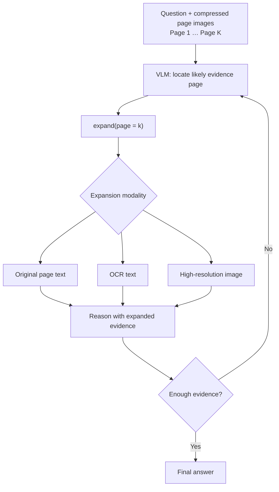
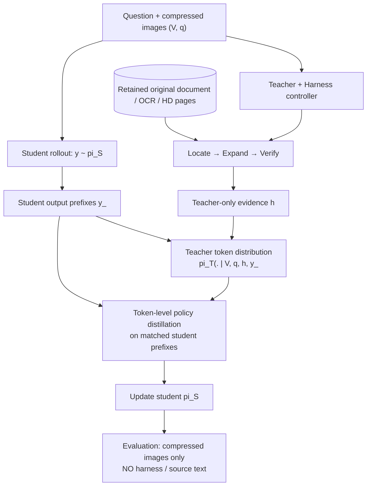

# Research Proposal: Harness-Augmented OPD for Compressed Visual Context

> Status: research idea / unvalidated hypothesis · 2026-11-05  
> Inspiration: **LensVLM: Selective Context Expansion for Compressed Visual Representation of Text**  
> Related threads: OPHSD, HAD, ActionOPD, multimodal / heterogeneous-teacher OPD.

## TL;DR

**Question:** Can a teacher equipped with an evidence-access harness better distill long-context reasoning into a student that only sees a fixed-budget, compressed visual rendering of text?

**Main hypothesis (to test, not assume):** A *select–expand–verify* teacher may provide better **student-aligned** supervision than a teacher simply reading the full source text, because its reasoning is organized around information visible (or approximately localizable) to the student.

**Crucial constraint:** If compression destroys answer-bearing information, a tool-free student cannot reliably reconstruct arbitrary missing facts. The target is improved use of residual signals, localization, reasoning, and learnable priors—not guaranteed recovery of inaccessible text.

## 1. Motivation: what LensVLM does

LensVLM renders a long document into multiple compressed page images. A VLM receives the question and the compressed page overview; it predicts which page might contain useful evidence, requests expansion, and continues reasoning with a returned higher-fidelity representation.

### Visual overview: selective expansion



> In the original-text mode, the external tool accesses a retained source document; the VLM does not reconstruct invisible text from the compressed pixels. Diagram is conceptual, not an exact implementation call graph.

Conceptual loop:

```text
question + compressed page images
            |
            v
       page selection
            |
            v
       expand(page=k)
            |
            +--> original page text (if source is retained)
            +--> OCR of page (alternative)
            +--> higher-resolution page image (alternative)
            |
            v
     reason / select again / answer
```

**Important distinction:** The page index is inferred from imperfect visual cues; it is *not* necessarily computed by searching full original text. However, an **original-text expansion** configuration **does access the original text** through the tool after selecting a page. This is retrieval from an externally retained source, not information magically reconstructed from low-resolution images.

LensVLM's training can be understood as teacher-generated tool-use trajectories followed by on-policy optimization of page selection and answer generation. Its original goal is **inference-time selective expansion**; a no-tool student distilled from a harness-enabled teacher is a distinct research question.

### Harness interpretation

A minimal external harness has:
- **State:** compressed pages, document/page mapping, source store, expansion history, tool budget.
- **Policy/controller:** decide *whether*, *where*, and *how* to expand; optionally verify evidence and replan.
- **Actions:** `select_page`, `read_original_text`, `ocr_page`, `zoom_page`, `retrieve`, `verify`, `stop`.
- **Observations:** evidence from the selected page(s), with provenance.
- **Guardrails:** index validity, source access permissions, token/tool budget, prevention of answer leakage into student inputs.

Simply wrapping `expand(page)` in code is an engineering baseline, not a sufficient research novelty claim.

## 2. Two research directions

### A. Inference-time visual evidence harness

Separate the controller from the answering VLM. Use global compressed image cues to select candidate pages, then route to an expansion modality and verify the evidence. Compare trained selection, a text-retrieval controller, and rule/LLM-based controllers.

Potential advantages: interpretable selection actions, explicit tool budget, recoverable wrong-page selections, optional abstention. This direction retains tools at deployment and should be evaluated on answer accuracy **and** tool cost.

### B. Harness-augmented online policy distillation (primary)

**Teacher:** sees the same compressed pages as the student and additionally receives evidence from an external harness (selected original text / OCR / high-resolution views).  
**Student:** sees **only** the compressed pages and question; no source-text store, expansion calls, teacher evidence, or retrieved content at test time.

Define `V` = compressed images, `q` = question, `h` = teacher-only harness observations, and `y_<t` = prefix from the *student's own rollout*. A conceptual token-level objective is

$
\mathcal{L}_{\mathrm{OPD}} = \mathbb{E}_{(V,q)\sim\mathcal{D},\; y\sim\pi_S(\cdot\mid V,q)}\left[\sum_{t=1}^{|y|}\mathrm{KL}\!\left(\pi_T(\cdot\mid V,q,h,y_{<t})\;\|\;\pi_S(\cdot\mid V,q,y_{<t})\right)\right]
$

This is an illustrative forward-KL design, **not** a claim that all OPD methods use this KL direction. In practice, teacher and student must be evaluated on **matched output-token prefixes**; tool-call tokens and raw tool responses are not student targets. An alternative is action-level supervision or outcome-guided distillation if tokenizer/model interfaces differ.

**Central research question:** Is an evidence-selection-and-verification *process* a more transferable teacher advantage than unrestricted access to the entire original text?

### Visual overview: teacher-only harness distillation



**Access boundary:** Only the teacher/controller can query the original-document store. The student receives no expanded evidence, OCR, source text, or tool-call trajectory as an input.

### Training workflow

1. Render documents into `K` indexed page images with a controlled visual-token budget and several compression ratios.
2. Prepare QA tasks and gold answer/evidence-page annotations **for training/evaluation only**; audit page mappings.
3. Generate an **on-policy student rollout** from `(V,q)`; save output prefixes and predicted answers.
4. For the same sample, run a teacher with an attached harness to locate, expand, and verify evidence.
5. Condition teacher scoring on its *private* evidence and the **student's output prefix**; obtain token distributions on shared answer/reasoning tokens.
6. Compute masked distillation loss, optionally mixed with task loss / outcome rewards; never include harness observations in the student context.
7. Evaluate the **standalone student with all tools disabled**; separately measure a teacher-with-harness upper bound.

**Implementation caveat:** If the teacher's private evidence changes the interpretation of a student prefix or the teacher and student use different vocabularies, direct full-vocabulary token KL may not be well-defined or desirable. Try matched-token models first and compare sequence/action-level alternatives later.

## 3. Minimal experimental matrix

Keep **student architecture, training examples, visual budget, student-rollout policy, teacher capacity, and training compute** as comparable as possible.

| Variant | Teacher context | Student deployment | What it isolates |
| --- | --- | --- | --- |
| Student baseline | None (no distillation) | Compressed pages only | Intrinsic information available in compressed pages |
| OPD-Visual | Compressed pages only | Compressed pages only | Distillation without privileged text |
| OPD-Text | Full uncompressed original text | Compressed pages only | Strong text teacher / modality asymmetry |
| OPD-Oracle | Compressed pages + gold evidence-page text | Compressed pages only | Upper bound on **evidence quality**, not valid inference-time page selection |
| OPD-Harness | Compressed pages + autonomously selected/expanded/verified evidence | Compressed pages only | Benefit/cost of an operational evidence-access workflow |
| Teacher + Harness (inference bound) | Compressed pages + online expansion | Harness enabled | Tool-enabled achievable accuracy; **not** a student baseline |

**Do not interpret OPD-Harness > OPD-Oracle as guaranteed or required.** Oracle page access may outperform a real controller. OPD-Harness > OPD-Text under controlled conditions would motivate the hypothesis, but further ablations are needed to attribute gains specifically to workflow rather than prompt length, evidence filtering, or teacher budget.

### Required ablations

- Compression level and fixed visual-token budget; number of pages; evidence distribution across pages.
- Expansion policy: random page, visual selection, text retrieval, gold-page oracle.
- Expansion content: original text vs OCR vs high-resolution image.
- Number of expansion rounds, retrieved token cap, verification/replanning on/off.
- Teacher privileged information: full text vs selected evidence vs expanded evidence plus a reasoning trace.
- Distillation granularity: token KL vs selected-answer tokens vs action/sequence-level targets.
- Matched teacher input cost and total inference/training compute.
- Wrong-page expansion and tool failure; whether errors are recoverable.

## 4. Metrics and evaluation

**Primary:** tool-free student QA accuracy / exact match (or appropriate semantic and multi-hop metrics) at **the same compressed-vision budget**.

**Diagnostic:**
- Evidence-page selection Recall@k, hit@1, and all-evidence recall on multi-hop examples.
- Standalone page-localization probe for the student (not a test-time retrieval tool).
- Teacher final accuracy and hallucination rate, along with source attribution correctness.
- Expansion calls, tool latency, input/output tokens, total teacher training cost.
- Sensitivity to new, random, and long-tail facts; answer extractability from the compressed images.
- Calibration/abstention where evidence is not visible.

**Critical partition:** classify examples into (i) visually recoverable, (ii) partly inferable, (iii) information-lost/unrecoverable. If gains appear only on memorized facts, this is weak evidence of transferable retrieval reasoning.

### Leakage controls

- Split by **document/source**, not only QA pair; deduplicate cross-split passages.
- Never pass ground-truth evidence pages or raw expansion outputs to student inputs or test-time controller.
- Distinguish teacher's legitimate private privileged context (training) from evaluation leakage.
- Check whether teachers see gold answers during trajectory construction; do not silently treat oracle-generated demonstrations as autonomous evidence selection.
- Include tests on novel entities, numbers, identifiers and counterfactual fact substitutions so memorization cannot masquerade as recovery.

## 5. Practical MVP

**Stage 0 — feasibility without OPD.** Reproduce compressed-page QA, page-selection probes, and a simple `read_page` harness. Compare tool-enabled and tool-free ceilings; collect failure cases at 5×/10×/15× or equivalent resolutions.

**Stage 1 — small controlled OPD.** Use a ~2B multimodal student and same-tokenizer/same-family teacher if available. Train OPD-Visual, OPD-Text, OPD-Oracle and OPD-Harness with a fixed student rollout protocol. Use the same held-out test set and fixed vision budget.

**Stage 2 — credit and transfer.** Test whether selection-aware teacher feedback produces better *student page localization* even when the student is not allowed to expand pages at inference. Add an auxiliary localization objective only as a separately labeled ablation.

**Stage 3 — broader harness.** Add verification, multiple rounds, OCR/zoom routing and hard cases. Consider harness evolution only after a reproducible distilled-student benefit has been demonstrated.

### Go / no-go criteria

- **Go:** OPD-Harness reliably improves **tool-free** QA over OPD-Visual and OPD-Text across independent held-out documents at matched student input and comparable training cost, with supporting localization or robustness gains.
- **Ambiguous:** improves the tool-enabled teacher but not the no-tool student; or wins only because its teacher consumed much more text/compute.
- **No-go / reframe:** gains disappear on truly information-lost facts and novel identifiers; pivot toward *tool-aware* student/harness co-design rather than claiming to distill impossible missing information.

## 6. Positioning / novelty boundary

**LensVLM:** trains a VLM to use selective expansion **during inference**.  
**Generic Harness:** externalizes state, source access, decisions, and tools.  
**Harness-augmented OPD (proposed):** uses a privileged external evidence-access workflow **only for the teacher during training**, attempting to transfer the *selection-informed reasoning behavior* into a vision-budget-constrained, tool-free student.

This connects to OPHSD's procedural-vs-dynamic-information distinction: potentially distill *how to use observable clues*; do not claim to distill arbitrary inaccessible facts. HAD/ActionOPD are useful conceptual comparators for harness-aware and action-level supervision, but equivalence should not be assumed.

## 7. Open questions

1. Does the student learn page localization, or merely more fluent answer priors?
2. Is an autonomous harness superior to an oracle evidence extractor **as a teacher** when student information is limited?
3. Where is the boundary between learnable visual semantics and permanently lost text?
4. Does iterative search/verification yield better policy supervision than single-step expansion?
5. Is it better to distill **answer tokens**, **page selection actions**, or both, when the deployed student is tool-free?
6. Would a low-cost student with a small deployment harness outperform a strictly tool-free student at equal **total** inference budget?

## References

- **LensVLM: Selective Context Expansion for Compressed Visual Representation of Text** — [paper](https://arxiv.org/abs/2605.07019), [code](https://github.com/apple-aiml-research/ml-lensvlm).
- This repository's [OPHSD reading notes](../notes/OPHSD-reading-notes.md), [HAD reading notes](../notes/HAD-reading-notes.md), and [ActionOPD reading notes](../notes/ActionOPD-reading-notes.md).

> This document proposes experiments; it does not report results from this proposed OPD setup.
