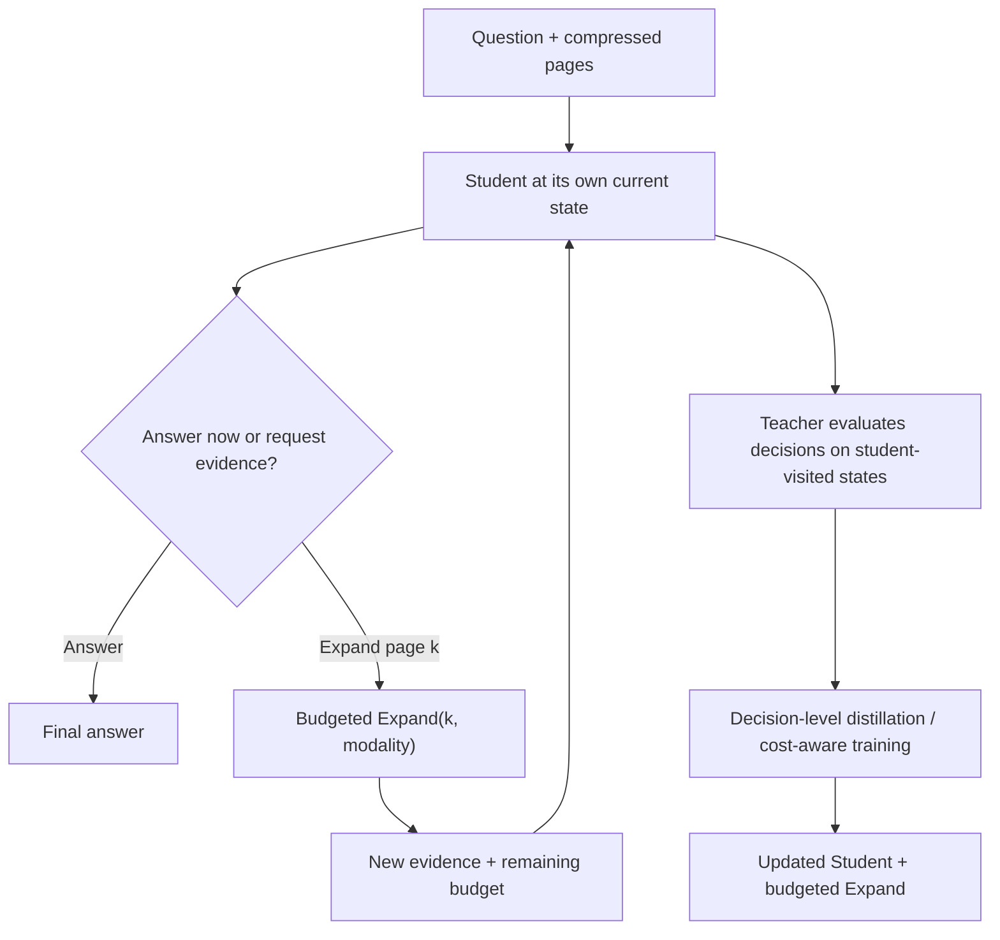

# PRISM Plan B：Budget-Aware Harness OPD（保留 Expand 的保底研究路线）

> 研究备选方案，尚未完成实验验证 · 2026-11-05  
> 关联：[PRISM 主方案](PRISM-transferability-aware-harness-distillation-proposal-zh.md) · [LensVLM 阅读笔记](../notes/LensVLM-reading-notes.md) · [HAD](../notes/HAD-reading-notes.md) · [ActionOPD](../notes/ActionOPD-reading-notes.md)

## 0. 为什么需要 Plan B？

主路线尝试将训练期拥有原文/高清页面访问能力的 Harness Teacher 蒸馏给**推理时完全没有 Expand 工具**的 Student。但视觉压缩如果导致姓名、数字等必要事实彻底丢失，无工具 Student 就无法在新的文档上可靠恢复这些事实。Teacher 的强能力和正确 logits 不会凭空增加 Student 测试输入的信息量。

**保底策略：放弃“完全移除 Harness”的硬限制。让小 Student 在部署时保留轻量、受预算约束的 Expand 工具，并通过 OPD 学会何时、何处、以何种代价读取高保真证据。**

主方案 A：Teacher 有完整 Harness → Student 完全无工具。  
保底方案 B：Teacher 有完整 Harness → Student 有**受预算限制的** Expand。

此保底路线比完全无工具更符合信息可恢复性约束，但其创新性风险也更大：已有 LensVLM、HAD 和 ActionOPD 研究过工具使用、Harness-aware distillation 和行动监督。

## 1. 一句话定义任务

给定问题 $q$ 和 $K$ 张压缩文档图像 $V=(v_1,\ldots,v_K)$，Student 可以：
- 直接回答（Stop/Answer）；
- 调用 `Expand(k, m)` 查看第 $k$ 页在模态 $m$ 下的高保真信息；
- 利用新证据决定继续展开还是回答。

其中 $m$ 可为 **Original Text、OCR Text、High-resolution Image**；它们是同一 Expand 工具的返回方式，而非三套独立 Harness。原文读取必须保留源文档与索引；OCR/高清图可从原页图像取得。工具具有文本/视觉 token、调用次数或延迟成本。

**目标：相同证据访问预算下更准确，或相同 QA 准确率下更少展开。**

### 基本工作流

## 2. 与已有论文的真实重叠

| 工作 | 已有贡献 | Plan B 与它的关系 | 不能当作本方案新颖性的内容 |
| --- | --- | --- | --- |
| **LensVLM** | 压缩图像选页、展开原文/OCR/高清页；SFT + DAPO 学工具调用 | **同一任务设定与工具结构** | Select–Expand 本身、9B 模型缩小到 2B 本身 |
| **HAD** | Student 在自己交互历史上学习带 Harness Teacher 的动作/推理，部署仍保留 Harness；有/无 Harness action preference | **保底方案本质上很像 HAD** | Harness-conditioned teacher、action contrast、on-policy 交互状态 |
| **ActionOPD** | 在 Student 访问的状态上用黑箱 Teacher 的语义动作监督 | 对 Expand 的页码/停止决策可直接借鉴 | 将工具调用当作语义 action 来蒸馏 |
| **OPHSD** | 训练时借 Harness Teacher，部署时去掉 Harness | 对应主路线 A 而不是保底 B | “Teacher 有工具、Student 无工具”的范式 |
| **主动检索 / Value of Information** | 衡量观察/工具调用带来的预期效用与成本 | 可能的区别化方向，但 VoI 概念本身已存在 | 仅仅加入 `-\lambda C` 成本惩罚 |

**结论：** 目前的 Plan B 应被诚实地看作 **HAD/ActionOPD 在 LensVLM 压缩文档环境中的迁移和实验保底**，不是天然独立的新方法。若要投稿，需要证明一个更具体的新机制，例如以视觉压缩下的**信息获取边际价值**为目标的在线决策监督。

## 3. 候选研究切入点：Value of Information（VoI）

Teacher 可以提出“应该展开 Page 8”，但仅模仿选页是不够的。关键问题应该是：

> 对**当前 Student 状态**，是否值得付出 token/时间成本来读取这一页？相比现在直接回答，读取它究竟能改善多少预期正确率？

定义历史 $s$ 包含问题、压缩页面、已展开的证据和剩余预算。可选动作集合是 $a\in\{\mathrm{answer},\mathrm{Expand}(k,m)\}$。一个概念性的动作效用为：

$$
Q(s,a)=\mathbb E[R_{\mathrm{QA}}\mid s,a,\text{后续最优或指定策略}]-\lambda\,\mathbb E[C\mid s,a].
$$

边际信息价值可以定义为展开动作相对直接回答的优势：

$$
\operatorname{VoI}(s,k,m)=Q(s,\operatorname{Expand}(k,m))-Q(s,\operatorname{Answer}).
$$

这里的 $Q$ **不能只看展开后 Teacher 是否知道答案**；它应反映当前 Student 在获得该证据后**实际能否利用它**、后续策略和总成本。估计 $Q$ 才是真正困难的研究部分。

### 潜在实现

1. **Student on-policy state collection**：让 Student 在自己的压缩图像/历史上运行，到候选决策点记录当前状态、预测答案、已访问页和预算。
2. **Counterfactual action evaluation（预实验）**：同一个状态比较直接回答与展开若干候选页后继续运行的结果。候选页可以来自已有定位器、GT oracle（**仅用于训练分析**）或随机负例。控制 rollout 数量，不能把 oracle 在测试时偷偷给 Student。
3. **估计 Decision Value**：用多次 continuation 的正确率、证据有效性和 token/时延估算各动作的相对收益；构造页码排序、展开/不展开偏好或成本敏感动作目标。
4. **On-policy decision distillation**：在 Student 真正访问的状态上监督停止/展开决策，可分别试 teacher response SFT、HAD 式 pairwise action preference、ActionOPD 式 semantic-action reward。
5. **部署与评测**：Student 保留预算约束的 Expand 工具。报告不同预算下的 accuracy–cost Pareto frontier，而非只报告总准确率。

**严谨性提醒：** 上述评估是 VoI 的近似估计。若同一状态下使用不同后续策略，得到的 $Q$ 不可直接比较；需统一 continuation policy、样本与 rollout budget，或明确使用反事实评估校正方法。多次真实 rollout 成本高，训练必须验证估计器是否与真实收益相关。

## 4. 怎样才能区别于 HAD / LensVLM？

只说“Student 在自己状态上学 Teacher 的工具调用”不足以新颖。可尝试验证的区别是：

- **压缩专属的决策价值**：视觉图像越模糊，展开的价值往往越高，但不是所有页都有价值；显式学习 *可见性/不确定性—页级证据收益—访问成本* 的联系。
- **反事实边际收益监督**：不仅用 Teacher 选择的动作作为正样本，还比较“现在直接答”与“先展开某页再答”的实际收益；区分高准确 Teacher action 和真正有价值的动作。
- **Budgeted stopping + page selection**：把是否展开、展开哪个页面及停止时机放在同一决策问题中，而非无条件鼓励使用工具。
- **可测的成本—准确率曲线**：在同等 token 和调用预算下验证相较 LensVLM SFT+DAPO、HAD、ActionOPD 是否有可靠优势。

以上仍是**候选创新点**。预算感知工具选择、VoI、cost-sensitive RL 本身已有研究；投稿前必须补充最新相关工作的严格查新。

## 5. 最小实验对照

| 实验 | 推理时有无 Expand | 训练 | 对照问题 |
| --- | --- | --- | --- |
| Base compressed VLM | 无 | Base | 无工具性能下限 |
| LensVLM-style | 有 | SFT + DAPO | 官方工具学习训练基线 |
| Tool-enabled token OPD | 有 | Teacher logits / matched-prefix KL | 普通在线 token distillation |
| HAD-style | 有 | Student visited state + Teacher response / action preference | Harness-aware 蒸馏基线 |
| ActionOPD-style | 有 | semantic action matching / reward | 黑箱 action-level 基线 |
| **VoI-guided Budget-aware OPD（候选）** | 有（预算限制） | 反事实动作价值 + 成本敏感蒸馏 | 是否提高 accuracy–cost frontier |

**关键消融：** 不考虑成本；不做反事实评估；只学是否展开；只学哪个页面；不用 on-policy states；不同压缩率；不同 Expand 模态；固定 vs 自适应预算；不同 Student 大小。

**核心指标：**
- QA accuracy / EM（多跳题可单独评估）；
- 每题展开次数、返回的文本/视觉 token、延迟；
- 相同预算下的正确率，以及相同正确率下的成本；
- 页码 Hit@1/Recall@k、错误展开比例、停止决策准确率（如有可构造的参考标准）；
- **Accuracy–Expansion Cost Pareto Curve**：比较整体效率而不是孤立 accuracy。

## 6. 主路线与保底路线共用什么？

| 基础设施 | A：Tool-free PRISM | B：Budgeted Harness OPD |
| --- | --- | --- |
| 文档分页与压缩视觉输入 | 共用 | 共用 |
| Page → 原文/OCR/高清图映射 | Teacher 用 | Teacher 和 Student 都用 |
| Student rollout 收集 | 共用 | 共用 |
| Teacher 有无 Expand 对照 | 共用 | 共用 |
| 训练目标 | 可迁移监督过滤或加权 | 页面选择、停止决策与边际取证价值 |
| 部署时 Expand | **无** | **有，限预算** |
| 最大风险 | 事实不可恢复 | 与已有 LensVLM / HAD / ActionOPD 创新重叠 |

**建议的执行顺序：**
1. 先复现压缩页面 + Expand 环境，并跑一个低成本 LensVLM-style SFT/DAPO 或 action-guided baseline，确认可复现；
2. 并行用相同 Student checkpoint 测 A 是否真的存在可迁移提升；
3. 若 A 受信息丢失强烈限制，则保留 B，优先开展“是否展开 / 哪一页最值 / 何时停止”的**反事实决策收益**实验；
4. 若 B 不能超过强基线，不应仅靠额外预算惩罚或更复杂的 Harness 命名来宣称新颖。

## 7. 一句话研究定位

**主路线 A：** 研究“特权 Harness 中哪些能力能在工具移除后迁移”。  
**保底路线 B：** 研究“当高保真证据不可被内化时，能否把 Harness 的**信息获取策略**蒸馏给受预算约束的小模型”。

> **论文判断：** 保底 B 的实验成功率可能更高，因为它没有要求模型恢复不可见事实；但其方法新颖性不自动成立，必须在严谨的 VoI / cost-aware agent baselines 上证明增益。
