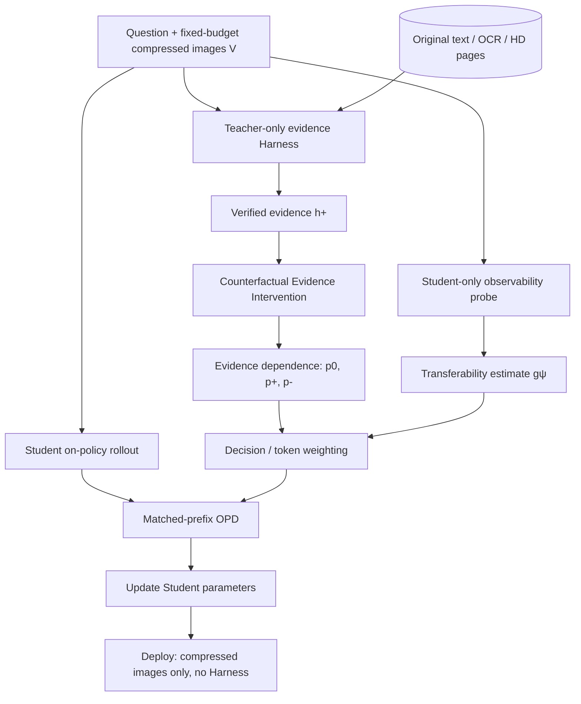

# PRISM：面向压缩视觉推理的可迁移性驱动 Harness 蒸馏

> **研究构想 / 中文投稿 Proposal（尚未实验验证）** · 2026-11-05  
> 工作标题：**PRISM: Distilling Transferable Knowledge from Privileged Harnesses for Visual Reasoning**  
> 备选标题：**Not All Harness Advantages Are Learnable: Transferability-Aware Policy Distillation**  
> 关键词：Harness OPD、Privileged Information、Visual Context Compression、Counterfactual Intervention、Transferability、Distillation-Aware Harness Optimization  
> 前序构想：[LensVLM Harness-OPD Proposal（中文）](LensVLM-Harness-OPD-proposal-zh.md)

## 0. 核心观点（TL;DR）

**不再把「带 Harness 的 Teacher 蒸馏到无 Harness 的 Student」当作主要创新。** 这一训练范式已经被 OPHSD、HERD 等探索。我们真正想回答：

> **Harness 带来的提升中，哪些是可以由 Student 的有限输入学习到的，哪些只是 Teacher 访问了 Student 永远看不到的私有信息？能否主动筛选、生成、优化最有可迁移价值的 Harness 监督？**

我们以 LensVLM 式的多页文本图像压缩为可控环境：Student 只看到固定视觉预算的低分辨率页面；Teacher 可以按需检索/展开原始文本、OCR 或高清页面。希望通过 **Counterfactual Evidence Intervention（CEI） + Student-Observable Advantage Estimation（SOAE） + Transferability-Gated OPD** 提升 **无工具** Student，而不是蒸馏不可观察的具体事实。

**最重要的边界**：低分辨率图像若彻底丢失某个随机数字、ID 等事实，Student 无法凭空恢复；需要区分 *procedural transfer* 与 *privileged factual leakage*。不能把 gate 的输出称为信息理论证明，它只能是经过校准的经验估计。

## 1. Motivation：Teacher Advantage ≠ Student Distillable Advantage

假设长文本被渲染为 15 张高度压缩的页面，Teacher 可以通过 Harness 选择页面并读取原文。

- **Case A（可能可迁移）**：问题是 climate adaptation 出现在哪个章节。压缩图像仍有可辨认标题/布局/章节线索。Harness 可能帮助 Teacher 建立更准确的页面选择策略，这类程序/定位能力有迁移潜力。
- **Case B（可能不可恢复）**：问题是第 12 页表格里某项指标的精确随机数值。压缩后字符完全不可读，Teacher 读原文可以回答，但无工具 Student 没有足够可观察信息。

二者都可能产生很大的 Teacher-with-Harness gain，却只有前者具备真实可迁移的输入信息基础。因此以 Teacher 最终准确率或 Teacher 有无 Harness 的 logits 差异直接选择训练目标，可能把不可学习事实也强化给 Student。

### 核心可证伪假设

- **H1（现象）**：同等视觉预算下，*Harness Teacher gain* 与 *tool-free Student distillation gain* 并不总是一致，且差异随压缩率、证据类型变化。
- **H2（机制）**：结合证据依赖干预与 Student-only 可观察性估计，能比 entropy/confidence/hardness/单纯 Harness advantage 更准确预测哪些样本或 token 能带来 Student improvement。
- **H3（算法）**：基于可迁移性加权的 OPD 可稳定提升 tool-free Student 性能；如果 H1/H2 不成立，不应强行继续 Harness evolution。
- **H4（拓展）**：以 Student 下游收益而非 Teacher 分数为指标来选择 Harness 证据策略，能进一步提升蒸馏效率（可选，后做）。

## 2. Related Work：与仓库内各研究的确切关系

| 论文 / 方向 | 已有做法 | PRISM 不能重复的部分 | 借鉴点 |
| --- | --- | --- | --- |
| [LensVLM](https://arxiv.org/abs/2605.07019) | 压缩页图定位、Expand 访问原文/OCR/高清图，推理时有工具 | 不把 select/expand 本身当作创新 | 可控视觉信息瓶颈与证据定位 |
| [OPHSD](../notes/OPHSD-reading-notes.md) | Harness 作为 Teacher-only context，在 Student rollout prefix 上反向 KL；部署去掉 Harness | Teacher-only Harness → Tool-free Student 不是创新 | matched-prefix OPD、程序与不可见事实边界 |
| [HAD](../notes/HAD-reading-notes.md) | 对比同 Teacher 有/无 Harness 的 action，并在 Student reasoning 上强化正向行为；部署保留 Harness | 不仅是简单的正负 Harness action contrast | 行为归因与决策层偏好 |
| [ActionOPD](../notes/ActionOPD-reading-notes.md) | Student 访问状态上使用黑箱 Teacher 的 semantic action reward；不要求相同 tokenizer | 不仅是把 token KL 替换成 action matching | 页面选择等语义行动的监督 |
| [VPD](../notes/VPD-reading-notes.md) | 语言反馈条件下 Teacher refinement 与 Student distillation 交替 | 不能仅靠 teacher/student 双阶段更新声称新颖 | Feedback-conditioned teacher 优化思路 |
| [HERD](../notes/HERD-reading-notes.md) | Skill 与 residual memory 的递归演化与内化 | Harness 演化再蒸馏不是创新 | Student residual 与避免漂移 |
| [GUI-HARVEST](../notes/GUI-HARVEST-reading-notes.md) | 证据驱动的 harness runtime 代码 patch 与两层 validation | 不应声称发明 evidence-driven harness evolution | 干预、跨样本验证与可证伪修复 |
| Privileged-information distillation / harness policy distillation（需继续查新） | 可能已覆盖 Teacher 私有信息与控制语义迁移 | 投稿前应核验最接近方法与时间线 | 明确创新边界 |

**潜在新颖性**不是这些方法的简单叠加，而是：构造一个**可测、可干预、面向 Student 可观察输入的转移价值估计**，并用于选择 Harness 的证据生成策略与 OPD 监督单位。投稿前必须重新检索最新相关工作，不能宣称完全无人研究。

## 3. Method 总览

三个主要模块：

1. **CEI：** 测「Teacher 是因为哪段证据改变行动/答案」，而不是假定所有扩展结果都有用。
2. **SOAE：** 测「Student 的压缩输入是否仍包含可以支持该行动/答案的线索」，并与 Teacher 差异区分。
3. **Transferability-Gated OPD：** 仅对可迁移、有效的 token 或 semantic action 赋予较高训练权重；不对不存在的事实强制蒸馏。

可选的第 4 个模块是 **Distillation-Aware Harness Optimization**，前述方法有效之后再加入。

## 4. Method 1：Counterfactual Evidence Intervention（CEI）

对于 Student 当前 rollout 的前缀 $y_{<t}$，在统一输出 token 空间定义三种 Teacher 分布：

$$
p_0^t = \pi_T(\cdot\mid V,q,y_{<t}),\qquad
p_+^t = \pi_T(\cdot\mid V,q,h^+,y_{<t}),\qquad
p_-^t = \pi_T(\cdot\mid V,q,h^-,y_{<t}).
$$

- $h^+$：Harness 找到并验证的相关证据；
- $h^-$：证据删除、局部遮盖或受控干扰的条件；
- $p_0$：没有 Harness 信息时的 Teacher 条件分布。

定义一个简单的 **Harness-induced distribution shift**（只是参考信号）：

$$
A_t=D_{\mathrm{KL}}(p_+^t\|p_0^t).
$$

**大 $A_t$ 只能证明 Harness 改变了 Teacher 分布，不能证明 Student 可以学到这种变化。** 更稳妥的是结合 action correctness / answer correctness、证据是否与问题相关以及反事实后的变化，而不是只最大化 KL。

### 两种必要干预不能混淆

- **Evidence ablation（固定图像）**：保持 Student 图像 $V$ 不变，遮盖或移除 Teacher 可读的某段证据。用于测 Teacher 对那段证据的依赖。
- **Paired counterfactual（同步改原文和图像）**：修改原始事实/文本，并重新渲染压缩图像，保持两个分支的输入内容一致。用于评估该差异是否还能被 Student 看见。

如果只改 Teacher 的原文而不改图像，可能制造图文不一致，因此不能凭单侧干预证明 Student 不可学习。

对精确数字、人名等可设计**受控随机事实替换**，要求 held-out entity/value 与文档划分严格隔离。

## 5. Method 2：Student-Observable Advantage Estimation（SOAE）

训练或校准一个轻量估计器：

$$
g_\psi(V,q,t)\in[0,1],
$$

表示在当前输入和决策位置，**特定 Teacher 指导内容**是否可以被不带 Harness 的 Student 从可观察线索中可靠预测。

建议输入信号包括：

- Student-only 直接回答/页面定位的正确性、置信区间和跨采样稳定性；
- 相邻分辨率下可见性变化与不同压缩等级的 QA 表现；
- paired counterfactual 事实替换后，Student 能否随真实可见变化调整答案；
- page-level localization、视觉线索是否仍存在；
- held-out 文档上的 calibration，而不是只用训练集拟合 probe。

**注意防止循环论证**：Probe 不能仅用 Student 当前 confidence 当作「可迁移性真值」；它需要在独立探针集上与真实 OPD 后收益/受控可见性测试对照。低 $g_\psi$ 也可能表示当前模型弱，而非信息已被数学上证明不可恢复。

### 四象限决策图

| | 高可观察性 / 高可迁移潜力 | 低可观察性 / 尚无可迁移证据 |
| --- | --- | --- |
| **Harness gain 大** | **重点监督**：学习使用仍可见的线索 | 警惕不可见事实；必要时只蒸馏程序 |
| **Harness gain 小** | Visual OPD 即可或作为保底 | 可降低蒸馏预算、进一步诊断 |

这里 **Harness gain** 与 **Student observability** 是不同的信号，不能用一个 Teacher 熵值替代。

## 6. Method 3：Transferability-Gated OPD

组合 Harness 改变分布的强度与可观察性估计，定义一种候选权重：

$$
w_t=g_\psi(V,q,t)\,\phi(A_t),
$$

其中 $\phi$ 为有界函数，以避免 KL 极值支配训练。真实算法还需引入证据有效性、Teacher 纠错置信度或样本级 budget；上式只是一版可消融的起始设计。

采用 **Student on-policy rollout + matched output-token prefixes**：

$$
\mathcal L_{\mathrm{PRISM}}
=\mathbb E_{(V,q)\sim\mathcal D,\,y\sim\pi_S(\cdot\mid V,q)}
\left[
\frac{\sum_t w_t D_{\mathrm{KL}}\!\left(
\pi_S(\cdot\mid V,q,y_{<t})\;\middle\|\;
\operatorname{sg}\left[\pi_T(\cdot\mid V,q,h^+,y_{<t})\right]
\right)}{\sum_t w_t+\epsilon}
\right].
$$

这里展示的是 **reverse KL**，与仓库 OPHSD 基线更接近。需要消融 forward KL / reverse KL、权重 clip、样本过滤、answer-only mask，以及是否加入普通 task loss。

**为什么需要 action-level 实验？** 页面选择 / 多跳证据定位属于清晰的语义决策，正确决策可能有多个表达形式；直接 token KL 会把措辞差异当成行为差异。可以借鉴 ActionOPD，对 *page ID、动作名、工具参数* 做规范化行动匹配，并把相关决策作为辅助目标。若最终 Student 彻底无工具，不能直接训练它在部署时输出工具调用；可以将「预测相关页码」设计为独立 diagnostic/probe 或显式的内部辅助任务（评测必须区分）。

### 与 HAD 的关键差异

HAD 强调有/无 Harness 的行动对比，并训练**保留 Harness**的 Student 学会利用它。PRISM 的目标是没有 Harness 的 Student：即便 $a^+\ne a^-$，也必须进一步测试 $a^+$ 是否受 Student 可观察的信息支持；否则不该被当成无条件的正样本。

## 7. 可选拓展：Distillation-Aware Harness Optimization

Harness 不应只是最大化 Teacher 任务得分。更适合的目标是**下游 Student 无工具表现**：

$$
H^*=\arg\max_H\left[
R_{\mathrm{val}}\bigl(\pi_{\theta'(H)},\varnothing\bigr)-\lambda C(H)
\right],
\qquad
\theta'(H)=\operatorname{Update}_{\mathrm{OPD}}(\theta;H).
$$

$R_{\mathrm{val}}$ 在独立的、工具关闭的 Student 验证集上计算；$C(H)$ 表示取证、推理和训练的成本。它是双层优化的**概念性目标**，不是已有可低成本精确求解的算法。

和其他工作差别：

- **GUI-HARVEST** 选择能提升带 Harness Agent 行为的运行时代码 patch；
- **HERD** 优化并内化可复用 skill / high-residual memory；
- **PRISM（候选）** 按**一次 Student 更新后带来的下游收益**选择 Harness 的证据获取策略。

### 现实可行实现

先不做源码自动改写。只在几种可控 Harness 之间路由：Full Text、Oracle Evidence、Visual Page Selection、Select–Verify、OCR、HD Zoom。用少量 Student 更新和 held-out loss reduction 估计蒸馏价值；之后才考虑学习路由器。每轮完整训练 Student 的双层优化代价过高，必须有代理估计和代理准确性验证。

如果方法 1–3 已经足够强，这一节可以移入 Future Work，不必强行作为第一篇论文的主贡献。

## 8. 三个核心 Research Questions

### RQ1：Teacher gain 与 Student gain 是否脱钩？

做一个**Motivation Experiment**：在 5×/10×/15×（或等视觉预算的多档压缩）下，比较：
1. Teacher 无工具 vs Teacher+Harness 的任务得分；
2. Uniform OPD 后无工具 Student 的得分变化；
3. 按任务、可见性、证据类型分层后的两个 gain 的相关性。

若 Teacher gain 与 Student gain 几乎一致，则提出新的 transferability estimator 的必要性会减弱。若有大幅脱钩，则可构成论文核心现象。

### RQ2：可迁移性估计优于普通置信度与 Hardness 吗？

| Baseline | 信号 |
| --- | --- |
| Uniform OPD | 所有 token 等权 |
| Hard-only OPD | Student-only 答错样本 |
| Teacher Entropy / Confidence Weighting | Teacher 不确定性 |
| Harness Advantage Weighting | $D_{\mathrm{KL}}(p_+\|p_0)$ 或性能差异 |
| Observability-only | $g_\psi$ |
| **PRISM** | CEI + SOAE 的可迁移性加权 |

必要消融：去掉 CEI、去掉 SOAE、只做样本筛选不做 token weighting、只蒸馏 answer、只蒸馏 page/action、不同 KL 方向、不同反事实干预比例。比较 **预测实际 Student Improvement** 的 AUROC/相关性/校准曲线，以及最终 QA。

### RQ3：优化 Harness 的目标应是 Teacher utility 还是 Student utility？

在 RQ2 获得稳定提升后再增加：
1. Static Harness + Uniform OPD；
2. Static Harness + PRISM Gating；
3. Distillation-aware selection + Uniform OPD；
4. Distillation-aware selection + PRISM Gating。

同时评估工具成本；不能只增加 Teacher token 使用量，就归因为 Harness 策略优化。

## 9. 数据集、评测与可证伪分析

### 数据

- **长文本 QA**：HotpotQA、MuSiQue、Natural Questions（按 LensVLM 风格分页渲染）；保留 evidence-page annotations。
- **长上下文**：HELMET 中适合压缩视觉文本的问题类型。
- **文档 VQA**：DocVQA、MP-DocVQA，测试 OCR、版式和图文关系。
- **强控制合成数据**：同版式文档的随机编号、金额、人名、表格数值替换；同步重渲染图像，构建视觉可见 / 模糊 / 丢失三个层级。

### 核心评测

- **Primary**：Tool-free Student QA accuracy / EM / multi-hop score，在完全一致的视觉 token 预算下测量；
- **Mechanism**：Teacher gain vs Student gain、证据页 Hit@1 / Recall@k、定位 probe、CEI 干预敏感度、SOAE 校准；
- **Efficiency**：Teacher token、Harness 展开数、工具时延、Student 训练算力与推理 FLOPs；
- **Robustness**：压缩率曲线、跨文档和跨实体泛化、信息不可恢复样本的错误与幻觉率。

主分析图建议是 **Compression–Transferability Curve**：压缩程度增加时，Uniform OPD 和 PRISM 对 Tool-free Student 的相对改善；预期中等压缩时可能最有效、极端压缩时所有无工具方法都受上限约束，但**不能提前写成实证结果**。

### 防泄漏要求

- 按文档/来源划分训练与测试，不能只随机划分 QA；
- Oracle 证据与 gold answer 只能用于明确标注的训练对照、诊断，不可偷偷用作 autonomous controller 输入；
- 工具返回的原始事实、OCR 文本不出现在 Student 的输入；
- 必须有随机/新实体、难以记忆的数值及 paired counterfactual，避免参数记忆伪装成信息恢复；
- 真实不可恢复性只能在受控数据设定下论证，不能从一个弱 Student 的失败得出一般性定理。

## 10. MVP 与实验优先级

**P0｜验证研究问题存在（最高优先级）**
1. 复现 compressed-page QA 与 `read_page` Harness，标定固定视觉预算；
2. 完成 OPHSD 风格的 uniform teacher-only harness OPD；
3. 测 Teacher Gain vs Student Gain 的偏差，并通过随机数字/事实替换检测不可恢复边界；
4. **Go/no-go**：若不存在明显脱钩，先重新考虑问题设定，不急着做复杂 Method。

**P1｜核心算法**
1. 在已保存的 Student rollout prefix 上，对同一样本构造 $p_0,p_+,p_-$；
2. 设计 paired counterfactual 与 visibility probe，校准 $g_\psi$；
3. 实现 PRISM weighting，依次对比 hard filtering、entropy、advantage；
4. 记录真实 Student Improvement 与估计信号的关系。

**P2｜只在 P1 有效时增加 Harness 路由与优化**
1. 先在有限 Harness 策略库上进行 selection；
2. 用少量 Student update 测代理 distillation utility；
3. 在独立验证集检验是否真优于 Teacher-utility 优化；
4. 只有收益充分才考虑 Harness self-evolution 或源码 patch。

## 11. 投稿贡献与 Reviewer 风险

### 预期 Contributions（待实验成立后才能定稿）

1. **Formulation**：明确定义 Harness 的 privileged advantage 与 Student 能够内化的 transferable advantage 之间的差别，并在视觉压缩场景中建立可控验证。
2. **Method**：CEI + SOAE + Transferability-Gated OPD，在 matched student prefixes 上以可迁移性指导 token/action 监督。
3. **Analysis / Optional Optimization**：系统分析可见性—压缩—蒸馏收益的关系；若可行，再加入以 Student 下游表现为目标的 Harness 策略优化。

### 三个最危险的审稿问题

**Q1：这不就是 confidence / entropy weighting 吗？**  
需要有受控 CEI、paired counterfactual 和 SOAE 的真实预测价值；不能只是乘一个 confidence 系数。

**Q2：你怎么证明信息不可恢复？**  
不能用一个弱 Student 的失败证明。使用随机事实、严格文档拆分、同步渲染反事实、分辨率校准，并将结论限制为经验可观察性或受控数据的信息丢失。

**Q3：Teacher 直接读完整文本不是更好吗？**  
必须同容量、同预算比较 Full-text Teacher、Oracle Evidence、Visual Selection Harness、Select–Verify；最好证明 Teacher answer accuracy 与 Student distillation benefit 不是同一个目标。

### 其它重要风险

- 用 Student 自身 correctness 来训练 gate 可能引入循环定义/数据泄漏；需要 probe 与最终评测严格隔离。
- 反事实证据可能导致 Teacher 输入和图像冲突；区分 ablation 与 paired intervention。
- 过强的 gate 容易把 Hard Samples 全排除，导致学习不到更难能力；应与探索/课程学习或保底 loss 比较。
- OPHSD 已经阐述程序性和不可蒸馏信息的边界，因此**单纯指出这一现象不是足够的创新贡献**。
- 如果 CEI+SOAE 无法稳定超过简单的 confidence/filtering，应缩减 claims，不加入更复杂的 harness controller 掩盖问题。

## 12. 推荐的论文包装

**首选标题：** PRISM: Distilling Transferable Knowledge from Privileged Harnesses for Visual Reasoning

**更尖锐标题：** Not All Harness Advantages Are Learnable: Transferability-Aware Policy Distillation

**一句话 pitch：** *The best harness for a teacher is not necessarily the best harness for distillation.*

**摘要主线：** Harness 提高 Teacher 的准确率，但新增信息可能在 Student 观察中不存在；提出可证伪的 evidence dependence / student observability 测量，并用这一估计在 OPD 中选择可迁移监督；以压缩文档视觉推理为实验环境研究性能及信息边界。

**范围建议：** 第一篇聚焦 P0 + P1（Transferability-Aware Harness OPD）；Distillation-Aware Harness Optimization 作为扩展，只有在真实收益清晰时并入主文。避免同时堆叠 Harness Evolution、Multi-Teacher Router、Token Routing、Visual Compression 四个大模块。

## 13. Abstract（英文标题的中文摘要草案）

推理期 Harness 可以通过外部证据获取、结构化推理流程与迭代验证显著增强模型能力。已有研究尝试将这种能力通过策略蒸馏内化到部署时不再访问 Harness 的 Student 中，但 Harness 带来的提升并不必然可迁移：程序性推理可以依赖 Student 可见的信息学习，而部分高保真证据可能揭示其输入中根本不存在的事实。我们提出 PRISM，一种面向 Harness 的可迁移性驱动 Online Policy Distillation 框架。PRISM 结合反事实证据干预与 Student 可观察性估计，识别由可见线索支持的 Teacher 指导，并自适应分配 token / 语义决策层面的蒸馏监督。我们选择压缩视觉长上下文推理作为可控测试环境：Student 只观察受限预算的低分辨率文档图像，Teacher 则可选择性访问原始文本或高清证据。该研究旨在刻画哪些特权 Harness 能力能够被无工具 Student 内化，并探索以 Student 下游收益而非 Teacher 自身得分为目标的 Harness 监督选择。上述效果均为待检验假设，而非现成实验结果。

---

## Repo References

- [原 LensVLM + Harness OPD 中文 Proposal](LensVLM-Harness-OPD-proposal-zh.md)
- [OPHSD](../notes/OPHSD-reading-notes.md) · [HAD](../notes/HAD-reading-notes.md) · [ActionOPD](../notes/ActionOPD-reading-notes.md)
- [VPD](../notes/VPD-reading-notes.md) · [HERD](../notes/HERD-reading-notes.md) · [GUI-HARVEST](../notes/GUI-HARVEST-reading-notes.md)
- [Harness formulation comparison](../notes/harness-formulation-comparison.md)

> **状态说明：** 这是研究构想，不代表已有实验数据、已验证创新性或论文接收。所有效果描述均应在实验后更新。
